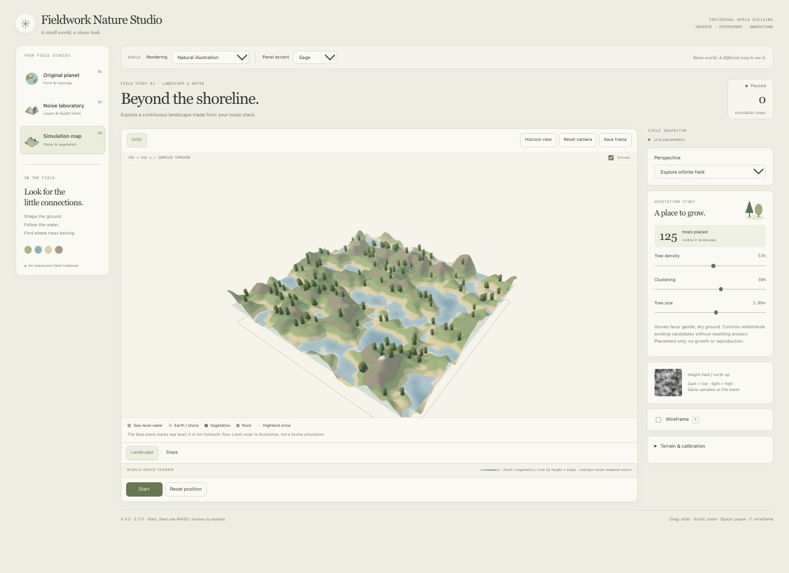
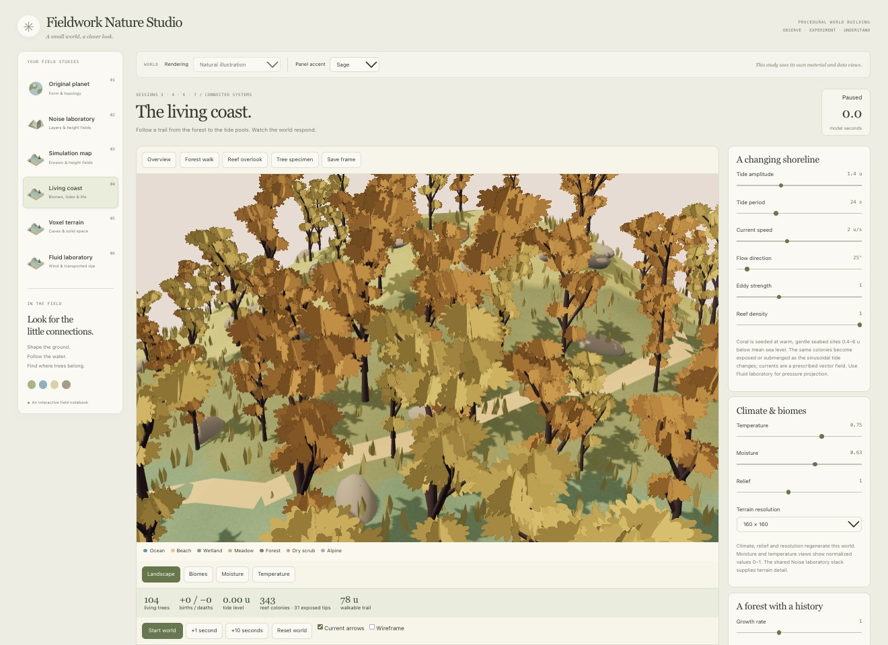

# Procedural World Building

Student project for Cornell Tech **Procedural World Building**.

I am learning to build a procedural planet in the browser using React, TypeScript, and Three.js. My notes record the prompts I try, the changes I observe, and screenshots of each experiment.

## Pocket Island — independent phone experience

[Open Pocket Island](https://fieldwork-pocket-island.jc3785.chatgpt.site/) · [Scan the QR code](docs/tutorials/images/2026-10-14/06-pocket-island-qr.png) · [Gesture tutorial](docs/tutorials/19%20-%20A%20World%20in%20Your%20Hands.md)

Gentle shaking adds wind, tilting steers it, rain changes soil moisture, and seeds establish only in suitable habitat. Touch controls provide the same experiments. This is a separate mobile build with independent visitor state; it does not control the desktop. Browser checks passed; physical phone sensor testing remains pending.

## Desktop experiments — published October 21

[Open the latest desktop demo](https://fieldwork-procedural-atlas.jc3785.chatgpt.site/?experiments=1) · [Living coast studio](https://fieldwork-procedural-atlas.jc3785.chatgpt.site/?workspace=living&spin=0) · [Exhibition](https://fieldwork-procedural-atlas.jc3785.chatgpt.site/?exhibition=1)

The published desktop demo includes eleven controlled comparisons. Rain, Wind and Forest provide a short presentation route; additional studies cover terrain, grid resolution, shaders, biomes, caves, branching, growth and crowding. Matched views, fixed conditions and optional rule explanations make the results inspectable.

Living coast now preserves its population and clock when climate inputs change. Seeds can wait, germinate and continue growing. **Show rules** exposes establishment conditions. These changes are now published and remain separate from the phone build.

[Experiment tutorial and presentation steps](docs/tutorials/21%20-%20One%20Change,%20Two%20Possibilities.md) · [Verified progress and screenshots](docs/tutorials/2026-10-20%20-%20Progress%20Log.md)

## Explore the project

- [Planning and feature backlog](docs/planning/backlog.md)
- [Tutorials and learning path](docs/tutorials/00%20-%20World%20Building%20Learning%20Path.md)
- [Assignment 1: voxel terrain tutorial and plan](docs/tutorials/06%20-%20Assignment%201%20-%20Voxel%20Terrain,%20CSG%20and%20Meshing.md) — foundations; see Tutorial 12 for the implemented voxel study
- [Inspiration gallery and reference library](docs/library/README.md)
- [Analysis notes](docs/analysis/README.md)
- [Application source](app/)

## Midterm exhibition — October 13 development checkpoint

Revision 3 adds a 5:28 full course film with controlled experiments, measured comparisons, camera orbits and a 32-second rotating procedural planet finale. Local preview pending owner review. [Course coverage audit](docs/tutorials/14%20-%20Midterm%20Coverage%20Audit.md) separates implemented features, recorded evidence and remaining experiments.

Open `http://127.0.0.1:5173/?atlasfilm=1` for the full course film and chapter navigation. [Tutorial 15: experiments and measured results](docs/tutorials/15%20-%20Controlled%20Experiments%20and%20the%20Planet%20Finale.md) documents the comparison conditions.

Open **Open exhibition** in the running app, or visit `http://127.0.0.1:5173/?exhibition=1`. Three resettable demonstrations isolate tides, voxel carving and forest growth. Detailed controls remain behind **Show rules**.

[Exhibition film previews: music and silent versions](docs/exhibition/README.md) · [Tutorial 13](docs/tutorials/13%20-%20From%20Research%20Studio%20to%20Public%20Exhibition.md) · [October 13 progress log](docs/tutorials/2026-10-13%20-%20Progress%20Log.md)

## Current progress

**As of 2026-10-07**, the app has six workspaces:

- **Original planet:** sine-based radial terrain, UV sphere / icosphere comparison, and smooth or faceted shading.
- **Noise laboratory:** seeded Perlin, Cellular and Sine layers, shaping, blending, and linked 2D/3D previews.
- **Simulation map:** a shared-noise height field, keyboard exploration, and simplified hydraulic erosion with rain painting, storms, batch steps and diagnostic views.
- **Living coast:** climate-driven biomes, tides, fixed reef colonies, current vectors, terrain-aware A* trails and a growing L-system forest.
- **Voxel terrain:** 3D density shapes, ordered CSG, Marching Cubes, density slices and local chunk rebuilding.
- **Fluid laboratory:** prescribed wind and a separate 2D advected-dye model with pressure projection.

The current checkpoint is **Fieldwork / Nature Studio**: a warm-paper research interface with study navigation, a central world viewport and grouped inspectors. **Natural illustration** is the new default. The world keeps blue water, green vegetation, earth and rock colors independently of the interface accent. The earlier Illustrated map remains selectable for comparison.

Simulation map adds tree/terrain shadows, restrained distance fog and depth-based coloring for Explore water. Its vegetation inspector controls density, clustering and size and reports actual placed trees. These are distribution rules, not population growth.



[Tutorial 08](docs/tutorials/08%20-%20Nature%20Studio,%20Shadows%20and%20Tree%20Distribution.md) explains the redesign and tree controls. The [October 7 log](docs/tutorials/2026-10-07%20-%20Progress%20Log.md) records the original checkpoint and the new local experiment with screenshots and checks. The [Visual Changelog](docs/tutorials/Visual%20Changelog.md) preserves earlier iterations.

The new [Connected Worlds tutorial](docs/tutorials/12%20-%20Connected%20Worlds%20-%20Coast,%20Caves%20and%20Living%20Forests.md) explains the implemented systems and real parameter trials. Living coast adds branching trunks, textured leaf clusters, grass, rocks, shadows and depth-aware water; it retains separate biome and climate diagnostics. Simulation map remains a separate hydraulic experiment.



Tab navigation now retains mounted study state and pauses hidden studies. Reloading still resets runs. Tides and coast currents are prescribed, coral placement is static, and the fluid solver is bounded 2D; no 3D cave water or complete weather model is claimed. See the [backlog](docs/planning/backlog.md) for remaining work and [style guide](STYLE-GUIDE.md) for visual boundaries.

## Course checkpoint — Sessions 3–7

- [New progress report: screenshots, improvements and parameter experiments](docs/tutorials/2026-10-07%20-%20Nature%20Studio%20Course%20Progress.md)
- [Learning insights for all five sessions](docs/tutorials/2026-10-07%20-%20Learning%20Insights%20-%20Sessions%203%20to%207.md)
- [Session 5: Voxels and Spatial Density](docs/tutorials/09%20-%20Session%205%20-%20Voxels%20and%20Spatial%20Density.md)
- [Session 6: Vector Fields, Fluids and Atmosphere](docs/tutorials/10%20-%20Session%206%20-%20Vector%20Fields,%20Fluids%20and%20Atmosphere.md)
- [Session 7: L-systems, Growth and Ecosystems](docs/tutorials/11%20-%20Session%207%20-%20L-systems,%20Growth%20and%20Ecosystems.md)

The earlier report preserves the pre-implementation checkpoint. [Tutorial 12](docs/tutorials/12%20-%20Connected%20Worlds%20-%20Coast,%20Caves%20and%20Living%20Forests.md) is the current implementation record: Sessions 5–7 now have working volume, vector-field and vegetation models, with explicit limitations and measured trials.

## The Fieldwork Express — October 13 development checkpoint

Open `?intro=1&workspace=planet&spin=0` on the running app, or choose **Ride the Fieldwork Express**. The current edit lasts **2:56**, including a **14-second opening**. A little seed links land, water, habitat and life, then the film moves into parameter experiments from Sessions 3–7 and ends on a rotating procedural planet.

The flat illustrated map and small 3D train sit in front of the preferred layered green/ochre tree crowns. Trees pass along two depth lanes with perspective parallax, suggesting forward travel. Pause holds the train, trees and narration together; reduced motion holds the decorative scenery. Map stickers now jump directly to their experiments.

The full short cut uses the warmer synthetic elderly narrator, English captions, restrained original music and nature ambience. Live parameter meters, matching A/B views and the independent-model boundary remain visible. Owner listening and exhibition-device review are pending. The [2:56 review film](docs/exhibition/fieldwork-express-v5-review.mp4) supersedes the [8:19 archive](docs/exhibition/fieldwork-express-v4-review.mp4). Detailed experiments remain available in the studio and the longer course-film view. See [the editing notes](docs/tutorials/18%20-%20A%20Three-Minute%20World%20-%20Editing%20for%20Clarity.md). This revision is included in the October 21 publication. The listening-review limits above still apply.

- [Story, synchronization and progress screenshots](docs/tutorials/17%20-%20The%20Fieldwork%20Express%20-%20A%20Narrated%20Journey.md)
- [Earlier globe and tree art-direction checkpoint](docs/tutorials/16%20-%20A%20Readable%20World%20and%20an%20Unfolding%20Map.md)

## October 20 — a seed's viewpoint

Living coast now offers **Be a seed** and **Walk the forest**. WASD nudges airborne drift or moves the observer; arrows/drag look around, Space pauses the world, and Esc returns to the overview. Successful settlement adds a real population member, and the camera rises with growth. Desktop and Pocket Island remain independent.

[Tutorial and course-alignment audit](docs/tutorials/20%20-%20A%20Seed%20Finds%20a%20Home.md) · [Progress evidence](docs/tutorials/2026-10-20%20-%20Progress%20Log.md). This is included in the October 21 desktop publication. Evolutionary solvers, autonomous scheduled agents, procedural cultures and saved ecology across reloads remain future work. The next priority is controlled transport, habitat and competition experiments.

## Run locally

With Node.js and npm installed:

```bash
cd app
npm install
npm run dev
```

Open the local URL printed by Vite in the terminal.

Validation from `app/`: `npm run build`, `npm run lint`, and `npm run test:simulation` (the simulation tests need a Node.js version that supports `--experimental-strip-types`).

## Repository layout

```text
app/                React + TypeScript + Three.js sandbox
docs/planning/      Feature backlog and plans
docs/tutorials/     Learning notes, visual changelog, and screenshots
docs/analysis/      Observations, comparisons, and rejected experiments
docs/library/       Inspiration gallery and reference reading
STYLE-GUIDE.md      Design direction and palette tokens
```

The tutorials are also accessible through my Obsidian vault. Images stay beside the tutorials in `images/`.

## Session 8 — Agents and ecosystem feedback

The local desktop app now has a separate Agents workspace (`?agents=1`). Click an individual bird to inspect its need, perception radius, state and reason; adjust flocking and visitor rules; then trace spills and rainfall into creek conditions and seed dispersal. Use `cd app && npm run dev` to preview it locally. [Session 8 tutorial and controlled experiment plan](docs/tutorials/22%20-%20Session%208%20-%20Agents,%20Flocking%20and%20Ecosystems.md) · [November 3 progress log](docs/tutorials/2026-11-03%20-%20Progress%20Log.md). This local desktop study has not been published.
