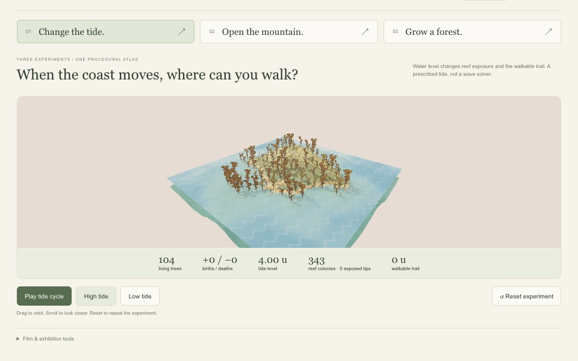
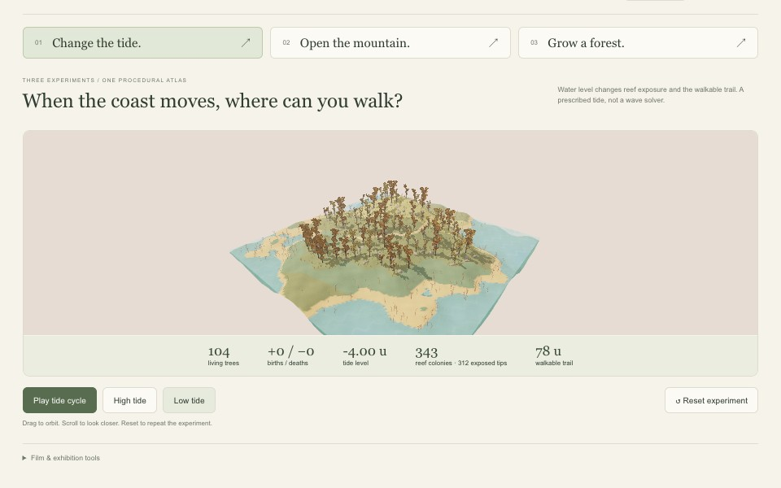
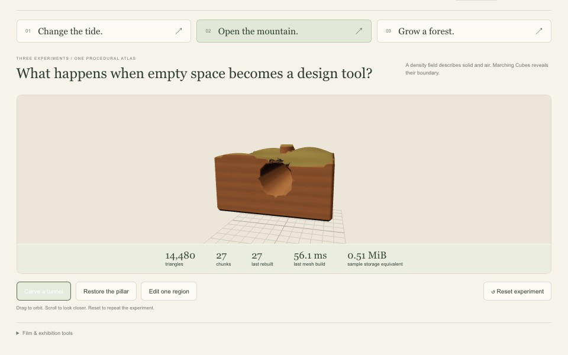
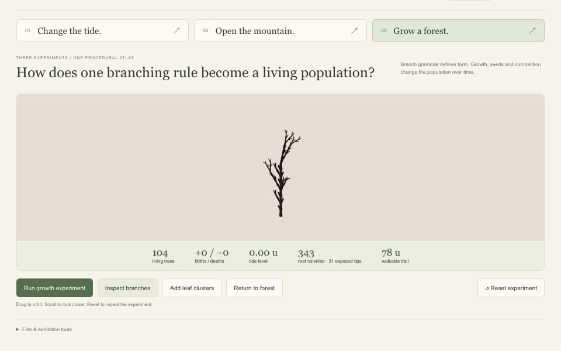

# 13 — From Research Studio to Public Exhibition

The app now has two entrances. The research studio keeps all six workspaces. **Open exhibition** opens a separate tab with three repeatable experiments. The original research tab keeps its current state.

A visitor should be able to change one thing, see a result, and reset it. That became the main design rule for this version.

## 1. Start with a question

Open `http://127.0.0.1:5173/?exhibition=1` while the local app is running.

The three questions are:

- **Change the tide:** When the coast moves, where can you walk?
- **Open the mountain:** What happens when empty space becomes a design tool?
- **Grow a forest:** How does one branching rule become a living population?

The large viewport carries the result. The short row below it carries the actions. **Show rules** reveals the existing parameter controls and diagnostic views. The paper, sage and earth palette stays consistent with Nature Studio.

> Suggested reflection: I had enough controls to explore the world, but an exhibition needs a clear starting point. A smaller set of actions makes the cause and effect easier to follow.

## 2. Run the tide experiment

Press **High tide**, then **Low tide**. Both actions reset the seeded world and step to a known phase of the same prescribed tide. **Play tide cycle** starts a fresh cycle. **Pause tide** freezes it. **Reset experiment** returns to model time zero.

| Parameter / result | High tide | Low tide |
| --- | --- | --- |
| Amplitude / period | 4 u / 24 model seconds | Same |
| Model phase | 6 seconds | 18 seconds |
| Water level | +4.00 u | −4.00 u |
| Living trees | 104 | 104 |
| Reef colonies | 343 | 343 |
| Exposed reef tips | 0 | 312 |
| Walkable trail | 0 u | 78 u |

These are measurements from the October 13 UI check, not predictions for every possible seed. Tree state is held fixed in this exhibition experiment so shoreline changes remain easy to isolate. Coral colonies stay anchored to the seabed. A* excludes flooded cells; the path is recalculated as the coast changes.

The screenshots above record the initial exhibition camera. The final film moves the overview closer and uses a taller capture area.

**Course connection:** Session 3 supplies the noise-driven surface and height/material cues. Session 4 contributes terrain processes and biome reasoning. Session 6 contributes time-varying fields; this tide is a sine function, not a solved fluid simulation. The separate Fluid laboratory remains the place to investigate advection and pressure projection.

## 3. Open the mountain

Choose the second study. Begin with the solid terrain, then use:

1. **Carve a tunnel** — subtract the tunnel from the solid density field.
2. **Restore the pillar** — subtract first, then unite the pillar. Operation order changes the result.
3. **Edit one region** — carve a local pocket and reveal the chunk bounds.
4. **Reset experiment** — return to the original solid volume and camera.

This preset uses 48³ cells, with 16³ cells per chunk: 27 chunks total. In the verified sequence, the local pocket rebuilt **8 of 27 chunks**, producing 14,836 triangles. The sample-storage estimate was 0.51 MiB; that excludes meshes, JavaScript objects and GPU allocations. Timing varies by machine and browser load.

**Course connection:** Session 5 — density, sequential CSG operations, Marching Cubes and local chunk rebuilding. This is a bounded volume; it does not implement infinite streaming or 3D cave water.

## 4. Separate tree structure from population time

Choose **Grow a forest**. **Inspect branches** isolates one individual with three L-system iterations. **Add leaf clusters** shows its crown. **Return to forest** restores the initial stand.

The grammar is `F → F[+F]F[-F][&F]`. One iteration produces 5 segments; three produce 125. Changing that number changes structural complexity. It is not the same as watching a tree age.

**Run growth experiment** starts a fresh population and advances the ecology model. Individuals keep size, age and health; reproduction and competition change the population. The check grew from 104 to 166 trees, with 62 births and no deaths before pausing. Reset returned to 104 trees and zero births/deaths. Those counts describe that run length, not a general growth rate.

The tide amplitude is zero in this preset. That keeps flooding from obscuring the growth story. The 300-plant limit is a performance cap, not an ecological carrying-capacity claim.

**Course connection:** Session 7 — branching grammar, growth, seed dispersal and population dynamics. Wind-driven leaf movement belongs to the Session 6 visual field, and does not by itself prove ecological growth.

## 5. Make a backup film without manually performing the sequence

Open **Film & exhibition tools**, then **Record 78-second film**. The app switches between the real renderers, sends the same experiment commands, and composites their frames with English captions and live measurements. Keep the tab visible; switching away stops capture. Download the captioned WebM when it finishes.

The finished submission files are in [the exhibition folder](../exhibition/README.md): a music MP4, a silent MP4, and English SRT captions. Captions are already burned into both films; the SRT is for editing or accessibility workflows, so enabling it on top of the film would duplicate the text.

The soundtrack is an original synthesized ambient score: soft pads, sparse upper notes, stereo echoes, and gentle fades. It contains no sampled commercial music or voice. `tools/exhibition/finish_film.py` recreates the score and converts the browser recording into H.264/AAC MP4.

> Suggested reflection: A backup video is useful when it shows the same interactions I can demonstrate live. It should not make the project look more simulated than it really is.

## 6. What to say in the exhibition

“Fieldwork is a procedural atlas where small rule changes become visible. First, a changing tide alters where a route can go. Next, a density field lets me carve inside a mountain. Finally, a branching grammar becomes a population that grows over time. These are separate educational models with one visual language.”

Keep the live app as the interactive piece. Use the short film when unattended or if live rendering fails. The film supports the demonstration; it is not a substitute for explaining the rules.

## Next experiment

Ask one visitor to restore the trail, find the cave opening, and return the forest to its original population without verbal instructions. Record which action needs a clearer label. This audience test has not been performed yet.
