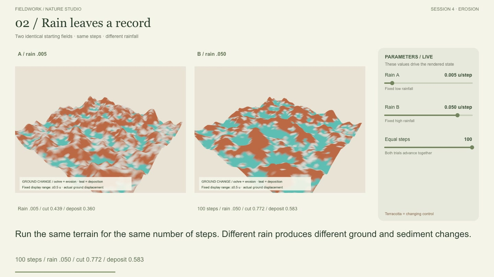
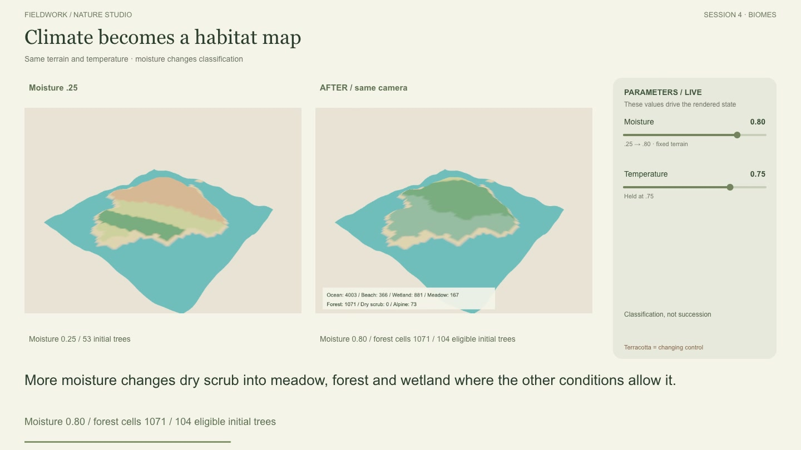
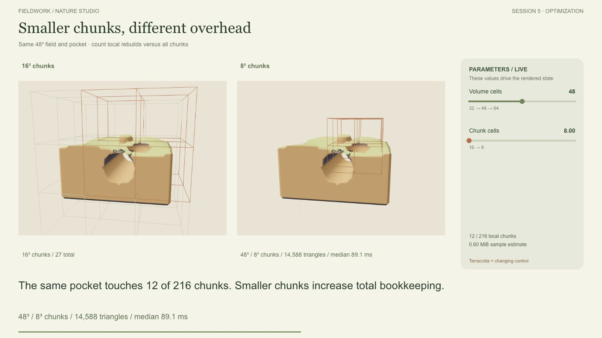
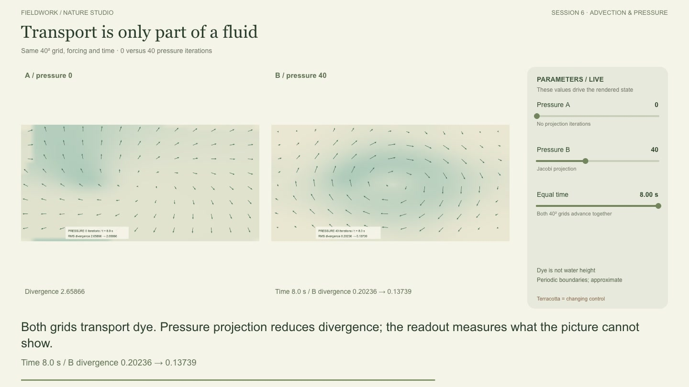
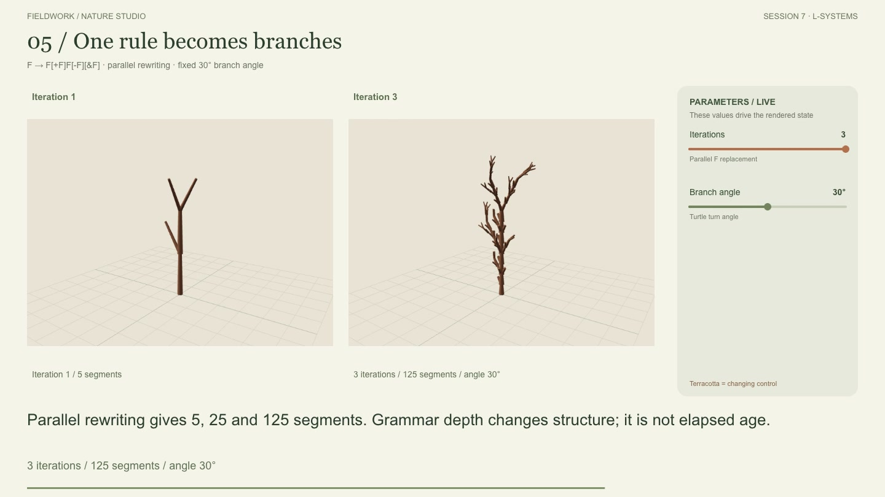
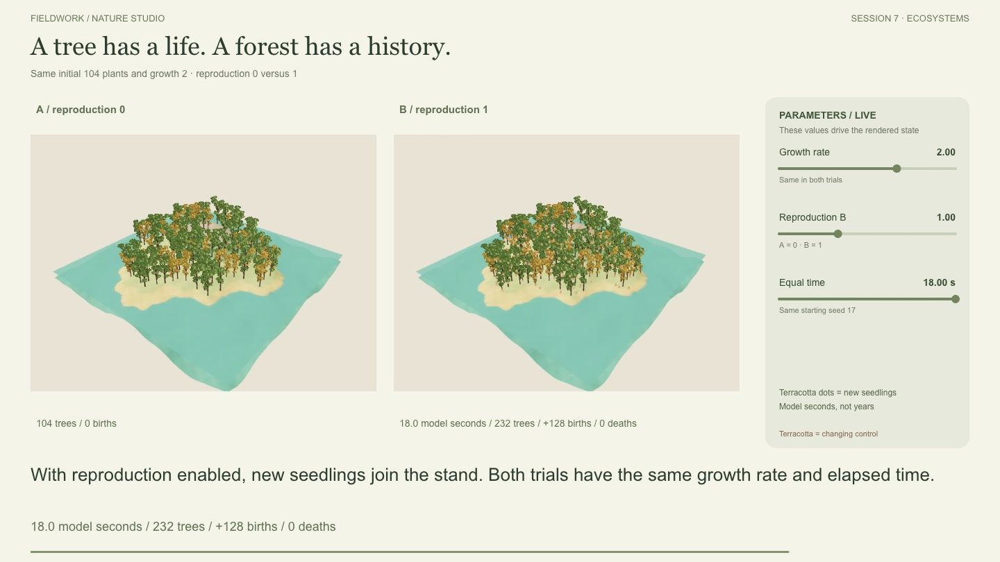
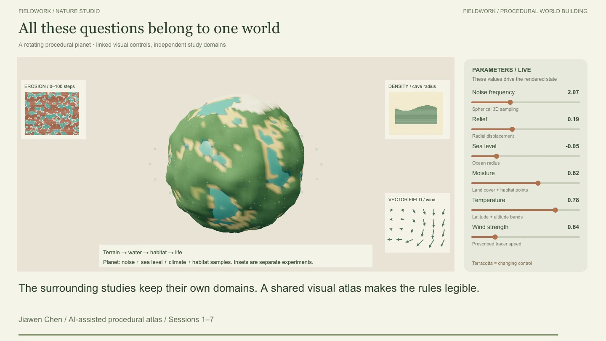

# 15 — Controlled Experiments and the Planet Finale

October 13, 2026 · Sessions 1–7 · Exhibition film revision 3

**Request, translated:** Fill in the missing parameter comparisons and course topics. End with a rotating whole planet whose parameters and visual changes flow together.

The earlier film explained tide, carving and forest growth. It left the noise, erosion, biome, fluid and isolated grammar studies outside the film. This revision records those experiments and ends with a shared visual atlas. It uses the existing model functions in a dedicated film page; it does not replace the six research workspaces.

[Watch or download the films](../exhibition/README.md) · [Repeatable measurement data](../exhibition/fieldwork-v3-experiments.json) · [Coverage audit](14%20-%20Midterm%20Coverage%20Audit.md)

## Watch, then repeat

Open `http://127.0.0.1:5173/?atlasfilm=1`. Play the full film, choose a chapter, or enter a preview time. The right panel displays values actually supplied to the models. It is an automated parameter demonstration, not footage of a cursor manually dragging the research sliders. Paired experiments advance together. Static before/after comparisons return to the reference camera. Orbit shots and short dissolves connect the chapters.

| Time | Course focus | Change | Hold fixed / look for |
| --- | --- | --- | --- |
| 0:00 | Sessions 1–2: process | Question → prompt → implementation → inspection | React controls and Three.js rendering; English learning records |
| 0:08 | Session 3: noise | Frequency 1 → 4 | Seed 17, three octaves, relief 22; features get smaller |
| 0:26 | Sampling | 24 → 48 → 96 cells per side | Frequency 4 and 160-unit domain; triangles 1,152 → 4,608 → 18,432 |
| 0:40 | Shader | Snow threshold 6 → 16 | Exactly the same geometry; the white material band retreats |
| 0:52 | Session 4: erosion | Rain .005 versus .050 units/step | Same starting ground and 100 steps; cut/deposition colors |
| 1:14 | Biomes | Moisture .25 → .80 | Same terrain and temperature .75; forest and wetland classifications |
| 1:32 | Session 5: density | Sphere → Box → Noise volume | 48³ cells; inspect both surface and density slice |
| 1:48 | CSG | Cave radius 0 → 5; then add pillar last | Same volume; operation order changes the tunnel interior |
| 2:08 | Local edit | Add one radius-4 pocket | 8/27 chunks intersect the edit and sampling margin |
| 2:20 | Resolution cost | 32³ → 48³ → 64³ cells | Same density and 16³ chunks; actual CPU timings |
| 2:34 | Chunk size | 16³ → 8³ cells per chunk | Same 48³ field; 27 → 216 total chunks, 8 → 12 local chunks |
| 2:46 | Meshing alternatives | Compare representations and tradeoffs | Marching Cubes is implemented; the other methods are explained |
| 2:54 | Session 6: wind | Direction 0° versus 90° | Speed 4, time 8 seconds, zero swirl; equal 32-unit travel |
| 3:12 | Fluid | Pressure iterations 0 versus 40 | Same grid, source, forcing, damping and elapsed time |
| 3:32 | Session 7: grammar | 1 → 2 → 3 rewrites | Angle 30°; segment counts 5 → 25 → 125 |
| 3:50 | Branch form | Angle 15° → 45° | Three rewrites; 125 segments remain |
| 3:58 | Growth | Growth rate 0 versus 2 | Reproduction off; existing trees change size |
| 4:06 | Reproduction | Reproduction 0 versus 1 | Growth 2, initial 104 plants, equal 18 model seconds |
| 4:28 | Competition | Crowding radius 0 versus 5 | Same growth/reproduction/time; compare health and births |
| 4:36 | Connected coast | Amplitude 2 → 4, then tide phase | Plant state fixed; a dry A* trail disappears and returns |
| 4:56–5:28 | Planet finale | Noise, relief, sea, moisture, temperature and wind | One continuous rotation; parameters drive visible changes |

## What the comparisons actually show

### Maps, materials and erosion

A finer sampling grid represents the same field more densely. It does not add another noise octave. The shader trial changes the snow-colored band without moving any vertices; it is not simulated snowfall.

After 100 erosion steps, mean cut is **0.439 versus 0.772 units**, and mean deposition is **0.360 versus 0.583** for low versus high rain. Ochre marks loss of ground; teal marks deposition. Both images use the same ±0.5-unit display scale, which saturates larger changes. These are per-cell mean height changes, not total cubic volume. Ground changes exchange with transported sediment; water also evaporates at the model's fixed rate.

At moisture .25 versus .80, forest-class samples increase from **348 to 1,071** on the 81×81 diagnostic grid. Eligible initial trees change **53 → 104**. Ocean and beach counts remain unchanged. Classification and eligible placement are not the same as a forest growing over time.

### Volume and chunk cost

These separate CPU measurements use three trials per configuration. The film also measures in its browser runtime; its milliseconds can differ. This is not an FPS benchmark. Trial order, compilation, caching and other applications affect the times.

| Volume cells | Chunk cells | Density state | Triangles | Chunks | Median CPU ms |
| --- | --- | --- | --- | --- | --- |
| 32³ | 16³ | Base | 6,292 | 8 | 116.2 |
| 48³ | 16³ | Base | 14,480 | 27 | 170.3 |
| 64³ | 16³ | Base | 26,716 | 64 | 390.4 |
| 48³ | 16³ | Pocket | 14,588 | 27 | 226.5 |
| 48³ | 8³ | Pocket | 14,588 | 216 | 304.9 |

For a local pocket in the 48³ field, rebuilding only affected chunks took a median **99.8 ms for 8/27 chunks** at chunk size 16, versus **18.2 ms for 12/216 chunks** at size 8 in this run. More affected chunks can still contain fewer total cells. Smaller chunks improve this local edit but increase total bookkeeping and duplicate boundary samples. These three-trial results do not establish a universal best size.

The sample-storage readout estimates Float32 density samples across chunks, including shared boundary duplication. It excludes mesh buffers, renderer memory and other allocations; it is not peak process RAM. The local pocket film uses the add-last pillar sequence, while the timing table uses the default cut-last density, so their triangle counts differ.

Marching Cubes interpolates the zero surface. Greedy meshing merges exposed block faces; Marching Tetrahedra splits cubes into simpler cases; Surface Nets and Dual Contouring choose vertices per active cell, with different placement and feature-preservation strategies. Only Marching Cubes is implemented here. Ambiguous topology, LOD seams and streaming remain further work.

### Transport, pressure, structure and life

The wind trial rotates a constant vector field. Both particle sets travel **32 units** in eight model seconds. This verifies direction and distance without adding swirl.

At eight seconds, the fluid trial without pressure iterations has RMS divergence **2.65866**. The 40-iteration trial measures **0.20236 before its final projection and 0.13739 after it**. The two runs already have different velocity histories; the within-step reduction and across-run difference answer different questions. Dye is a transported diagnostic, not water height. This is a periodic 2D approximate solver, not a weather simulation.

Growth and reproduction are separate trials. With reproduction off, growth changes mean size **0.718 → 1.300** while the population remains **104**. With growth fixed at 2, reproduction on yields **232 plants, 128 births and zero deaths** at 18 seconds. Terracotta markers identify new seedlings without making them adult-sized.

At the same time, crowding radius 0 gives **244 plants / mean health 1.0000**, while radius 5 gives **232 / health 0.9891**. No deaths occur in either short trial. This is evidence of a modest crowding effect, not forest collapse. Grammar iteration changes branch structure; elapsed age scales existing structures rather than rewriting a tree continuously.

## Why the ending changes several controls together

The experiments isolate causes. The finale is a synthesis: the same seeded noise sampler displaces a sphere; sea level sets ocean radius; latitude, height, temperature and moisture determine land colors and eligible habitat points. Wind strength changes prescribed atmospheric tracer motion. The camera sees a whole rotation while the controls flow continuously.

The surrounding erosion, density and vector-field insets remain **separate study domains**. The planet does not secretly contain a coupled hydraulic solver, 3D cave water or a global ecology. Its continents are procedural, not geographic Earth data. The legacy planet workspace remains unchanged; this new film globe uses the shared noise sampler.

## Insight and next experiment

**Development insight:** “Implemented,” “shown,” and “explained” need separate checks. The earlier selective film was useful, but it did not satisfy a request for the full course story. A chapter index, applied parameter values and saved measurements make that gap visible.

**Suggested learner reflection:** Before replaying a chapter, predict the result. Afterward, explain which condition stayed fixed and why the displayed measurement supports the conclusion. A quiet result, such as no mortality after 18 seconds, is still a result.

Next: test a longer crowding run and record the first death time, rather than increasing drama through visual effects. Also test the final video on the exhibition screen and confirm the public hosting link.

## Checks and scope

Production build and lint pass. All 23 automated checks pass, including seven new checks for sampling, rainfall conservation, climate classification, wind displacement, ecology comparisons, fluid projection and finite film timing. Actual encoded frames and caption timing are inspected separately. The base bundle still has a size advisory.

This covers the scheduled technical themes of Sessions 3–7 and introduces the Sessions 1–2 workflow. Private lecture decks and Canvas announcements were not independently accessible during the audit. Cloud formation, 3D cave fluids, generic CSG stacks, agents and later coursework are not claimed as completed. The film and notes are a local preview awaiting owner review before a push.
