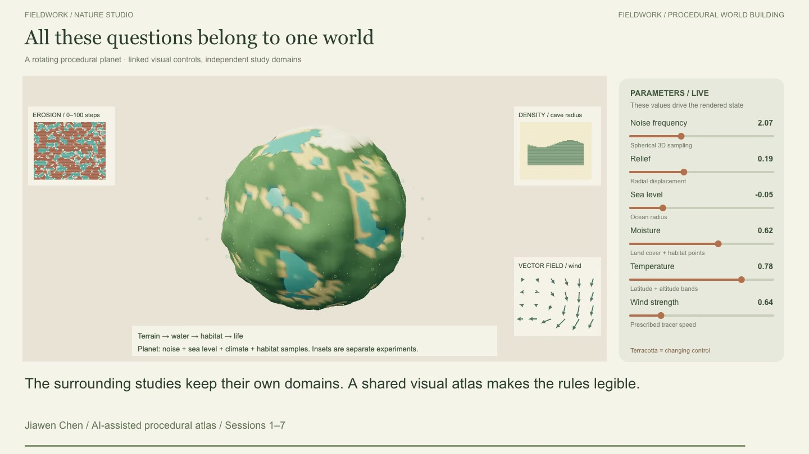
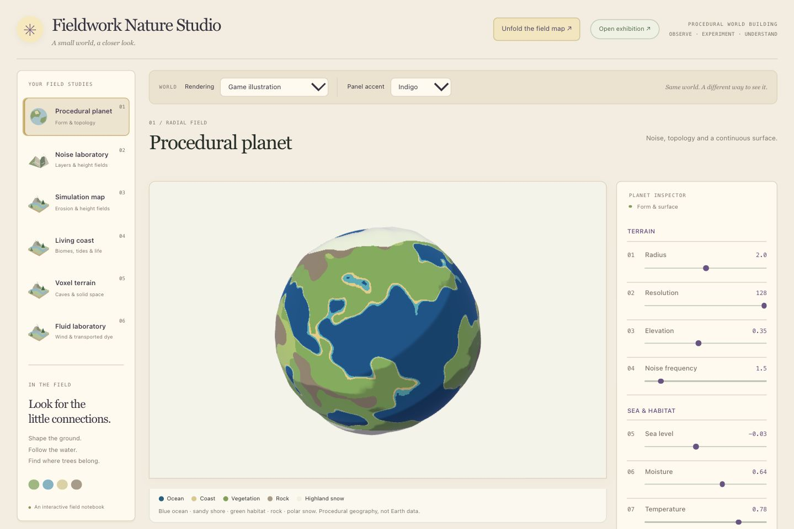
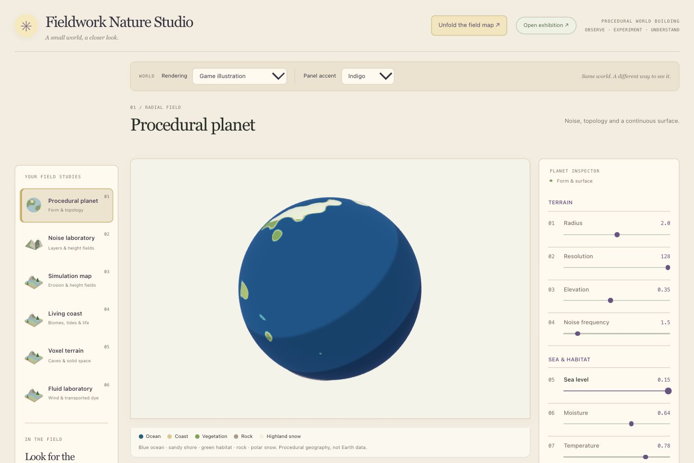
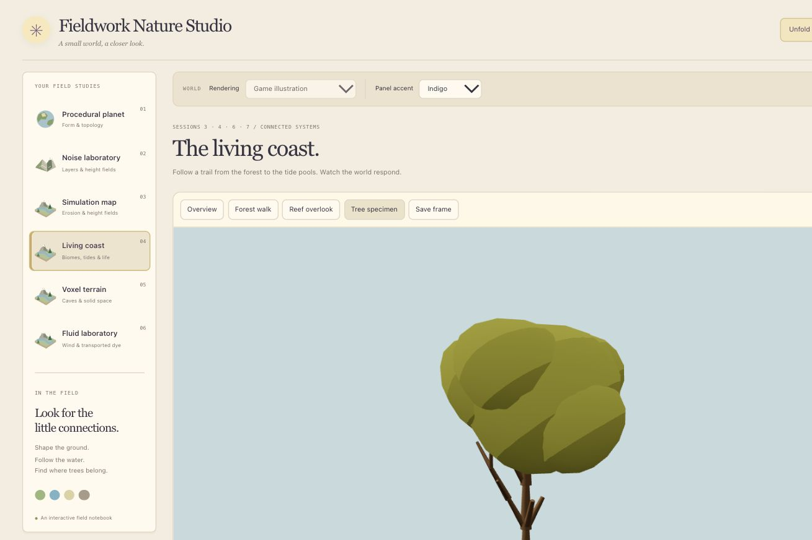
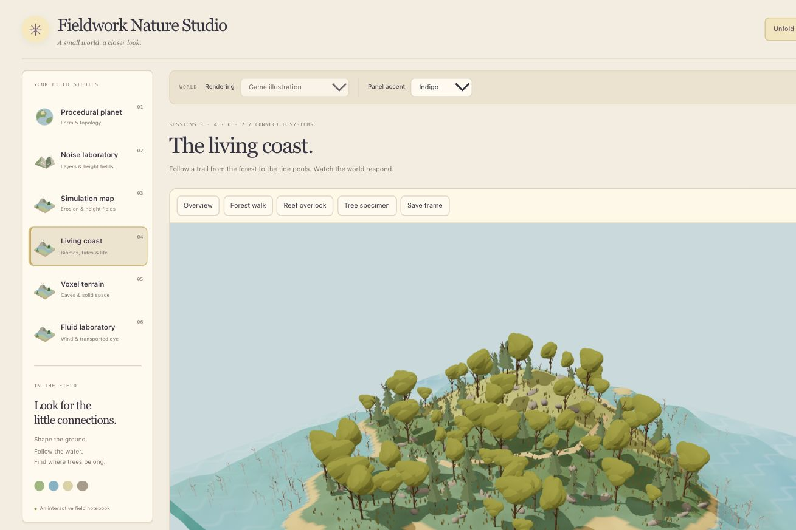
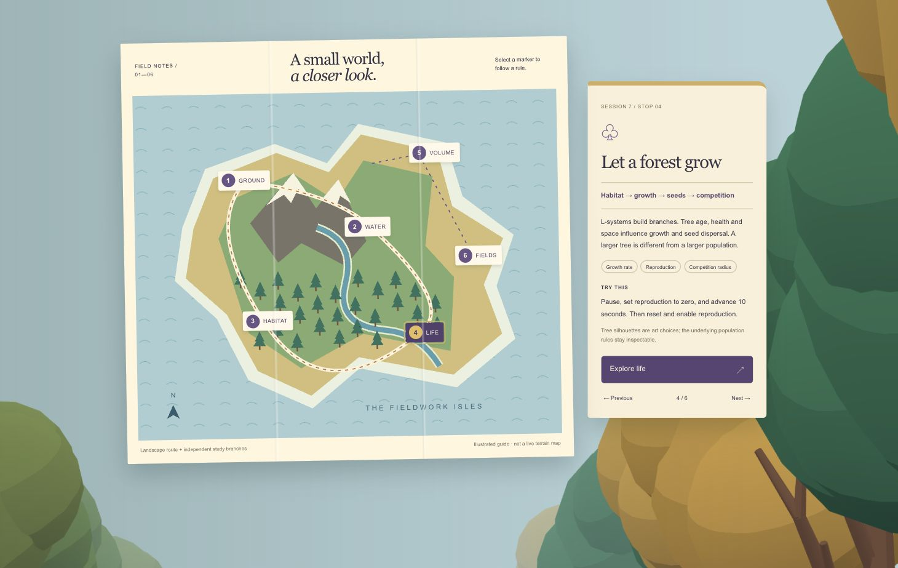

# A Readable World and an Unfolding Map

Date: 2026-10-13 · Local art-direction preview · Sessions 3–7

## The question

The earlier globe looked muddy, and the leaf clusters were difficult to read. The new request was to make the world feel like an illustrated game while keeping its geography and procedural rules visible. The reference images serve three different purposes: world rendering, control panels, and an app opening. The owner chose **app opening only** for the unfolding map.

## 1. Give each material a clear job

The previous film globe mixed colors at mesh vertices and used a translucent ocean. Small features became soft color patches. The new globe samples the same seed-17 Perlin field into a 512 × 256 scalar texture, then classifies pixels as sea, coast, habitat, rock or snow in the shader. A blue ocean and narrow shoreline make the boundary easy to follow. Three broad lighting levels and a lilac rim add volume without bloom or grain.

The sphere keeps 32% of its calculated radial relief for a cleaner silhouette. The uncompressed height still controls material classification. This is an artistic scale choice, not a claim about physical Earth proportions. The globe is procedural geography, not geographic Earth data. Archived surface modes retain the old sine terrain; they are historical studies, not a matched comparison with the new globe.

**Earlier film reference:** a different composition, preserved as the visual starting point.

**New app globe:** blue water, narrow sand, green land, rock and snow remain distinct.

> Side note: more texture was not what this globe needed. A readable coastline made a bigger difference.

## 2. Change one parameter and look for a consequence

In Procedural planet, leave frequency at 1.5, elevation at 0.35, moisture at 0.64 and temperature at 0.78. Compare sea level **−0.025** with **0.15**. The same seed and camera show large land areas becoming submerged. This changes the classification and rendered surface; it is not a color-filter trick. These values are normalized model units.

Next trials: hold sea level fixed and compare moisture, then temperature. Moisture changes dry/green cover; temperature changes snow eligibility. Resolution controls geometry density, independently of the scalar texture resolution. Frequency changes feature scale. Spin and orbit only change the view.

## 3. Separate a tree's rules from its silhouette

The old foliage used many small alpha-cutout leaf cards. The first replacement placed a round lobe at each branch tip, but the result looked stacked. The refined version groups the upper branch envelope into an overlapping broadleaf crown. A second species uses a layered fir outline. A three-step toon ramp gives the crowns readable lit and shadowed faces.

The branch grammar is still `F → F[+F]F[-F][&F]`. Branch skeleton view still exposes it. Iterations 1, 2 and 3 produce 5, 25 and 125 segments. Fir crowns are illustrative envelopes; they do not introduce a separate botanical growth model. Existing plant identity, age, health, births, deaths and competition are preserved. Canopy size follows the existing tree scale.

> Side note: a tree should still read as a tree when the whole island fits on screen.

Try Tree specimen and Branch skeleton, then return to Overview. Advance time with reproduction set to zero to distinguish larger individuals from a larger population. Reset before comparing a reproduction trial.

## 4. Enter through a field map

The app opens on an eye-level forest scene. **Unfold your map** raises a paper map with folds and a simple held-map silhouette. Select a numbered marker to read the rule, parameters, suggested trial and implementation boundary; **Explore** opens the actual study. **Skip intro** and Escape return to the current workspace. The masthead can reopen the guide.

The guide map is an illustration, not a projection of the simulated terrain. Its route connects ideas:

1. **Ground / Session 3:** noise → height → surface classification.
2. **Water / Session 4:** rain → flow → erosion and deposition.
3. **Habitat / Session 4:** height, slope and prescribed climate → biomes.
4. **Life / Session 7:** habitat → growth → seed dispersal → competition.
5. **Volume / Session 5:** density and ordered CSG → caves → meshing.
6. **Fields / Session 6:** velocity → transport; pressure projection in the separate fluid laboratory.

These are not all one coupled physical solver. Erosion and Living coast have separate terrain states. Voxel caves do not receive height-field water. Prescribed coastal currents are distinct from the 2D pressure solver. The opening says so beside the relevant chapter.

## 5. Keep the interface quiet

Cream paper, indigo controls and small brass accents form the interface palette. Water remains blue and habitat remains green. Diagnostic views retain their fixed scientific scales. The control-panel references determine grouping and hierarchy; they do not recolor the planet into a UI accent.

## Verification and boundaries

- Production build and lint checked.
- Existing model tests retained; additional tests check spherical field orientation, bounded relief, texture disposal, finite crown geometry and unchanged branch counts.
- Browser checks cover the map interaction, chapter navigation, sea-level change and tree specimen. Saved screenshots are actual app captures.
- The opening is keyboard operable, skippable and responsive; reduced-motion preferences suppress unfolding animation.
- Existing MP4 files are unchanged. No new video introduction was added. This version is local for review, not pushed.

The next art pass can address closer foliage detail and terrain cliff shapes after this direction is reviewed. Commercial game references set a direction; this remains a small procedural learning app.
