> **Current edition:** the app now uses a 2:56 cut with a 14-second opening and the warmer full narration. See [[18 - A Three-Minute World - Editing for Clarity]]. This note preserves the earlier 8:19 development history.

# The Fieldwork Express — A Narrated Journey

**Local app preview · 8:19 · English narration and captions · Sessions 3–7**

## The new question

**User request, translated and paraphrased:** Turn the opening map into an animated train journey. Let the train stop at different places and explain the overall logic as a story. Use a gentle, expressive elderly narrator, quiet forest or water ambience, and subtitles. Continue into the detailed experiments so the whole experience feels like one animated short.

The story follows a little seed looking for a home. This gives the audience a reason to care about terrain, water and climate before showing the parameter names.

## Before: choosing a marker

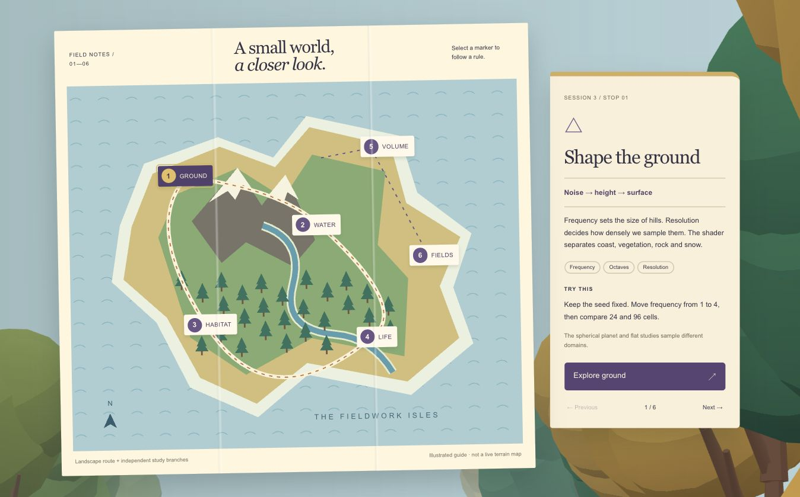

The previous opening let a visitor select a marker and read a note. It had a route, but no moving character, continuous narration or automatic handoff into the experiments. This baseline is a cropped map view; the new screenshots show the complete player. They are interface checkpoints, not a matched terrain experiment.

## After: follow the seed

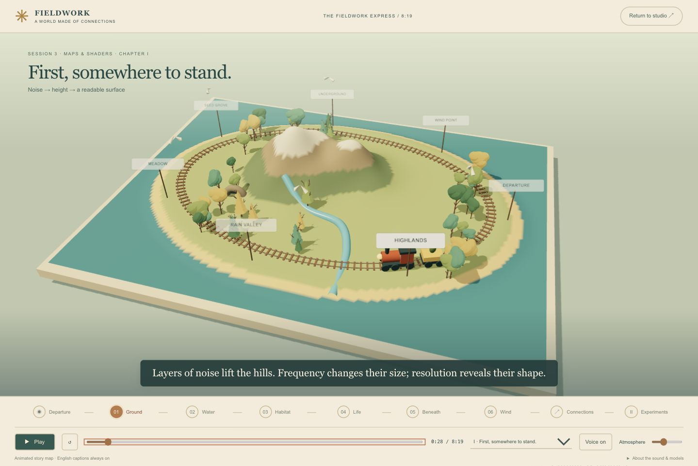

The first version carried a seed around a raised map, with rolling wheels, steam, birds, rain and growing decorative trees. The latest revision below keeps the geography flat, places a little 3D train above it, and brings passing 3D woodland back around the paper. These are story illustrations, intended to make relationships memorable before the audience enters the actual studies.

The first chapter lasts **2:51**:

1. **Departure:** a seed needs somewhere to belong.
2. **Ground — Session 3:** noise creates a height field; sampling resolution and shaders make it readable.
3. **Water — Session 4:** rain moves downhill, carries sediment and changes ground; tides change dry access near the coast.
4. **Habitat — Session 4:** height, slope, warmth and moisture decide which places are suitable.
5. **Life — Session 7:** branching rules describe a plant; growth, births and competition describe a population.
6. **Beneath — Session 5:** a density field has an inside; subtraction opens caves, meshing finds the surface, and chunks limit rebuilds.
7. **Wind — Session 6:** direction and speed transport particles; a fluid solver also needs pressure correction.
8. **Connections:** the ideas belong together, while the implemented experiments remain separate models.

> Side note: a train makes “next” feel like a destination instead of another slide.

## Then: change one rule at a time

At **2:51**, playback continues directly into **5:28 of real experiments**. This section reuses the app's noise, erosion, voxel, fluid and ecology code. It does not animate invented benchmark numbers.

The detailed chapters cover frequency, grid resolution, shader thresholds, equal-step rainfall, moisture and biomes, density shapes, CSG order, local chunk edits, resolution cost, chunk-size tradeoffs, meshing alternatives, wind direction, advection and pressure, L-system depth, branch angle, isolated growth, reproduction, crowding, tides and paths. The final rotating globe brings the visual ideas together.

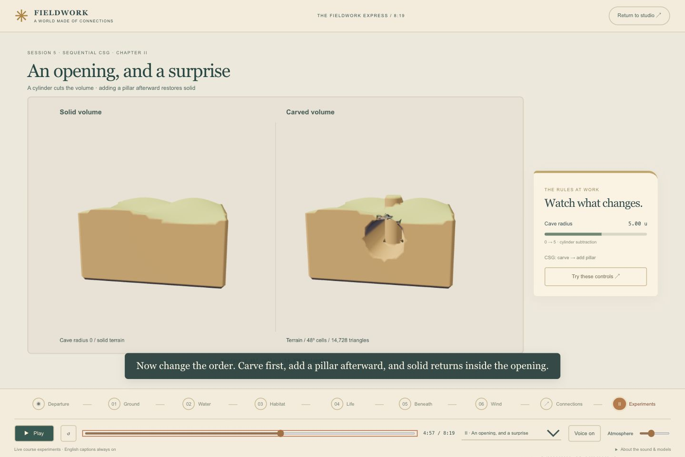

The right panel shows values actually used by the rendered experiment. Terracotta marks a changing control. These meters describe the demonstration; **Try these controls** opens the relevant research tab for hands-on changes. Comparisons use the study's fixed camera and conditions.

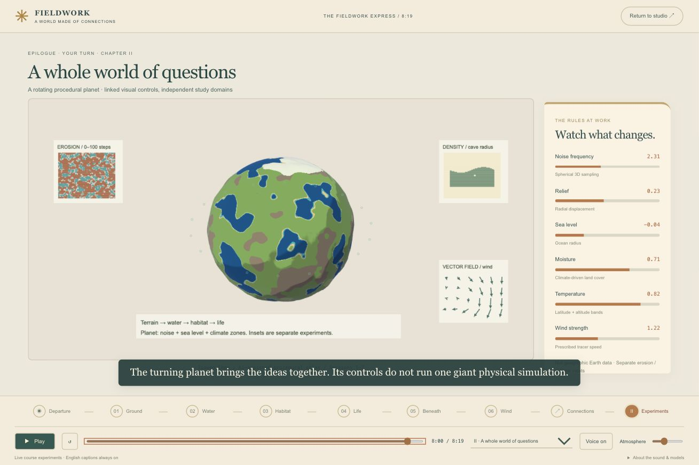

The planet, height-field erosion, tidal coast, three-dimensional caves and two-dimensional fluid solver are separate domains. The story connects their ideas without claiming one physically coupled world. Only Marching Cubes is implemented; alternative meshers remain an explained comparison.

## How the sound and subtitles stay together

One prerecorded narration track supplies the playback clock. Camera position, train travel, chapter selection, parameter demonstrations and English captions all follow its `currentTime`. Pausing stops the voice and animation together. Seeking moves both. Captions remain readable between spoken lines within a chapter.

There are **64 English caption cues**. The player includes chapter selection, restart, a timeline, voice mute, an independent atmosphere slider, and a caption download. Sound starts only after a visitor presses Play. Leaving the journey or hiding the tab pauses playback.

The ambience is original synthesized noise shaped into soft forest, rain, stream and wind textures, with occasional quiet bird-like chirps. It becomes quieter during speech. No downloaded nature recordings or commercial music were used.

**Voice limitation:** the current track is the local macOS Daniel voice, used as a male synthetic preview. It is not yet the emotionally performed elderly storyteller requested by the owner. A later follow-up below adds a 34-second elderly voice audition for review. The full track is still provisional; do not describe it as a finished character performance.

> Side note: the voice should leave room for the landscape. More sound would make the small changes harder to notice.

## What was checked

- Production build and lint passed; 28 automated tests passed.
- Tests verify that all 21 detailed chapters line up with the existing 328-second experiment timeline, and that every spoken cue has positive duration inside its chapter.
- The first audio-generation attempt produced empty speech files despite a successful command exit. A duration check caught it. Regeneration through the working local speech service produced audible, non-silent data; the final track is 499 seconds long.
- Browser checks covered play/pause, keyboard timeline seeking, chapter jumps, automatic story-to-study continuation, cave A/B views, fluid/population/tide/planet chapters, and the final handoff to Living coast.
- A narrow-screen check showed no horizontal page overflow; transport and chapter controls wrap beneath the stage.
- These are functional and spot checks, not a claim that the full 8:19 has been reviewed on the exhibition display and speakers.

## Try it

Open the running app at `?intro=1&workspace=planet&spin=0`, or choose **Ride the Fieldwork Express**. Press **All aboard**. Use the chapter menu to compare a story stop with its detailed experiment, then choose **Try these controls**.

Next experiment: show the opening to someone who has not seen the project. Ask them to explain why the seed needs more than just land. If that relationship is clear before the technical section begins, the story is doing its job.

This remains a local review. Existing MP4 exports are unchanged; no commit or push was made for this revision.

## October 13 follow-up — keep the map, audition the storyteller

**Owner request, translated and paraphrased:** Make one short, gentle elderly storyteller sample before recording the full voice. Keep the preferred folded-map illustration, allowing the scenery to remain three-dimensional.

### A voice to try

[Listen to the 34-second storyteller audition](../../app/public/audio/fieldwork/grandfather-audition-01.mp3), or open **Meet the storyteller** in the app. This is a new AI-generated elderly English voice, using the Elias preset, a slightly slower pace, a soft opening and one small chuckle. The file lasts **34.08 seconds**. Only this sample has been generated; the complete 8:19 journey still uses Daniel. The owner has not approved the new performance yet.

The audition says:

> Well now... there you are. Come a little closer. Do you see that tiny seed, beside the train? It has never seen a mountain. Or heard the rain. And yet... it is looking for a home. So, shall we help it find one? First, we'll need some ground. Then a little water... and a place where the wind is kind. Come along. Our story starts with one small hill.

The app includes a readable transcript. Starting the audition pauses the full journey; starting the journey pauses the audition. They can be compared without two voices talking at once. The main journey retains its existing synchronized subtitles. The sample has a transcript, not a new set of timed captions.

### Keep the drawing; add depth carefully

Before — the railway diorama, paused at 0:00:

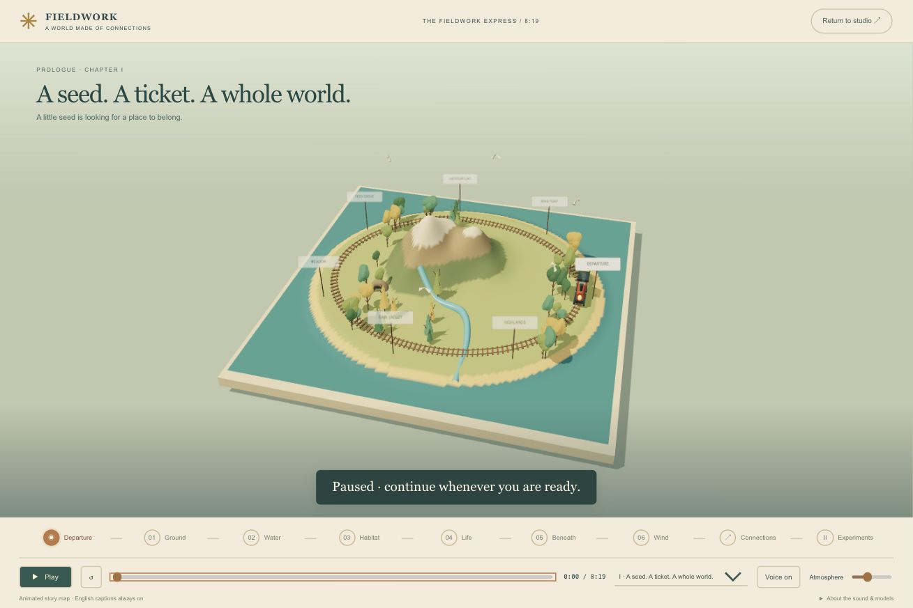

After — the Ground chapter at 0:28, with a different layout and camera:

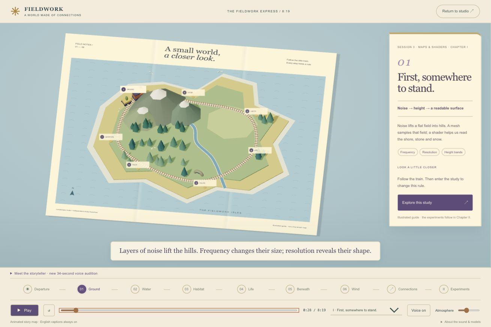

The revised map uses cream paper, subtle folds, printed blue waves, an irregular sand-and-green coastline, indigo numbered markers and a separate note card. Mountains, layered firs and the train rise above the page. A restrained orthographic view keeps the composition closer to the reference drawing. The railway, steam, gentle camera motion and chapter navigation remain active.

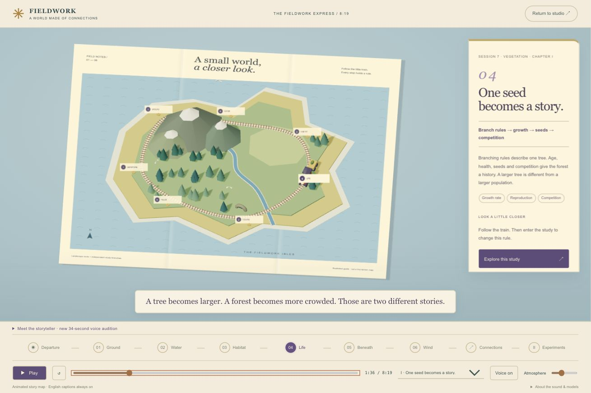

The map is an authored guide to the course, not the output of the terrain or ecology solver. In this earlier raised-map checkpoint, tree scaling illustrated growth. The latest printed-map revision below removes that decorative scaling; actual births, competition and health remain in the Living coast experiment. The card names the relevant parameters and links to the corresponding study.

> Side note: more depth does not have to mean more visual noise. The paper, coastline and labels do much of the work.

### Checks and next trial

- Build, lint and all 28 simulation/timeline tests passed.
- Browser playback confirmed that the audition loads as a 34.08-second file and that starting the full journey pauses it.
- The Ground and Life checkpoints were inspected and saved. The desktop checkpoints show different chapter times and compositions; they document the interface rather than a controlled geometry comparison.
- At a 391-pixel CSS viewport, the map and note card stack vertically and the page has no horizontal overflow. Controls require vertical scrolling on this narrow layout. No narrow-screen screenshot was saved for this revision.
- No browser runtime errors appeared in the checked preview. A deprecated shadow-map mode was replaced with the supported mode.

Next trial: listen for warmth, natural pauses and curiosity. If the character feels right, generate the remaining narration and retime the captions to the new recordings. Keep the visual art direction separate from that voice decision. No new MP4, commit or push was made.

## October 13 follow-up — a sticker map in a moving woodland

**Owner request, translated and paraphrased:** Bring back the passing trees around the earlier map. Keep the map itself two-dimensional, like a sticker, and combine it with 3D elements. Use the feeling of an Overcooked level-selection map.

The owner preferred a readable illustrated island. The reference clarified where depth belongs: geography stays on the paper, while the train and surrounding woodland give the journey physical presence.

### Three layers, three jobs

- **Printed map:** angular mountain silhouettes, pale snowcaps, a blue river with cream banks, pine symbols, coast, wave marks and subtle paper folds. These remain authored illustrations.
- **Little railway:** a dimensional locomotive carries its seed passenger just above the sheet. Station stickers stay legible and can be selected directly.
- **Passing woodland:** larger 3D firs and rounded crowns move behind the sheet and note card. They provide the feeling of travelling through trees without hiding the explanation.

The reference is the journey between destinations in [Team17's official Overcooked 2 overview](https://www.team17.com/news/the-a-z-of-overcooked-2). The implementation uses original course artwork, stations and train geometry.

### Try the new route

1. Open **Ride the Fieldwork Express** and press **All aboard**, or select a station sticker directly.
2. Select **Life**. Its card, narration and subtitles change to the vegetation chapter; the train travels along the railway to the destination.
3. Press **Pause**. The woodland, train and main narration share the same story clock and stop together.
4. Choose **Explore this study** to enter the actual controls, or continue into Chapter II for the parameter comparisons.

Map stickers are ordinary labelled buttons with visible focus styling. Reduced motion removes scenic drift, moving birds and steam, rainfall, and the train's travel animation. It keeps the chapter selection and information. The full journey still uses the earlier voice; **Meet the storyteller** contains the separate 34-second audition and its transcript.

### What this teaches

A navigation illustration, a cinematic background and a simulation do not need the same rendering rules. The printed forest is a symbol, and the passing woodland is scenery. Population, growth and competition are demonstrated in the real study. Keeping those roles explicit makes the story more playful without changing what the course experiments claim to model.

### Verification and evidence limits

The desktop browser check showed the flat island, dimensional train, moving woodland layer, selected Life sticker and matching chapter card. Selecting Life started playback; pausing stopped the main audio at about 1:39. The other audition audio remained paused. Build, lint and all 28 existing tests passed.

The screenshot below is the **previous raised-map checkpoint**, saved before this request. It is retained for comparison and must not be labelled as the new hybrid map.

A new view was inspected in the browser, but its image was not saved to the repository before the browser connection was interrupted. Reconnection was then blocked by the browser security policy. At that checkpoint, a saved after screenshot and repeat narrow-layout and keyboard checks were pending. The follow-up below resolves these items. Earlier mobile checks applied only to the previous revision.

## October 13 follow-up — browser evidence, woodland framing and a film

**Requests, translated and paraphrased:** Finish the missing browser checks and screenshots, retain the earlier close tree background, produce the complete video promptly, and make the grandfather voice gentle rather than ghostly. Keep everything local for review; do not push.

### Latest visual checkpoint

The blue-grey clearing and large layered green/ochre tree crowns return around the paper. The trees use the app's branching and crown geometry, with restrained toon lighting and slow layered drift. The flat island, small train, clickable stops and study links remain. These background trees are authored scenery, not population evidence.

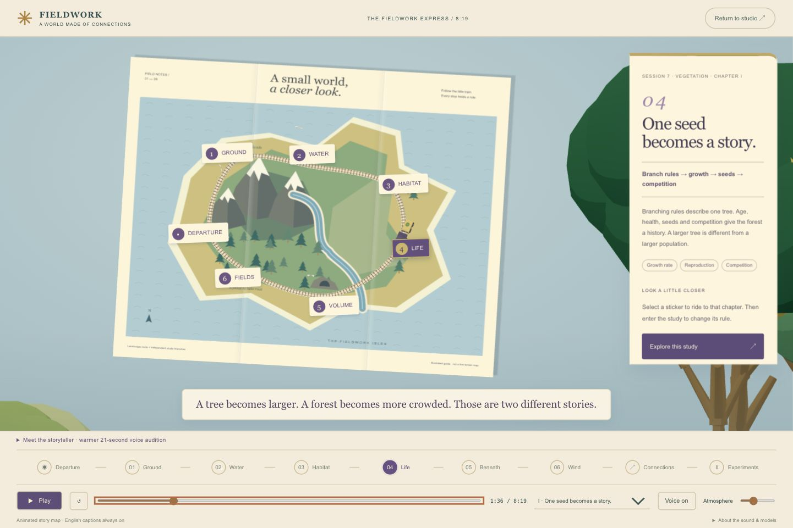

The earlier hybrid layout is saved below at the same 1:36 story time. The background composition and camera framing changed; this is a presentation comparison, not a terrain experiment.

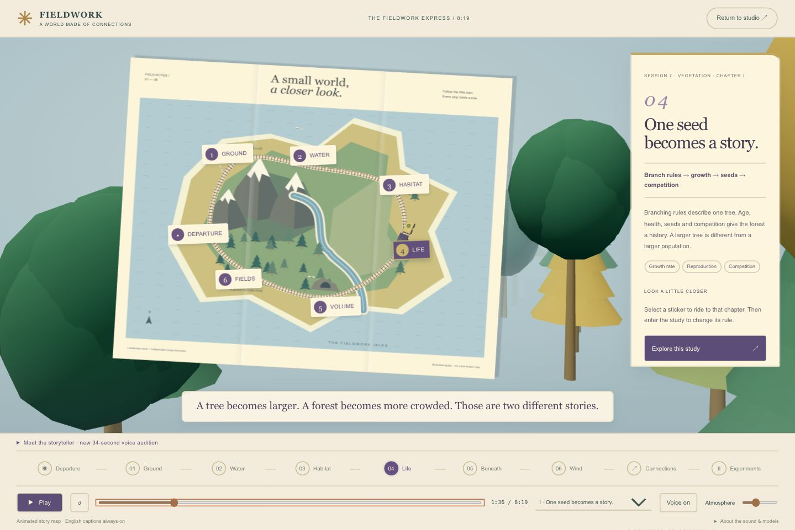

### A phone needs a reading flow

At a 390–391 CSS-pixel width, the note card's inner scrollbar hid part of **Explore this study**. The map, card and caption now form one vertical reading flow. The action is visible, and keyboard activation opens Living coast. A small extra map-camera margin also prevents the sheet's upper corner from clipping during drift.

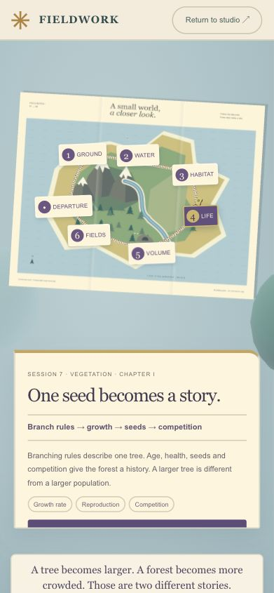

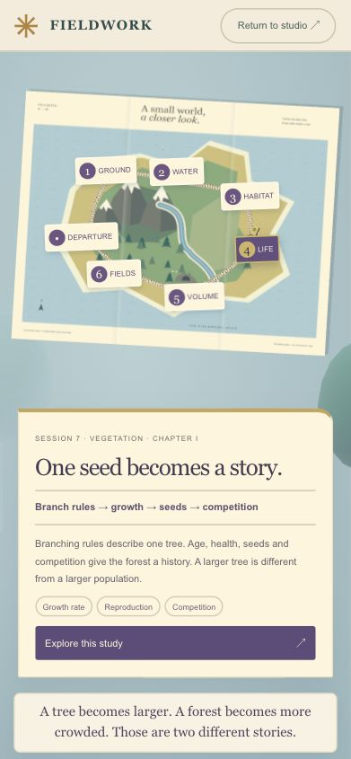

These two phone screenshots document the layout fix before the final tree-background refinement. The background update does not change the reading-flow rules.

> Side note: shrinking a desktop card is not enough. On a phone, the explanation needs somewhere to go.

### What was actually checked

- All **29 chapter destinations** loaded the matching heading, phase and timeline position. The 21 study sections exposed finite parameter values inside their meter bounds. [Raw chapter-navigation report](../../tools/journey/browser-chapter-review-2026-10-13.json).
- Keyboard Tab focus, Enter on a station, Space to pause, arrow-key seeking, Restart, Escape and the link back to Living coast worked.
- Pausing at 1:36 held the narration time and scene; two successive scene captures matched. Reduced-motion mode held the woodland while preserving chapter selection.
- The main journey and the audition paused each other. Actual playback crossed the 2:51 story-to-study boundary; playback near the end stopped at 8:19 and displayed the final invitation.
- Desktop and phone layouts were inspected. The checks are targeted navigation and playback samples, not a continuous exhibition-screen review of every second.

### Evidence from the detailed studies

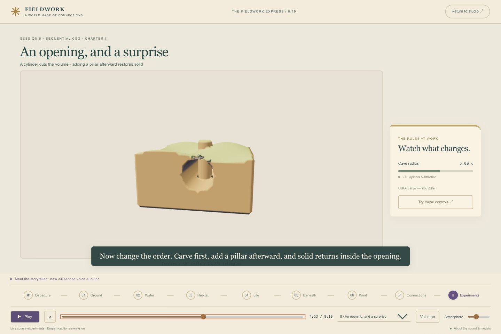

At 4:53, the cave radius is 5 and the operation order is carve, then add a pillar. This particular frame is a single state; the chapter's paired comparison occurs later.

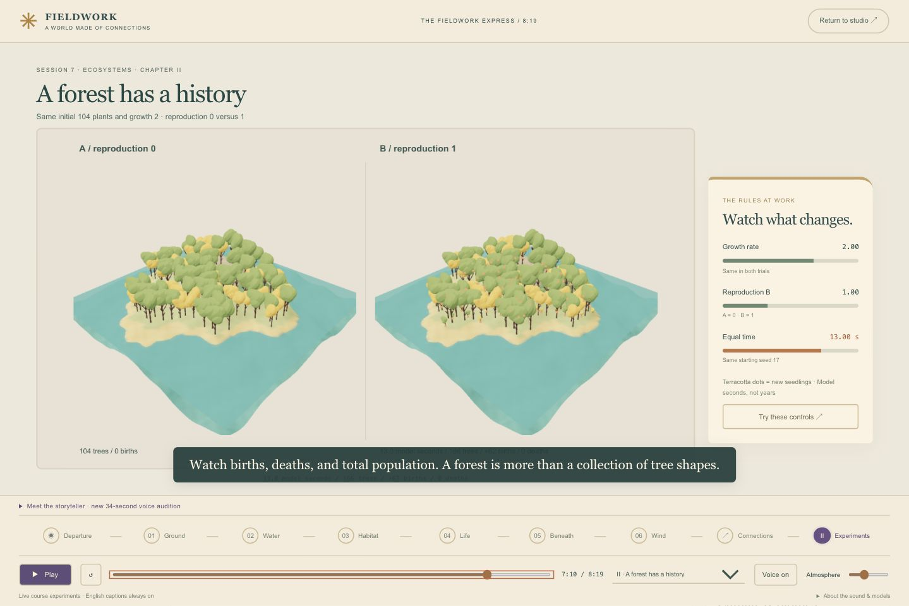

At 7:10, the paired population trial shows reproduction 0 versus 1: 104 versus 166 living trees after 13 model seconds, with 62 births in the reproduction-enabled case. Both use growth rate 2. These are measured model outcomes, not decorative tree scaling.

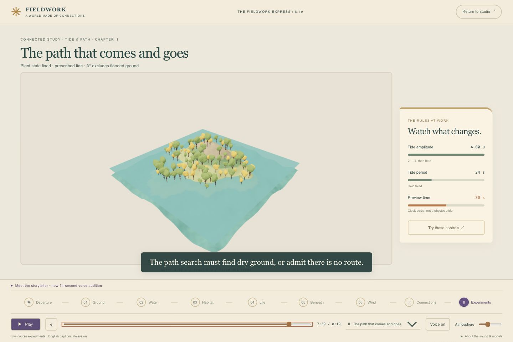

At 7:39, the high-water checkpoint reports sea level 4 and no walkable trail; the population is held at 104. This screenshot is one state, not a before/after pair.

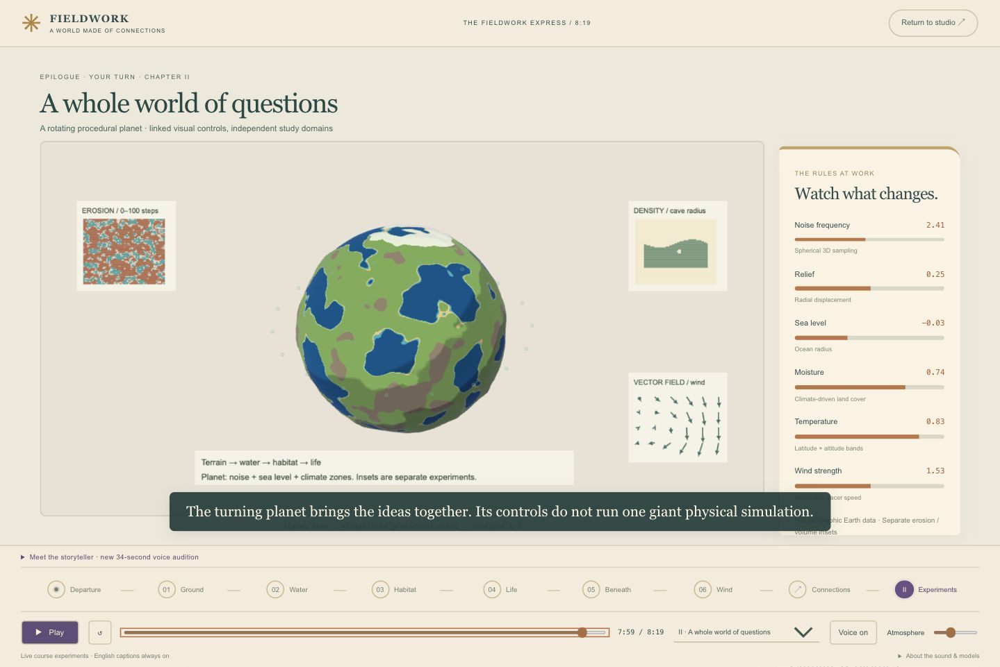

The final globe presents noise, relief, sea level, climate and wind together. The erosion and density insets remain separate educational domains.

### The narrator needs warmth, not exaggerated age

The owner rejected audition 01 as frightening and ghost-like. Audition 02 uses a different elderly voice, a natural pace, and warm/curious delivery directions. It removes the whisper and chuckle directions. [Listen to the revised 21.04-second sample](../../app/public/audio/fieldwork/grandfather-audition-02.mp3), or use **Meet the storyteller** in the app. The transcript has been updated. Listening approval is still pending; the full film uses the existing Daniel preview, not the rejected sample.

### The complete local film

[Play the 8:19 review film](../exhibition/fieldwork-express-v4-review.mp4) · [English subtitle file](../exhibition/fieldwork-express-v4.en.srt).

This is a frame-rendered film made from the app's map, train, woodland and experiment renderers. It contains the 2:51 illustrated introduction, 5:28 of detailed studies, changing parameter meters, matched comparisons and a rotating planet finale. Subtitles have their own lane below the scene so they do not cover the comparison measurements. The soundtrack combines the existing complete narration with quiet original ambient music and synthesized nature sounds. It is a local review export, not a newly performed full grandfather narration.

**Next experiment:** review the new voice for warmth, and watch the full film on the intended exhibition screen before replacing the complete narration or publishing. No commit or push.
