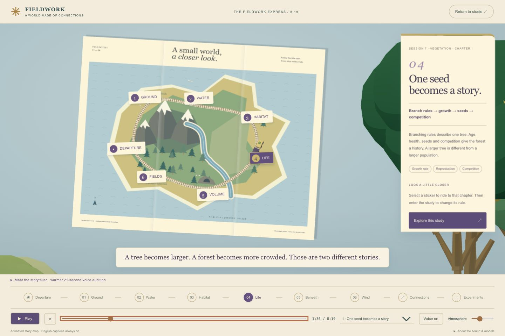
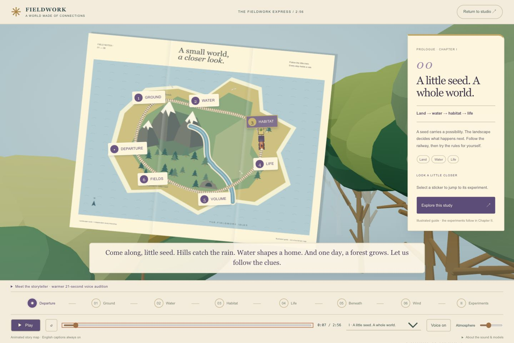
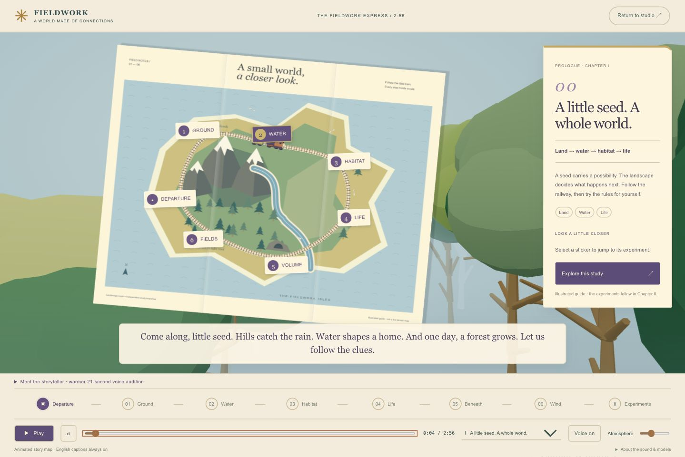
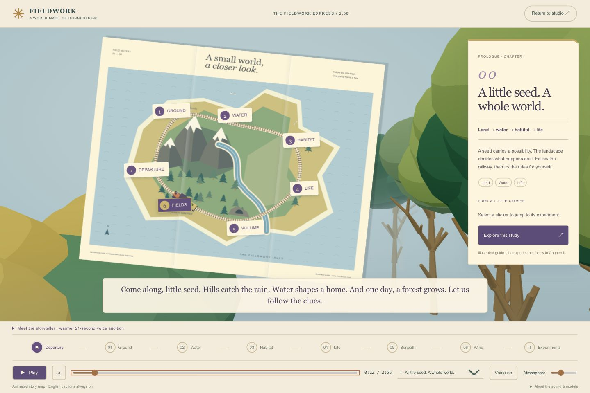
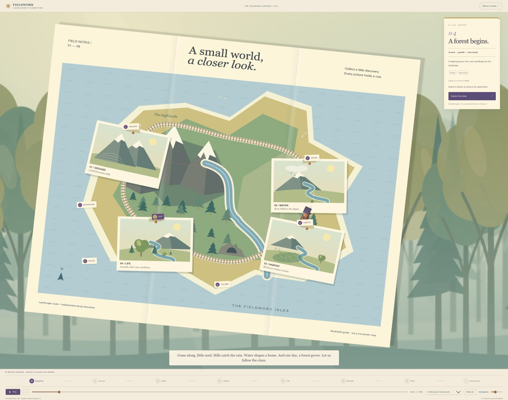

> **App update — October 14:** The live opening now uses a softly scrolling 2D woodland and four animated postcards. The v5 MP4 linked below preserves the earlier tree artwork. See [[2026-10-14 - Progress Log]] for current screenshots and checks.

# A Three-Minute World — Editing for Clarity

**October 13, 2026 · Local review · 2:56 total · 14-second opening**

**Request, translated and paraphrased:** Keep the introduction under 15 seconds and the complete film under three minutes. Remove repetition without losing the atmosphere. Restore the earlier large tree crowns, moving past the map as if travelling forward in a vehicle.

[Play the short film](../exhibition/fieldwork-express-v5-review.mp4) · [English subtitles](../exhibition/fieldwork-express-v5.en.srt)

## What changed

The previous film lasted 8:19, with 2:51 spent introducing ideas that the experiments explained again. The new opening gives one simple connection: **land → water → habitat → life**. A seed rides the railway around the paper map. At 0:14, the first real parameter experiment begins.

The opening retains the flat illustrated map, indigo stickers and dimensional train. The green and ochre crowns use the earlier layered tree geometry. Trees now move along two depth lanes. Perspective makes nearby trees grow larger and pass faster; distant trees fade into the blue-grey clearing. The map stays legible. Pausing freezes this motion, and reduced motion holds decorative scenery still.

### Earlier framing

This is an archived visual checkpoint at a different chapter, not a matched simulation comparison.

### The short opening

The last two captures use the same viewport and story. Their different tree positions record forward travel rather than a new forest preset.

## What stays in the film

| Time | Course connection | Visible change |
| --- | --- | --- |
| 0:00–0:14 | Opening | Seed train, paper map, passing woodland |
| 0:14–0:38 | Session 3: maps and shaders | Frequency, sampling resolution, snow threshold |
| 0:38–0:58 | Session 4: erosion and biomes | Rainfall comparison, moisture-driven habitat map |
| 0:58–1:37 | Session 5: voxels | Density shapes, cave radius, CSG order, local edits, resolution, chunks and meshing guide |
| 1:37–1:57 | Session 6: vector fields and fluids | Wind direction, dye transport and pressure correction |
| 1:57–2:27 | Session 7: vegetation | Branch grammar, angle, growth, reproduction and competition |
| 2:27–2:42 | Connected coastal study | Rising and retreating water, flooded trail and route response |
| 2:42–2:56 | Finale | Rotating procedural planet with changing parameters |

Each shot still traverses the original experiment's baseline, changing parameter and resulting comparison. The controls display actual model values. Camera motion remains in the source experiments, and A/B comparisons use matching camera views.

## Narration and pacing

The complete short track uses the warmer synthetic elderly voice from the revised direction. It was rewritten for the time budget. The opening has 23 spoken words, followed by breathing room. Music and synthesized forest/bird/water-like ambience remain quiet. English captions stay with their experiment and do not cover the measurement lane.

Most clips keep their generated pace. Two very small timing adjustments fit the short chunk sentence and final line. No pitch lowering or spooky echo was added. The owner still needs to judge the delivery on the exhibition speakers.

## What this edit teaches

A short exhibition film should give viewers a reason to try the controls. It cannot teach every algorithm in depth. Chunk overhead and alternative meshing appear as brief signposts; the longer course film, studio controls and earlier tutorials remain available for study.

Keep the distinction between appearance and evidence. Passing trees are scenic animation. The growth and population comparisons use actual plant state. The planet, height-field erosion, caves and fluid solver are independent educational models; the narrative links their ideas, not a single coupled Earth simulation.

**Development checks:** production build, lint and 30 tests passed, including the 15-second/three-minute limits, retained experiment coverage, audio containment and subtitle boundaries. Browser playback crossed the opening boundary correctly. Further film inspection is recorded in the progress log.

**Suggested next trial:** show the short cut once without explaining it. Ask a viewer which change created the cave, and whether larger trees mean more trees. Their answers will reveal whether the cause-and-effect shots are clear enough.

No commit or push. Earlier films remain as history.

## October 14 — make every story beat visible

The map now collects four pinned illustrations: hills rise, rain finds a river, moisture defines a habitat, and trees grow with new seedlings. Their arrival follows the existing fourteen-second narration. The side note changes with the same beat. The train becomes a small guide between discoveries.

A three-layer 2D forest scrolls slowly left behind the paper. Warm light, fog and softer distant silhouettes add depth without close-up crowns blocking the map. Decorative motion continues while the narration is paused; reduced-motion mode holds the scenery still.

**Learning insight:** motion should explain the idea being discussed. These are illustrative story animations; measured terrain and ecosystem models begin after the opening. The runtime remains 2:56. This app update has not yet been rendered into the saved MP4.
