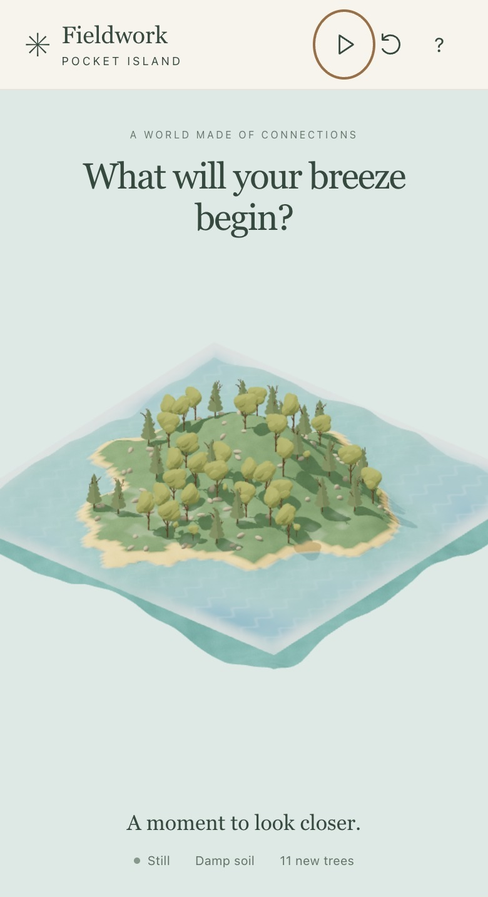

# A World in Your Hands

October 14, 2026 · Independent mobile experience

[Open Pocket Island](https://fieldwork-pocket-island.jc3785.chatgpt.site/)

## The idea

Request, translated and paraphrased: Create a separate phone world that visitors can open by scanning a code. Shaking and tilting should influence wind, water and ecology. Keep the interface quiet and the learning visible. The desktop and phone must remain independent.

Each visitor has their own browser-local island. No sensor data is uploaded, and the phone does not control the exhibition screen. The desktop only offers a QR invitation.

## Try three small gestures

1. **Breeze.** Enter with motion and grant permission, then gently shake. Tilt from a comfortable neutral position to steer. On touch, drag across the island or press Breeze. Wind changes seed trajectories; surface current follows with a delay.
2. **Rain.** Press Rain. Soil moisture increases, excess moisture transfers downhill, and evaporation continues afterward. The soil indicator comes from the model.
3. **Plant.** Select Plant, then tap a clearing. Water, steep slopes, dry ground and crowding can prevent germination. Try rain before planting in a dry area. New seedlings grow over time.

Pause to inspect. Reset recreates seed 17 for a repeatable comparison. Recenter recalibrates tilt. Touch only disconnects motion listeners.

## What this teaches

**Sessions 3–4:** A sampled noise field defines height and slope. Height, temperature and changing moisture define habitat.

**Session 6:** A vector has direction and strength. Wind advects airborne seeds. Surface currents respond to wind more slowly. Wind-driven motion is not a tide.

**Session 7:** Tree forms reuse the L-system geometry. Growth changes size; successful seed establishment changes population. Competition limits growth and germination requires suitable habitat.

This phone activity focuses on these connections. Voxel meshing, erosion and detailed fluid experiments remain in the desktop studies.

## Model boundaries

This is an accelerated teaching model, not a weather forecast or a full fluid solver. Water animation and current tracers visualize prescribed flow; the wind does not solve pressure or volume-conserving ocean dynamics. Moisture transfer is a small grid approximation. Reset or reload loses the visitor’s session. The phone build contains only the mobile experience.

## Checks and next experiment

TypeScript/build checks and lint passed. All 37 automated checks passed, including seven new tests for independent resets, gust decay, lagged current, directional seed transport, moisture, planting constraints and finite bounded state. Touch entry and actions were exercised in a 390 × 844 browser viewport. A real iPhone/Android sensor test remains to be done; desktop emulation does not prove hardware behavior.

Suggested comparison: reset, apply one breeze, observe seed travel. Reset again, add rain, then apply the same breeze. Compare successful seedlings, not only moving particles.

Motion requires HTTPS and, on some browsers, a permission request triggered by a tap: [MDN motion permission](https://developer.mozilla.org/en-US/docs/Web/API/DeviceMotionEvent/requestPermission). Touch remains available when motion is denied or no sensor signal arrives.

