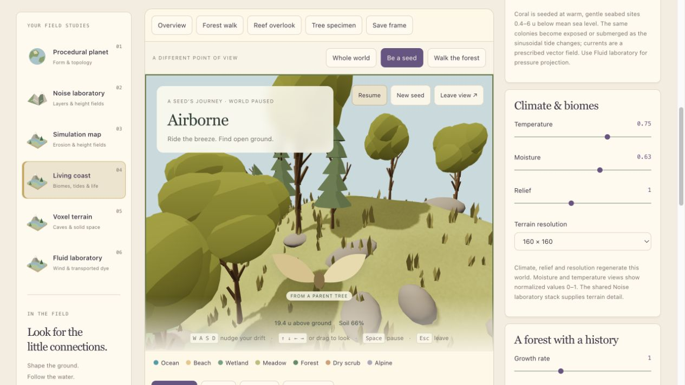
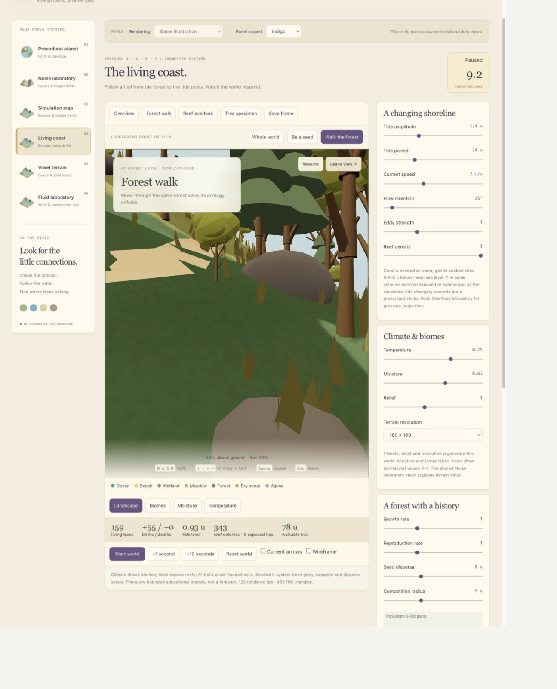
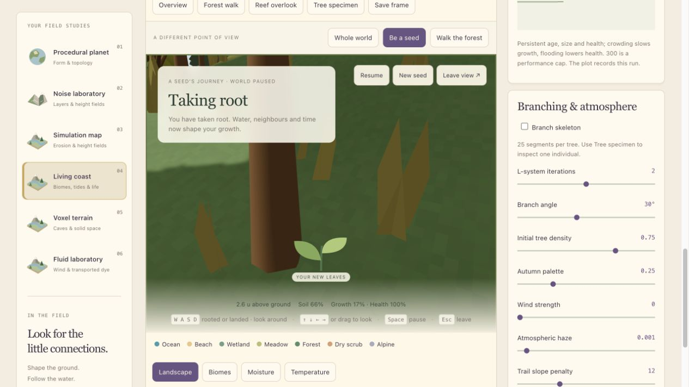

# A Seed Finds a Home

October 20, 2026 · Desktop local preview; phone remains independent.

**Updated later the same day:** The desktop now supports waiting and germination, persistent climate edits, a germination diagnostic and a controlled comparison page. See [One Change, Two Possibilities](21%20-%20One%20Change,%20Two%20Possibilities.md). Earlier screenshots below record the initial checkpoint.

## The question

Request, translated and paraphrased: Add a seed's first-person view and keyboard exploration, so visitors can watch the world and themselves change. Keep the story connected to what the course teaches.

The research question is: **Why does the same seed survive in one place and fail in another?** The viewpoint lets a visitor observe the rules. It does not replace evidence that those rules work.

## Try the desktop view

Open Living coast and select **Be a seed**. This starts the world clock. Use **WASD** to nudge the airborne seed; arrows or a drag change where you look. **Space** pauses the world; **Esc** returns to the overview. Click inside the scene after using an inspector control to restore keyboard focus.

Wind strength and Flow direction change drift. Steering is an explicit visitor intervention: real seeds do not choose a destination. Falling continues with model time. The seed must actually reach the sampled ground or water before a landing is evaluated.

Water prevents this terrestrial seed from establishing. Dry/cold habitat, the shoreline, steep slopes, nearby roots or the population cap now leave a seed waiting in place. Two uninterrupted suitable model seconds add one real member to the existing population. After rooting, WASD no longer moves it. The ordinary growth, crowding and survival rules take over; the camera rises with its size. The leaf illustration is an identity cue, not a botanical growth solver.

**Walk the forest** is a separate observer view. WASD moves, Shift moves faster, and arrows/drag look around. Walking follows terrain and blocks water and steep slopes. It is not a bird or an autonomous agent. Trees and rocks do not yet have physical collision volumes.

## Actual development observations

In a separate browser test world, reproduction was set to zero to isolate the tracked seed. With default wind strength 1.5 and direction 25 degrees, it eventually reached water and failed. At the inspected 50.2-second frame there were still 104 plants and zero births. This was an observed failed journey, not a scripted ending.

After resetting that test world, wind was set to zero. At 30.0 model seconds the seed had rooted: **105 plants, one birth, no deaths**, 17% normalized size, 100% health and 66% local moisture. These two screenshots are development examples, not an equal-time A/B comparison: the times and viewing directions differ.

A keyboard check moved the observer from (17.94, 9.91, 8.81) to (21.84, 10.07, 4.18) while the world was paused. Turning changed the heading; Esc restored the orbit view. The pause freezes ecology, not the observer's ability to inspect it.

## Three experiments to make the story teach

1. **Transport — Session 6.** Reset the same world, disable background reproduction, launch from the same parent and compare two wind directions for the same model duration. Record the landing coordinates and outcome. Do not steer during this comparison.
2. **Habitat — Sessions 3–4.** Compare an identical candidate location under two moisture conditions. The desktop Moisture slider now preserves terrain, the seed and existing population. Compare the same landing site before and after a climate change. This is still a climate intervention, not local rainfall simulation.
3. **Population — Session 7.** Keep initial density, climate and time fixed; vary competition radius. Record survival and mean growth as well as the final picture. A larger tree and a larger population are different results.

These controlled comparisons are the next research task; this note does not mark them as completed. Use a small table of inputs and outcomes and a diagnostic layer alongside each attractive view.

## Course alignment: implemented versus proposed

The [instructor's repository](https://github.com/jomasan/Procedural-World-Building) describes a parameter-to-procedure-to-picture loop. Its [learning path](https://github.com/jomasan/Procedural-World-Building/blob/main/docs/learning-path.md) calls for sliders, algorithm variants, tooltips and debug views. The supplied Canvas syllabus also values narratives and intentional design. The story can support the course when its turning points come from the model.

| Topic | Current evidence | Boundary or next task |
| --- | --- | --- |
| Maps, noise and shaders | Working desktop studies and earlier parameter experiments | Surface color and camera movement are not new terrain algorithms. |
| Erosion and biomes | Separate erosion grid; climate-based biome rules | Erosion does not currently update the Living coast height field. |
| Voxels | Density shapes, ordered CSG, chunks and Marching Cubes in a separate tab | The seed journey does not demonstrate voxel meshing. Keep that experiment accessible. |
| Vector fields | Wind-driven tracked seed; current visualization; separate 2D fluid solver | Wave animation is not full fluid simulation. The desktop seed uses uniform wind, not the fluid solver. |
| Vegetation | L-system form, suitability, growth, reproduction and neighbour competition | No explicit light competition or water-uptake budget. Existing branches scale with size. |
| Session 9: species / evolutionary solvers | Two tree appearance categories; offspring retain a category | No heritable quantitative traits, mutation, fitness-based evolutionary search or multi-generation evaluation. Not implemented. |
| Session 10: agents / state machines / schedules | Seed flight/root/failure lifecycle states | No autonomous bird with needs, decisions, schedules or memory. Lifecycle labels alone do not complete this topic. |
| Session 11: procedural cultures | Terrain-aware A* trail | No settlers, settlement rules, shared practices or procedural culture. A trail is not a culture model. |
| Sessions 12–13: optimization / performance | Instanced trees, bounded populations, some mesh caching and frame metrics | LOD, streaming, persistent saved ecology and measured physical-phone performance remain unfinished. |

## Keep the claims narrower than the story

The phone's local source includes wind transport, coarse downhill moisture transfer, habitat-gated planting, a waiting dry-seed state and growth. The latest tracked-seed revision has not been verified as deployed to the public site. The desktop and phone are separate models with different thresholds; they do not share a running world.

The phone always starts from the same seeded island. Different actions can produce different outcomes, but reloading does not generate a new unique island or restore the previous visit. Both experiences now support waiting seeds. Actual rain and downhill soil-water transfer belong to the phone model; desktop germination reads its climate field.

The story sentence “trees compete for light, water and space” was broader than the implementation. The current models use neighbour counts to penalize growth/health and moisture to gate or support life. They do not solve canopy light interception or resource consumption. Say **simplified habitat and crowding rules** when presenting this version.

No exact instructor critique was available for this audit. A possible presentation mismatch is that attractive animation and interaction hide the algorithmic experiments. That is a working interpretation, not a claim about what the instructor meant.

## The next priority

Keep the warm visual language and seed viewpoint. Before adding another character or narrated sequence, complete the three controlled trials above and make their rules inspectable. For Session 9, confirm the specific evolutionary-solver exercise before choosing whether to optimize plant traits or demonstrate ecological evolution; those are related but different investigations.

A concise presentation line: **“I use a seed's journey to expose procedural rules. By holding the initial world fixed and changing one parameter, I can show how transport, habitat and competition produce different outcomes.”**

See [today's progress log](2026-10-20%20-%20Progress%20Log.md) and the earlier [course experiment record](15%20-%20Controlled%20Experiments%20and%20the%20Planet%20Finale.md).
