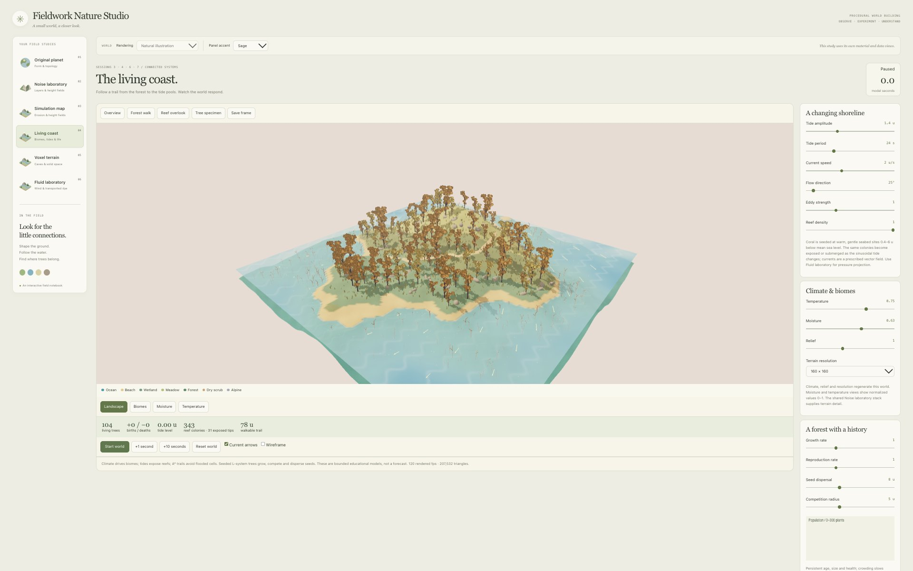
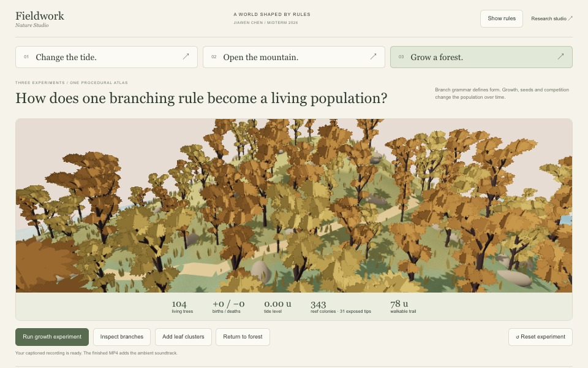

# Progress Log — October 13, 2026

## Request and intent

**User request, translated and paraphrased:** Before recording, improve the exhibition experience with a larger world view, simpler controls and three resettable demonstrations. Then record the app, add English captions and gentle ambient electronic music. Keep a silent version for presenting.

## Before

The existing studio exposed many research controls. This was useful for learning, but a visitor still needed help choosing a first action.

## What changed

- Added a separate `?exhibition=1` entrance with three studies: tide, cave and forest.
- Kept the original six-tab studio and its research controls. Opening the exhibition from the studio uses a separate tab.
- Added reproducible action presets and reset controls. Tide presets hold ecology fixed; forest presets hold the tide at zero.
- Moved detailed rules and diagnostic maps behind **Show rules**.
- Adjusted the cave camera to face the opening, so subtracting the tunnel can be seen.
- Added an actual-renderer film recorder with a scripted 78-second sequence, English captions, live measurements and a progress bar.
- Created an original ambient score and exported music and silent MP4 versions.

This is a different presentation mode and camera from the before image, not a controlled shader comparison. The underlying world style was retained.

## Verified experiments

- High tide: +4.00 u, 343 reef colonies, zero exposed tips, no walkable route.
- Low tide: −4.00 u, the same 343 colonies, 312 exposed tips, 78 u of route. Both presets kept 104 trees.
- Sequential cave operations: solid terrain, carved tunnel, restored pillar, then local pocket. The pocket rebuilt 8 of 27 chunks and produced 14,836 triangles.
- Forest trial: 104 → 166 trees, 62 births and zero deaths before pause. Reset restored 104 / zero births / zero deaths.
- Branch-only and leaf-cluster views expose the same L-system structure. Grammar iteration and elapsed growth are explicitly distinguished in the captions.

## Recording iteration

The first capture showed that the frame was too shallow and the growing canopy crowded the final view. The final capture uses a taller render area and changes to an overview near the end. This was a composition adjustment, not an added physical model.

The finished films show real app output, with a composed title/caption layer. They do not record the desktop or control panel. [Film files and playback instructions](../exhibition/README.md).

## Learning insight

A useful demonstration isolates a cause. Holding tree state fixed made the tide experiment easier to read. Holding tide level fixed made the growth experiment easier to explain. Three strong examples also make a better public entry point than asking visitors to understand every parameter immediately.

## Validation

Production build passed, lint passed, and all 13 simulation tests passed. Browser checks covered tide extremes, forest growth/reset, branches/crown, sequential CSG, local chunk rebuilding and the detailed-rules disclosure. Actual screenshots and sample film frames were inspected. MP4 streams and duration were checked after encoding.

The production build still reports its existing large JavaScript chunk advisory. No public-audience usability test or external projection-system test has been completed. The models remain educational: prescribed tide, bounded density volume and accelerated ecology.

## Next experiment

Run one short visitor test: can someone restore the trail, expose the cave and reset the forest without being told which buttons to press?

See [Tutorial 13](13%20-%20From%20Research%20Studio%20to%20Public%20Exhibition.md) for parameters, course connections and the recording workflow.
