# Progress Log — October 13, 2026

## Request and intent

**User request, translated and paraphrased:** Before recording, improve the exhibition experience with a larger world view, simpler controls and three resettable demonstrations. Then record the app, add English captions and gentle ambient electronic music. Keep a silent version for presenting.

## Before

The existing studio exposed many research controls. This was useful for learning, but a visitor still needed help choosing a first action.

## What changed

- Added a separate `?exhibition=1` entrance with three studies: tide, cave and forest.
- Kept the original six-tab studio and its research controls. Opening the exhibition from the studio uses a separate tab.
- Added reproducible action presets and reset controls. Tide presets hold ecology fixed; forest presets hold the tide at zero.
- Moved detailed rules and diagnostic maps behind **Show rules**.
- Adjusted the cave camera to face the opening, so subtracting the tunnel can be seen.
- Added an actual-renderer film recorder with a scripted 78-second sequence, English captions, live measurements and a progress bar.
- Created an original ambient score and exported music and silent MP4 versions.

This is a different presentation mode and camera from the before image, not a controlled shader comparison. The underlying world style was retained.

## Verified experiments

- High tide: +4.00 u, 343 reef colonies, zero exposed tips, no walkable route.
- Low tide: −4.00 u, the same 343 colonies, 312 exposed tips, 78 u of route. Both presets kept 104 trees.
- Sequential cave operations: solid terrain, carved tunnel, restored pillar, then local pocket. The pocket rebuilt 8 of 27 chunks and produced 14,836 triangles.
- Forest trial: 104 → 166 trees, 62 births and zero deaths before pause. Reset restored 104 / zero births / zero deaths.
- Branch-only and leaf-cluster views expose the same L-system structure. Grammar iteration and elapsed growth are explicitly distinguished in the captions.

## Recording iteration

The first capture showed that the frame was too shallow and the growing canopy crowded the final view. The final capture uses a taller render area and changes to an overview near the end. This was a composition adjustment, not an added physical model.

The finished films show real app output, with a composed title/caption layer. They do not record the desktop or control panel. [Film files and playback instructions](../exhibition/README.md).

## Learning insight

A useful demonstration isolates a cause. Holding tree state fixed made the tide experiment easier to read. Holding tide level fixed made the growth experiment easier to explain. Three strong examples also make a better public entry point than asking visitors to understand every parameter immediately.

## Validation

Production build passed, lint passed, and all 13 simulation tests passed. Browser checks covered tide extremes, forest growth/reset, branches/crown, sequential CSG, local chunk rebuilding and the detailed-rules disclosure. Actual screenshots and sample film frames were inspected. MP4 streams and duration were checked after encoding.

The production build still reports its existing large JavaScript chunk advisory. No public-audience usability test or external projection-system test has been completed. The models remain educational: prescribed tide, bounded density volume and accelerated ecology.

## Next experiment

Run one short visitor test: can someone restore the trail, expose the cave and reset the forest without being told which buttons to press?

See [Tutorial 13](13%20-%20From%20Research%20Studio%20to%20Public%20Exhibition.md) for parameters, course connections and the recording workflow.

## Revision 2 — Parameter changes, comparison frames and coverage audit

**Requests, translated and condensed:** Make tides, caves and tree growth easier to compare. Rotate at each step, synchronize captions with events, and show which sliders change in a dedicated area. Check coverage of the course so far. Show the finished preview before proceeding further.

Added the 110-second scripted comparison film, a fixed parameter panel, explicit clock labels, matched-camera reference frames, eased camera orbits and soft layout transitions. The displayed parameters drive the actual models; this is automated renderer capture rather than desktop mouse recording. The original film is retained.

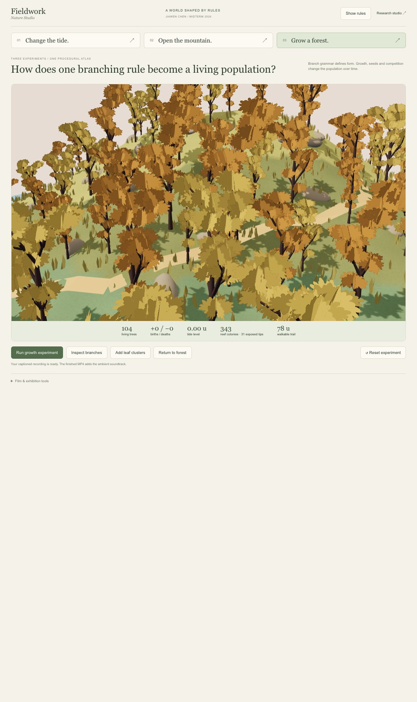
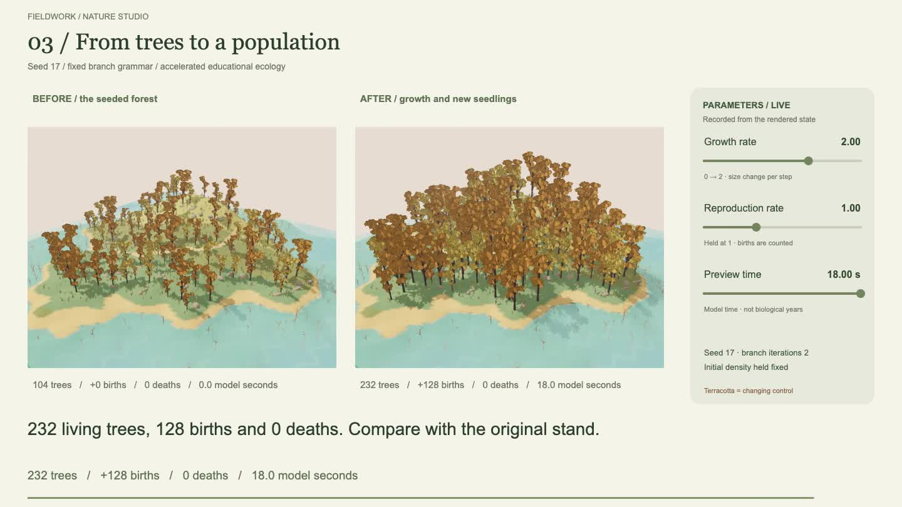

These two images compare presentation formats, not identical world states. The film's own before/after panels use matched cameras and stated conditions.

Observed in this capture: the low-tide reference has water −2 u, 164 exposed tips and 78 u of trail; high tide has +4 u, zero tips and zero trail. A local cave pocket rebuilds 8/27 chunks. Forest growth ends at 232 trees with 128 births and no deaths at 18 model seconds.

Production build and lint pass; all 16 tests pass. New checks cover changing parameters while time is held, returning comparison cameras to the reference orientation, and captions/readouts tied to rendered outcomes. Recorded frames and subtitle timing were inspected. The music MP4 is approximately 110 seconds, 1440 × 810, 30 fps, H.264/AAC. The existing bundle-size advisory remains.

[Course coverage audit](14%20-%20Midterm%20Coverage%20Audit.md): the main scheduled topics have implementations, but the current film is selective and several controlled comparisons are pending. Canvas live access and the Figma lecture decks were unavailable; the supplied syllabus, public instructor repository and actual project evidence define the audit's scope. Earlier unchecked planning lists are historical, not the current feature inventory.

**Next:** owner review of the revised video, then a fixed-seed parameter experiment for one under-documented course topic. This revision has not been committed or pushed while awaiting preview feedback.

## Revision 3 — Controlled course experiments and a rotating planet

**Request, translated:** Add the missing parameter comparisons and course coverage, then connect the ending with a rotating whole planet and continuously changing controls.

Added a dedicated 5:28 course-film page at `?atlasfilm=1`, using the existing noise, erosion, climate, voxel, fluid and ecology functions. The original research workspaces and short exhibition films remain available. Chapters now show noise frequency, sampling, snow threshold, equal-step rainfall, moisture, density shapes/slices, CSG, local chunk edits, resolution and chunk cost, meshing alternatives, wind direction, pressure iterations, grammar, branch angle, growth, reproduction and crowding. Tide/path closes the experiments, followed by a 32-second procedural globe.

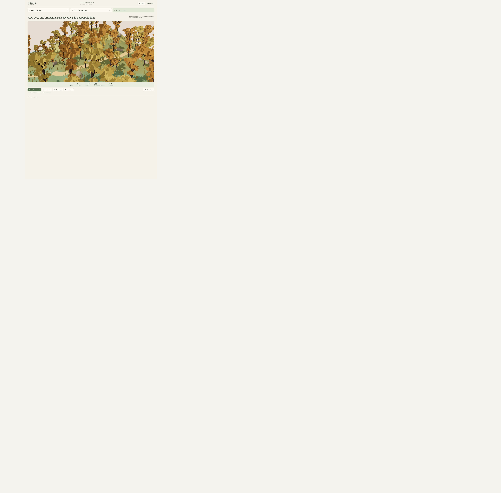
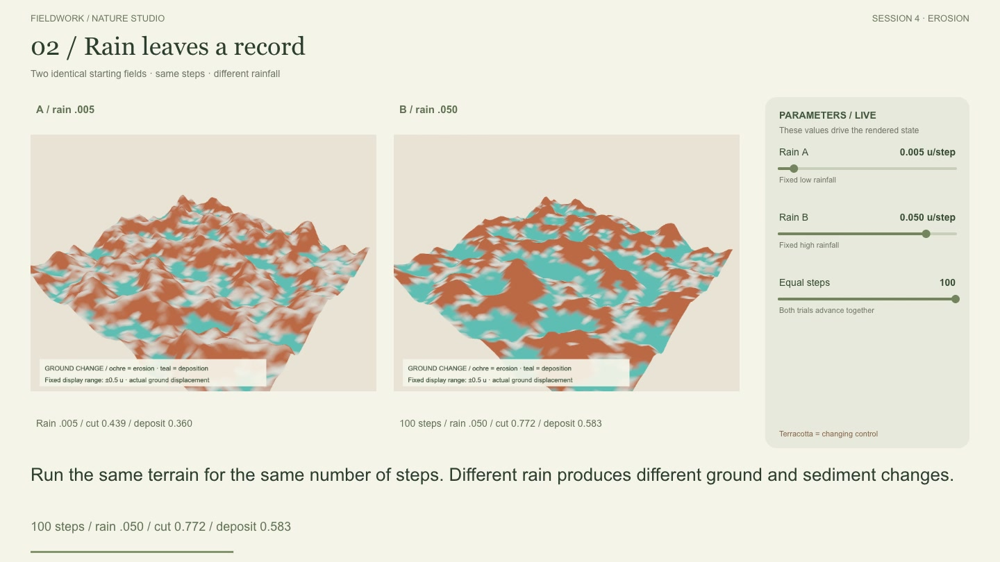
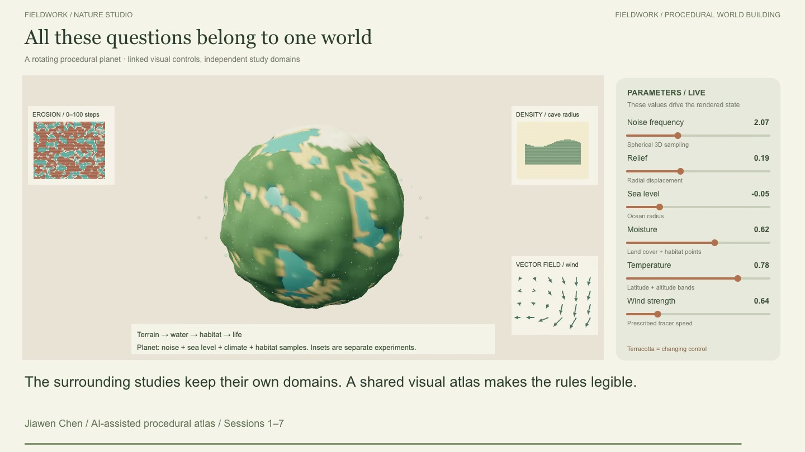

The before/after pair documents the presentation change, not identical simulation states. Controlled comparisons occur within the recorded film at matching camera positions, seeds and stated time/step conditions. The live-looking slider area displays the parameters applied by the script; it is not manual mouse footage.

Observed checks: low/high rain at 100 steps produces mean cut .439/.772; moisture .25/.80 gives 348/1,071 forest samples; constant wind travels 32 units at both directions; projected fluid divergence falls .20236 → .13739 on the final step. Reproduction 0/1 gives 104/232 plants at 18 seconds. Crowding radius 0/5 gives 244/232 plants with mean health 1.0000/.9891 and no deaths. Growth-only retains 104 plants while mean size changes .718 → 1.300.

Repeated CPU mesh trials and their raw timings are saved in [measurement JSON](../exhibition/fieldwork-v3-experiments.json). Smaller chunks make the tested local edit cheaper but increase the full-field chunk count. Browser timing is reported independently. These are small educational benchmarks, not device-independent FPS claims.

Build and lint pass; 23 tests pass. The film includes English captions, soft transitions, rotation, actual model readouts and original gentle ambient music, with a silent edition. The finale uses noise/sea/climate/habitat controls on the sphere and labeled separate study insets. It is not a coupled Earth simulator.

See [Tutorial 15](15%20-%20Controlled%20Experiments%20and%20the%20Planet%20Finale.md) for the time index, results, limits and insights. **Next:** owner preview, then exhibition-screen playback and a longer competition trial. No push has been made for this preview revision.

## Revision 4 — a readable world and an app-only field map

**Request, translated:** make the globe less muddy, improve the trees using the supplied illustrated-game references, keep world and interface design responsibilities separate, and introduce the course's parameter connections through a first-person unfolded map. The owner selected app opening only.

Implemented per-pixel planet material boundaries, a clear blue ocean, compressed radial relief, broad light bands and functional sea/climate controls. Living coast now has volumetric broadleaf crowns and layered firs, with the original grammar and ecology rules retained. Research controls use cream, indigo and brass. The opening links six course studies with parameter trials and explicit model boundaries.

The first crown attempt looked stacked, so it was revised into a grouped upper canopy. A sea-level comparison at −0.025 and 0.15 confirmed visible submergence with the same seed and view. Build, lint and model/geometry checks were run. Existing film exports remain unchanged; this is a local review before publication.

See [A Readable World and an Unfolding Map](16%20-%20A%20Readable%20World%20and%20an%20Unfolding%20Map.md) for screenshots, rules and the next trials.

## Revision 5 — The Fieldwork Express

**User request, translated and paraphrased:** Make the map opening a narrated animated train journey, with a gentle elderly storyteller, quiet nature ambience and synchronized English subtitles. Continue into the detailed course workflow.

Implemented an 8:19 app-native player: a 2:51 seed-and-train story continues directly into 5:28 of real parameter experiments. Added train motion, station navigation, camera movement, steam, birds, rain and growing trees. One prerecorded audio clock drives the picture and captions. The player supports pause, restart, seeking, 29 chapter entries, voice mute, independent ambience volume and return to the relevant research controls.

The current narrator is a local synthetic Daniel preview. The requested expressive elderly performance remains unfinished and needs a suitable voice-generation connection. Ambience is original synthesis, not field recordings. The story map is illustrative; the detailed experiments retain their real model boundaries.

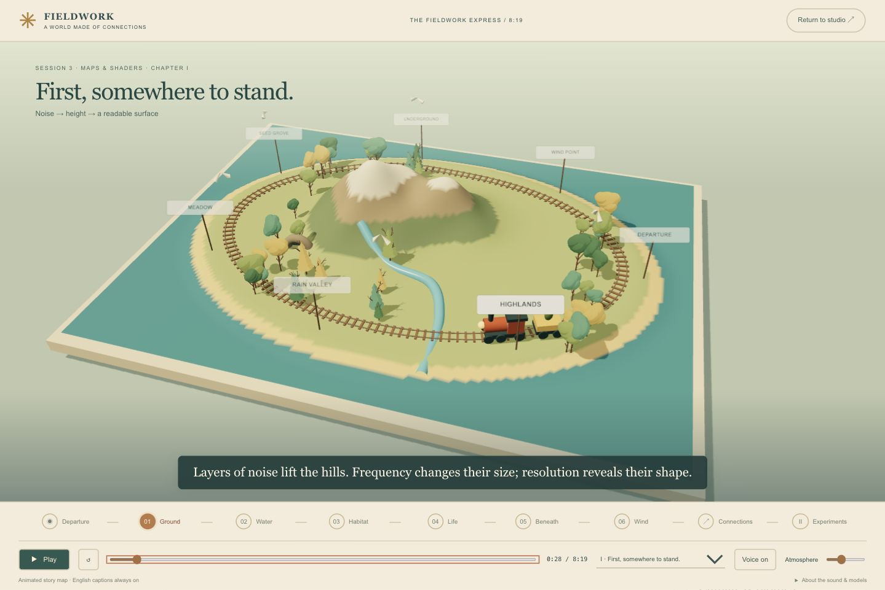

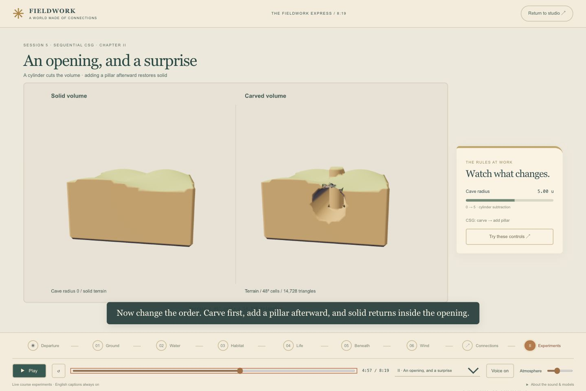

Checks: build and lint passed; 28 automated tests passed. Verified non-empty narration, 499-second media duration, positive caption durations and detailed-chapter alignment. Browser spot checks covered play/pause, seeks, automatic transition, key study families and handoff to Living coast. No full exhibition-device screening is claimed.

Learning point: successful audio generation can still produce an empty file. Validate the signal and duration before calling the narration ready.

Next: test whether a new viewer can explain the ground → water → habitat → life relationship after the story. Full notes: [[17 - The Fieldwork Express - A Narrated Journey]]. This is a local preview; existing exported videos are unchanged, and nothing was pushed.

## Revision 6 — a storyteller audition and a folded paper map

**Request, translated and paraphrased:** Hear one short gentle, emotionally varied elderly narrator sample, and retain the preferred illustrated field-map style with optional depth.

Created a 34.08-second English AI narrator audition with soft delivery, deliberate pauses and one small chuckle. It is available under **Meet the storyteller** in the app. Playback was checked; approval of the voice is still pending. The full journey retains the earlier narrator until the sample is reviewed.

The map now uses the reference's cream folded paper, blue wave marks, an irregular coastline, indigo numbered stops and a separate field-note card. Raised mountains, firs and the moving train preserve depth. Ground, Water, Habitat, Life, Volume and Fields still lead into the existing detailed studies.

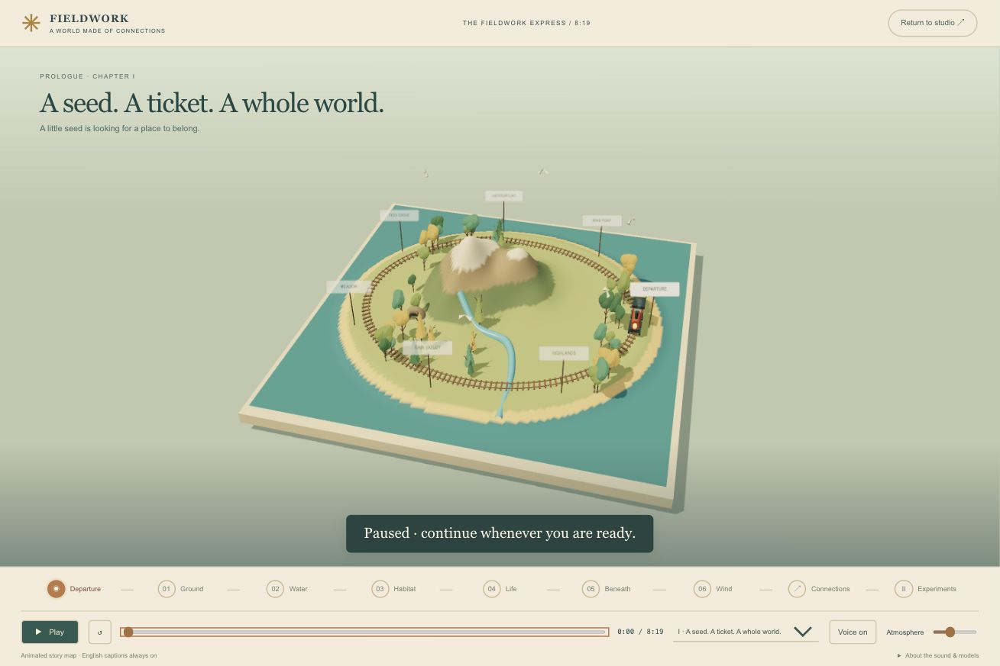

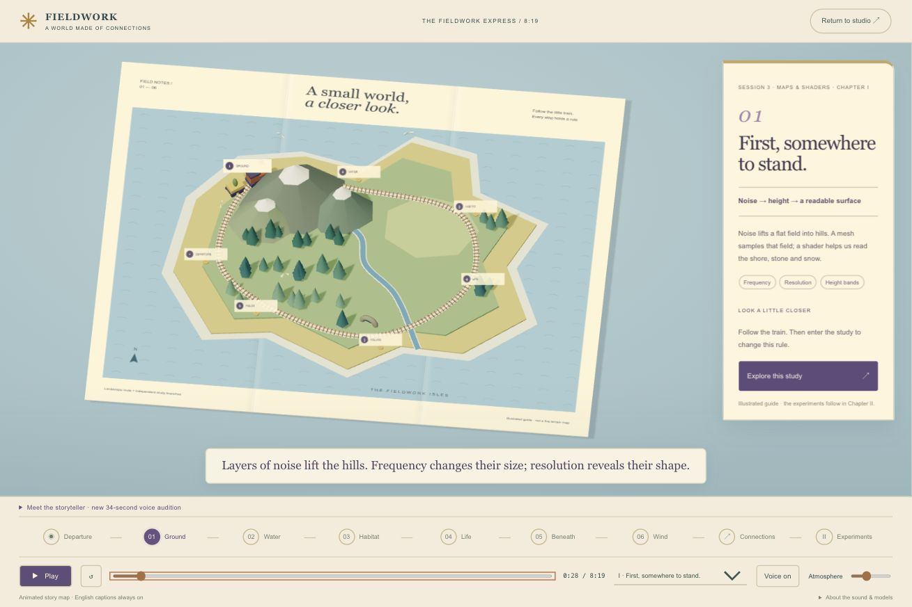

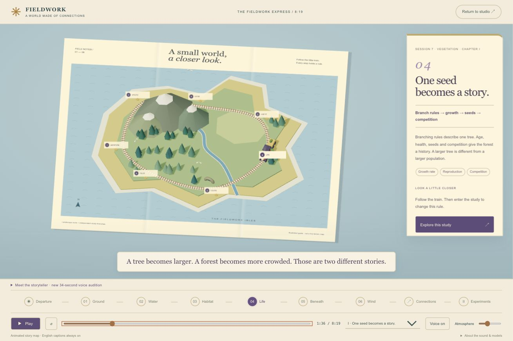

**Checks:** build, lint and 28 tests passed; browser playback confirmed the audition duration and that playing the main journey pauses it. A 391-pixel layout check found no horizontal overflow; controls scroll vertically. These are spot checks, not owner approval of the voice or a full exhibition playback review.

**Next experiment:** listen to the character, then either refine the delivery or generate the remaining voice and retime subtitles. No commit/push or new film export.

Full notes and audio: [[17 - The Fieldwork Express - A Narrated Journey]].

## Revision 7 — a sticker map in passing woodland

**Request, translated:** Keep the earlier passing-tree effect, combine a flat sticker-like map with 3D elements, and borrow the sense of travelling between map destinations from Overcooked.

The island geography is now printed: mountains, snow, river and pine symbols stay flat. A small 3D locomotive follows the railway, while larger woodland trees pass behind the paper and note card. Station stickers are selectable chapter buttons. Selecting one begins its narration and moves the train toward that stop. The forest and train share the audio clock, so Pause holds the scene. Reduced-motion handling keeps chapter navigation while suppressing decorative movement.

**Observed:** a desktop spot check showed the new layers and matching Life card. Clicking Life started playback; Pause stopped the main track at about 1:39 while the audition remained paused. Build, lint and 28 tests passed. The final small-screen and keyboard checks are still pending.

**Screenshot status:** the new desktop view was inspected but not saved before the browser session was interrupted. Browser security then blocked reconnection to localhost. Keep images 33 and 34 as the previous raised-map checkpoints; they do not depict this revision. Save the new after frame when preview access resumes.

**Insight:** depth works better when it has a job. The map explains the route, the train shows progression, and the surrounding forest makes the journey feel inhabited. The real ecology remains in the study workspace.

The elderly voice audition is still ready for listening review. No full voice replacement, new video, commit or push. See [[17 - The Fieldwork Express - A Narrated Journey]].

## Revision 8 — complete browser evidence, close woodland and a film

**Requests, translated and paraphrased:** Retry the browser and finish screenshots/checks without pushing. Retain the earlier large tree background. Produce the complete video promptly. The elderly audition sounded ghost-like; make it gentle and natural.

The local preview server was restarted and a fresh localhost tab restored access. Saved the missing desktop and phone evidence. A clipped mobile card action was fixed by stacking the map, complete note and caption in one reading flow. Increased map-camera breathing room. The background then changed to close layered green/ochre crowns, using the app's branching geometry, quieter toon lighting and slow scenic drift around a blue-grey clearing.

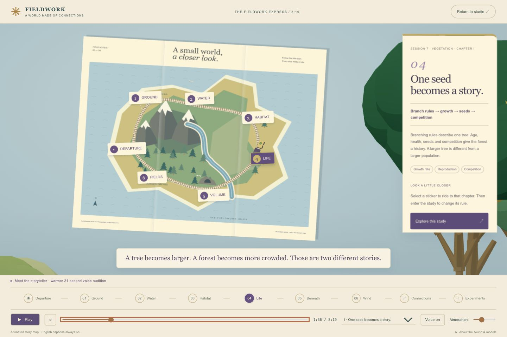

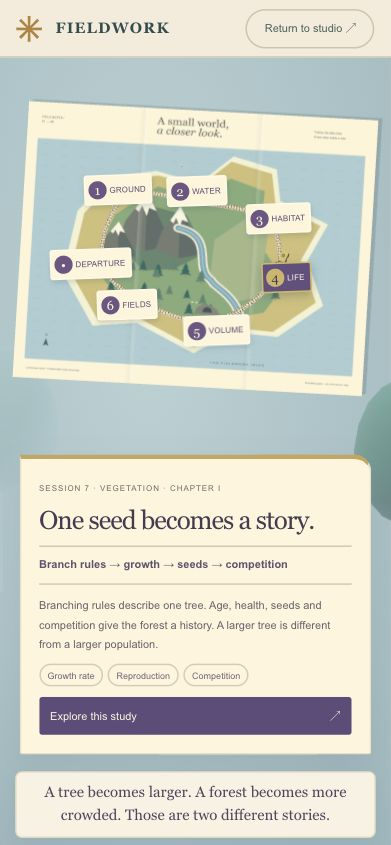

**Observed checks:** all 29 chapter entries and the 21 experiment parameter displays were checked. Tab/Enter/Space, timeline arrows, Restart, Escape and studio handoff worked. Pause held the picture and narrator; reduced motion held the forest. The audition and main voice paused each other. Actual playback crossed the story/study boundary and stopped correctly at 8:19. These checks sample behavior; they are not a complete exhibition-device screening.

Audition 01 was rejected by the owner as frightening. A new 21.04-second elderly sample uses a different voice, natural pacing and warm delivery without whispers or chuckles. It replaces the sample in the app. Approval remains pending; the full track has not been silently substituted.

Produced a complete [8:19 review film](../exhibition/fieldwork-express-v4-review.mp4) from the app renderers, with a dedicated subtitle lane, parameter meters, A/B studies, globe finale, existing full narration, quiet original music and synthesized nature ambience. This is a rendered app film rather than footage of manual mouse movements. Source experiment values still drive the displayed controls.

**Insight:** the story can be expressive while the experiment stays inspectable. Framing trees belong to presentation; births, cut/deposition, CSG and flow need actual model evidence. Keep narration subtitles away from those measurements.

**Next:** owner listening review of audition 02 and a full exhibition-screen screening. No commit or push. Tutorial and evidence: [[17 - The Fieldwork Express - A Narrated Journey]].

## Revision 9 — a fourteen-second opening and a three-minute cut

**Request, translated and paraphrased:** Limit the intro to 15 seconds and the whole film to three minutes. Remove unnecessary explanation, keep the atmosphere, and use the earlier tree crowns passing the map like a forward drive.

The default app journey is now **2:56**, including **0:14 of introduction**. The old 8:19 file remains archived. A concise seed story leads straight into the actual Session 3–7 experiments. Each short shot maps to the full source experiment, preserving parameter endpoints and comparison holds. Tide/path, cave/CSG, growth versus births, and the rotating planet remain.

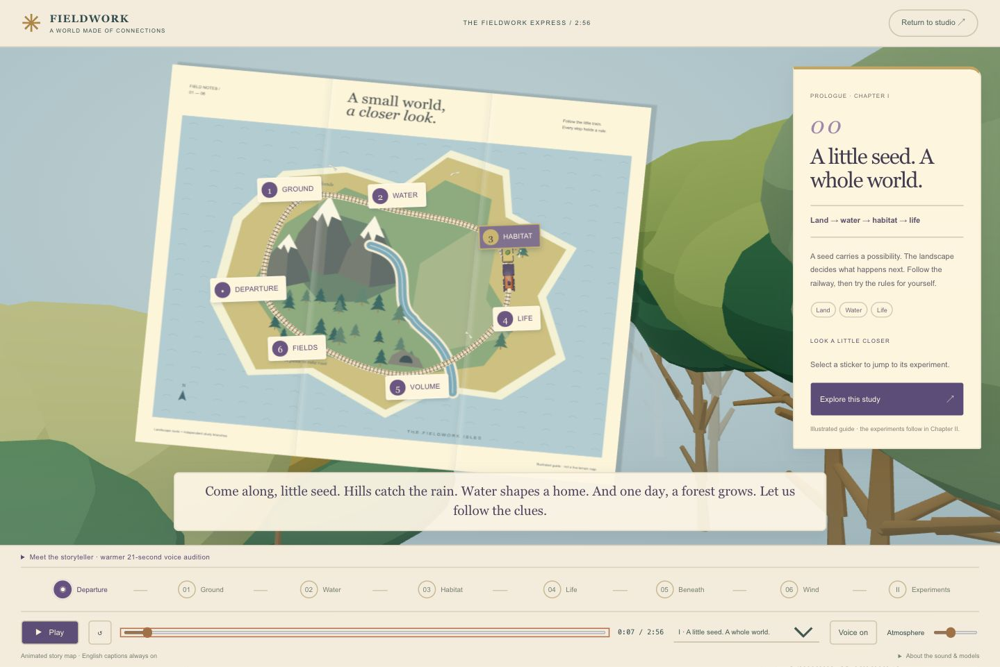

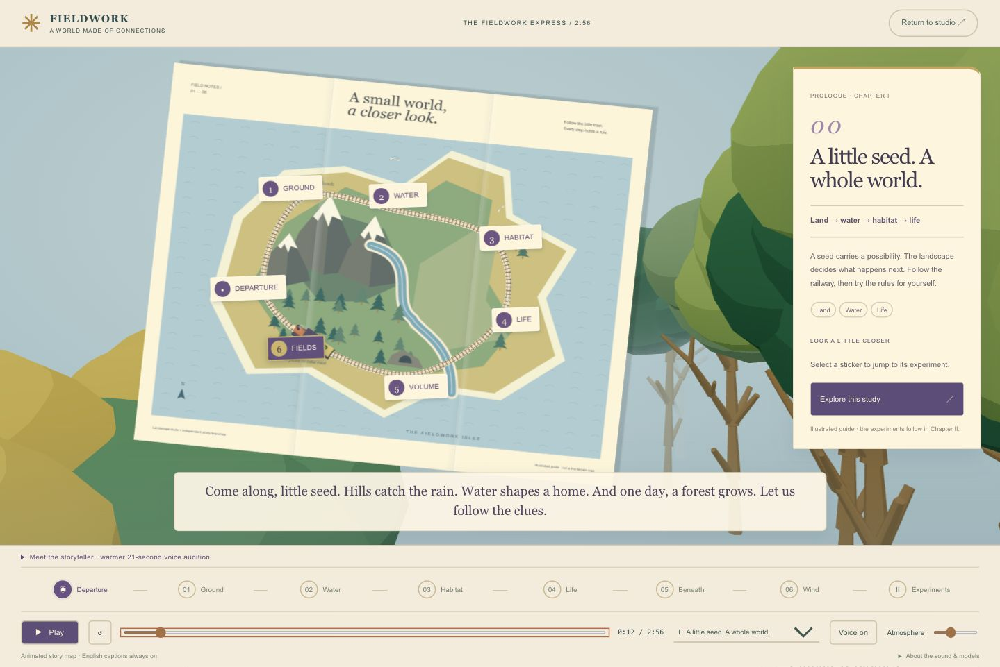

The preferred layered green/ochre crowns now travel on two depth lanes with perspective parallax. The paper map and train remain separate foreground elements. The full short narration was regenerated with the warmer synthetic elderly voice; English captions follow the shot clock. Quiet original music and synthesized nature ambience support the voice.

**Checks completed:** production build, lint and 30 tests passed. Tests enforce the intro/runtime limits, retained experiment sequence, narration containment and subtitle boundaries. Browser playback crossed the 14-second handoff into the real studies. Forward-scene captures at 4.1 and 12.1 seconds use the same viewport. Film metadata and key-frame inspection are recorded below after export.

**Insight:** reduce repeated explanations before reducing observation time. A short cut introduces the questions; detailed controls and long-form notes carry the deeper learning. Brief coverage of chunking and meshing is not a full lesson.

[Short film](../exhibition/fieldwork-express-v5-review.mp4) · [[18 - A Three-Minute World - Editing for Clarity]]. Next: owner listening review and one screening on the actual exhibition display. No commit or push.

**Final export verification:** the MP4 is exactly 176.000 seconds, 1440 × 900 at 24 fps, with H.264 video, AAC audio, an English subtitle track and 21 chapter markers. A full decode completed without errors. Inspected the rendered opening, cave A/B, population A/B, rising/retreating tide and globe frames; measurements and subtitles occupy separate lanes. The app's audio stopped at 2:56 and displayed its ending controls. This is technical and sampled visual verification; the owner's listening review is still pending.

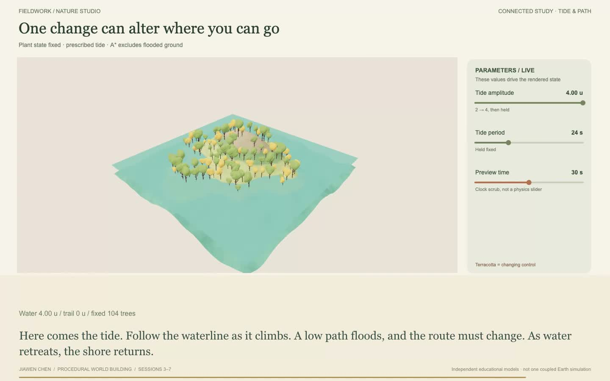

This frame is extracted from the final MP4 at 2:36. It shows the displayed tide parameters and the flooded-route result, rather than a separate concept illustration.
