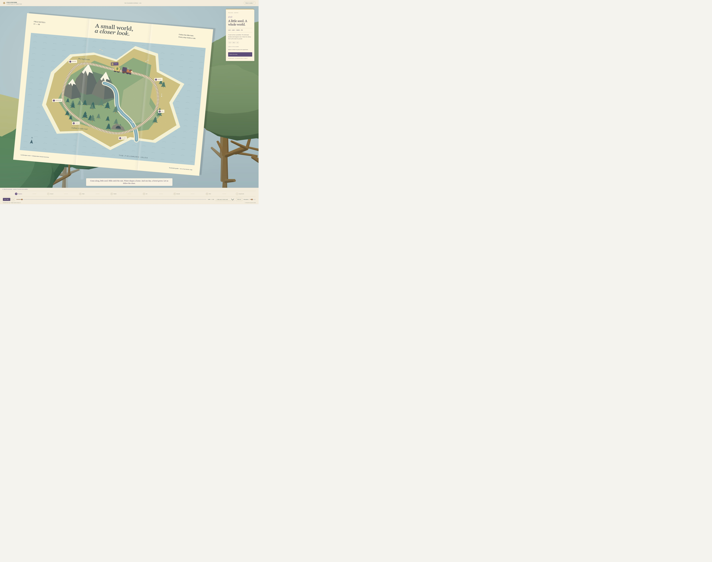
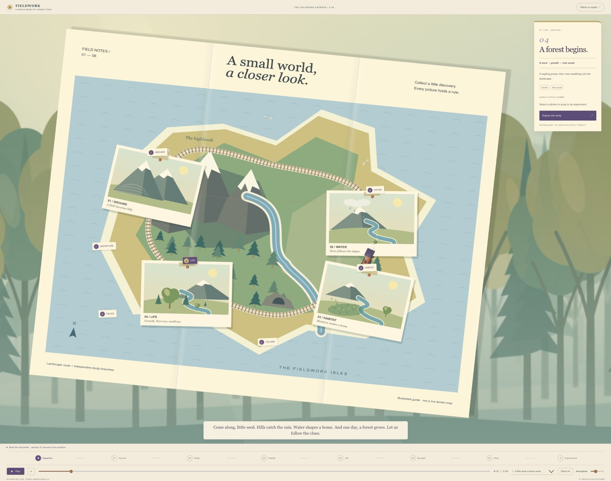
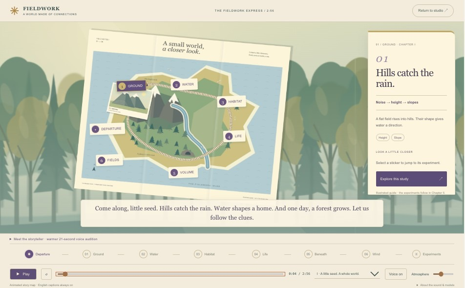
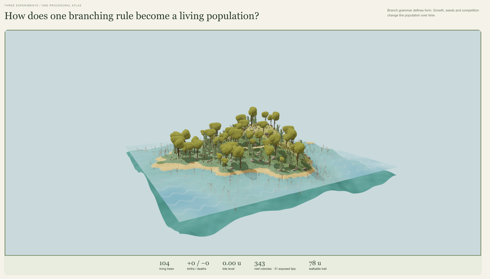
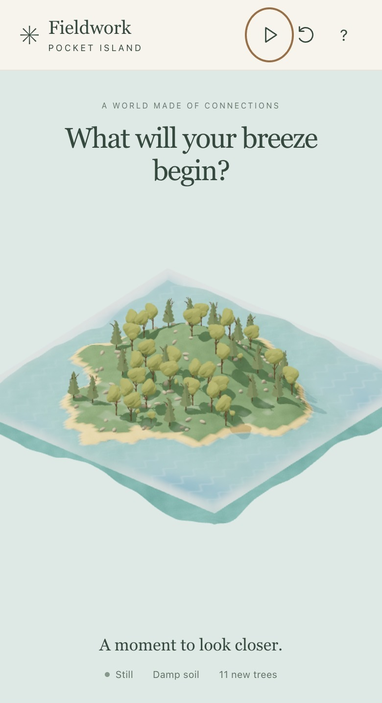

# Progress Log — October 14, 2026

## A quieter woodland and a map that collects discoveries

**Request, translated and paraphrased:** Keep the existing map and layout. Replace the unsettling close-up trees with a softly blurred, stylized forest scrolling slowly to the left. As the narration reaches each idea, pin a related animated picture to the map. Make a focused update; do not push.

The opening now uses three illustrated woodland layers, readable trunks and pine silhouettes, warm light and restrained mist. The scenery scrolls sideways at different speeds. It continues quietly while the story is paused; reduced-motion preferences keep the decorative forest still.

Four original illustrated postcards arrive during the existing fourteen-second opening: **Ground at 3.2 seconds, Water at 5.6, Habitat at 8.0 and Life at 10.0**. Hills rise, rain follows a river, a moist patch becomes a habitat, and a tree grows with new seedlings nearby. Paper borders, tape, pins and connecting threads make the discoveries accumulate on the map. The small train pauses between those ideas. The explanation card changes with the same beats.

The before capture preserves the original browser framing. After captures use a desktop reading viewport; these are visual checkpoints, not matched simulation measurements.

**Development checks:** build and lint passed; all 30 existing tests passed. Browser seeking correctly changed the Ground and Life notes, and playback passed the fourteen-second boundary into the actual noise experiment. The preview console reported no errors during that check. The final station-label and study-link adjustment is included in the final build check.

**Insight:** a moving object can guide attention, but an illustrated change explains the idea. Each postcard now contributes a specific cause-and-effect example. These opening animations are explanatory illustrations; the measured course experiments remain separate and unchanged.

**Scope:** app opening and shared export renderer only. Existing narration, English subtitles, fourteen-second intro and 2:56 timeline are retained. The previously exported v5 MP4 has not been regenerated with this artwork. No commit or push.

**Next trial:** watch the opening once without explanation and identify the sequence from ground to water, habitat and life.

Related: [[18 - A Three-Minute World - Editing for Clarity]].

## Pocket Island — a separate phone world

Request, translated and paraphrased: Let visitors scan a code and influence wind, water and ecology by shaking or tilting a phone, with a minimal interface. The owner explicitly clarified that desktop and mobile must remain independent, and authorized publishing the mobile preview.

[Live mobile site](https://fieldwork-pocket-island.jc3785.chatgpt.site/) · [[19 - A World in Your Hands]]

The mobile build has its own state and entry point. Desktop changes are limited to a QR invitation. A damped wind vector moves seeds, drives delayed surface currents and bends foliage. Rain changes a moisture grid; germination checks height, slope, warmth, moisture and space. Touch buttons and dragging reproduce the interactions without sensor access. Pause and deterministic reset support comparisons.

The image above is the owner’s original desktop reference. The phone screenshot below records a different, independent experience, not a matched before/after ecology trial.

**Checked:** TypeScript, production builds, lint and 37 tests passed. The public HTTPS site loaded successfully. In a 390 × 844 viewport, touch entry, Breeze, Rain and Pause worked; the model reported damp soil and 11 new trees after the interaction. This was a functional check, not a controlled measured comparison. No browser errors were observed during the local action check. Physical iPhone/Android motion permissions and sensors remain unverified.

**Insight:** Gesture feedback should reveal a connection: wind changes where a seed travels, while habitat determines whether it can grow. The water is an educational surface-flow visualization, not a full fluid solver or a tidal model.

**Next experiment:** On a real phone, enable motion, hold it comfortably, tilt gently, then try one small shake. Compare with touch. The main GitHub repository has not been pushed. The independent mobile site was published with permission.

Screenshot note: the phone image is cropped to the rendered scene and observation line; the touch controls sit below this crop.
