# Progress Log — October 20, 2026

## A seed's viewpoint, with a clearer research question

**User request, translated and paraphrased:** Add different viewpoints, including a seed's first-person perspective, and keyboard movement to observe the world and personal growth. Then check whether the seed story and future chapters are actually implemented and aligned with the course. The user could not recall the instructor's exact critique.

**Implemented locally:** Be a seed, Walk the forest and Whole world controls in desktop Living coast. Keyboard movement/looking, explicit pause and exit, real falling and wind drift, habitat-gated settlement, a persistent plant identity within the current run, and a growing camera height. The independent phone experience is unchanged by this desktop feature.

**Why:** Use the viewpoint to make transport, habitat and population rules observable. A story should expose a model's outcomes rather than guarantee a happy ending.

### Before

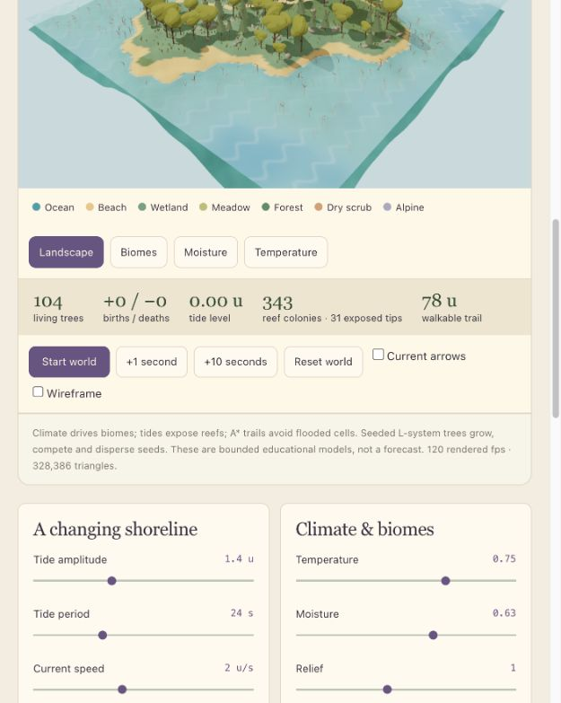

This is a partial, differently sized baseline capture. It is not a matched visual A/B experiment.

### After: airborne and rooted

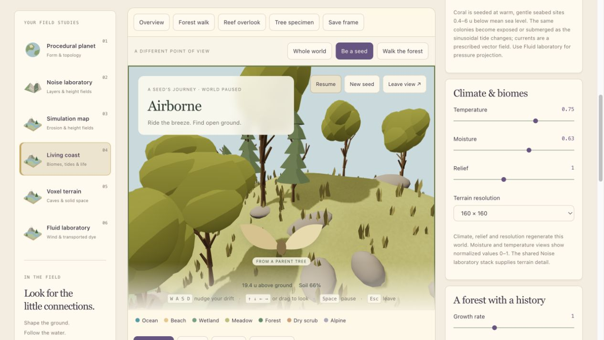

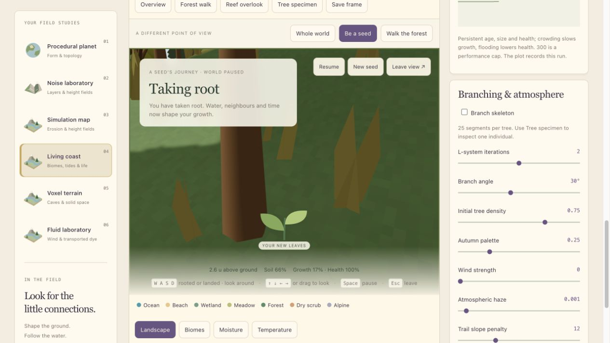

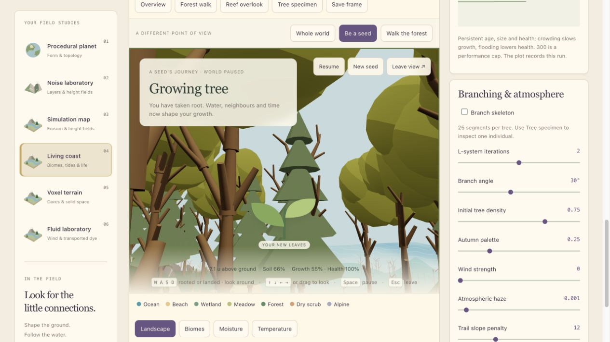

**Observed in the separate test tab:** With reproduction at zero and calm wind, the population changed from 104 to 105 after the tracked seed rooted. At 30 seconds its normalized size read 17% and eye height 2.6 units. At 50 seconds it read 55% and 7.1 units, with 100% health and the same population count. The later view turns and tilts to look through the forest; the camera angle is not held fixed between these screenshots.

A separate default-wind trial ended at the water with no birth. That is a different duration and starting run, not a controlled comparative result. The landing explanation remained visible.

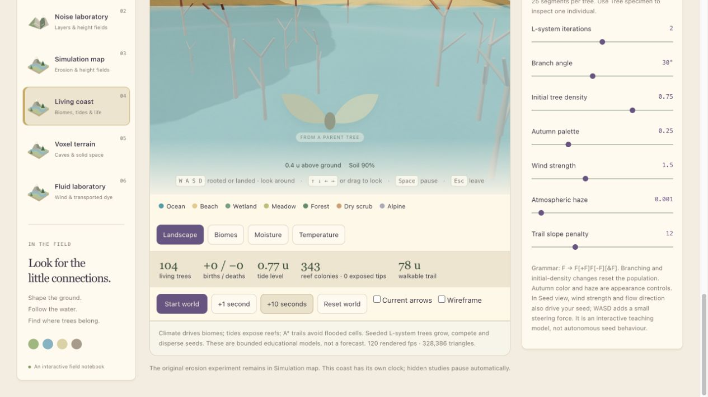

### Keyboard exploration

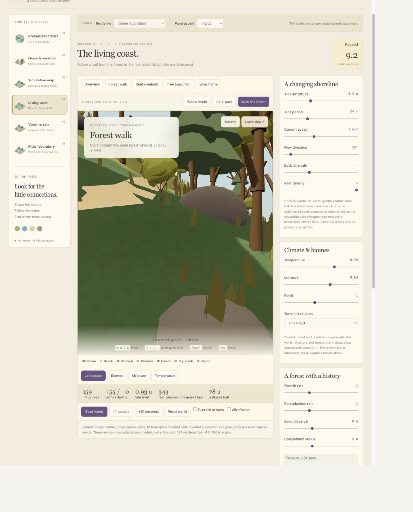

WASD changes camera-relative movement. Arrows or drag look around; Shift speeds up walking. Escape returns to orbit. Walking is an observer tool; airborne steering is an intentional visitor intervention, not autonomous seed behavior. Trees and stones do not yet block the observer.

### Checks

- Production build passed; all 45 automated tests passed, including five journey tests for motion, settlement, failure conditions, population identity and terrain-aware traversal.
- Lint completed with one existing warning in PocketIsland.tsx about reading a ref during initialization. The new desktop files have no lint warning.
- Browser checks verified walking displacement, turning, Escape, pause, water failure, rooting and continued growth. The test tab's captured error log was empty.
- Screenshots are actual browser captures. Their JPEG file signatures were checked and extensions corrected.
- Documentation was written directly in Obsidian. No GitHub push or new public deployment was performed.

### Course alignment correction

The current implementation is partial. Evolutionary solvers, an autonomous bird with schedules, procedural culture, LOD/streaming and saved ecology across reloads remain future work. Instancing and population caps already exist but do not complete the optimization coursework.

The mobile model has simplified downhill moisture transfer and neighbour competition. Neither current ecology computes explicit light interception or a plant water-uptake budget. The latest mobile tracked-seed revision exists locally; it has not been verified as the public deployed version. Desktop and phone remain independent models.

No reliable reconstruction of the teacher's comment is possible. The source-based recommendation is to make **parameter → procedure → visible result** the centre of the presentation, while retaining the warm visual style.

**Next experiment:** Hold the initial world and duration fixed, disable background reproduction, and compare two wind directions without keyboard steering. Record landing position and success/failure. Follow with fixed-location moisture and fixed-population competition trials. These comparisons are planned, not yet completed as a set.

[Full tutorial, model boundaries and course audit](20%20-%20A%20Seed%20Finds%20a%20Home.md).

## From story to testable rules

User request, translated and paraphrased: Keep the existing visual style, make parameter comparisons easy to demonstrate, fix the seed journey, and reveal the rules behind the world. Work locally for review.

### What changed

- Added a desktop comparison page: Rain, Wind and Forest, plus terrain frequency, grid resolution, shader threshold, biomes, cave radius, branch angle, growth and crowding. Each has repeatable starting conditions, matched cameras, a shared parameter or time slider, reset and a rule explanation.
- A dry seed now waits at its landing position. Suitable conditions must persist for two model seconds before it joins the population. A submerged land-tree seed cannot germinate.
- Changing Living coast moisture or temperature now preserves the current seed, population and clock. These are climate inputs, not rainfall simulation.
- Rooted seeds continue growing. Real offspring keep their parent identity. Flooded adult trees lose health and stop growing and reproducing.
- Show rules exposes the germination habitat map and the tracked seed's thresholds. Root spacing is checked at the seed location; the map does not claim to include all crowding constraints.

### Before

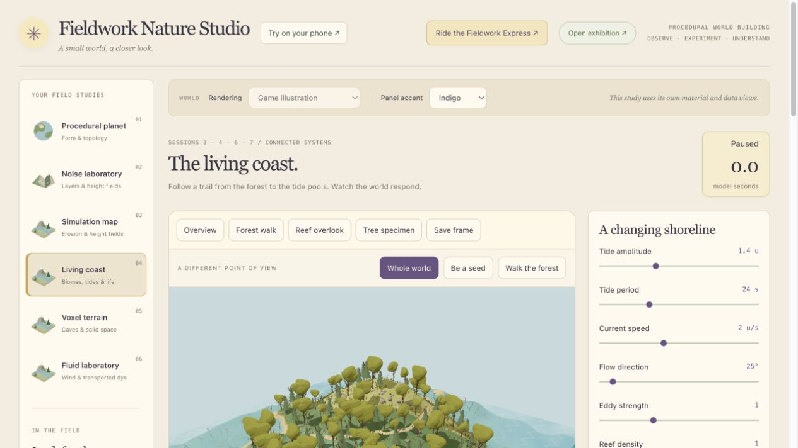

### Controlled comparisons

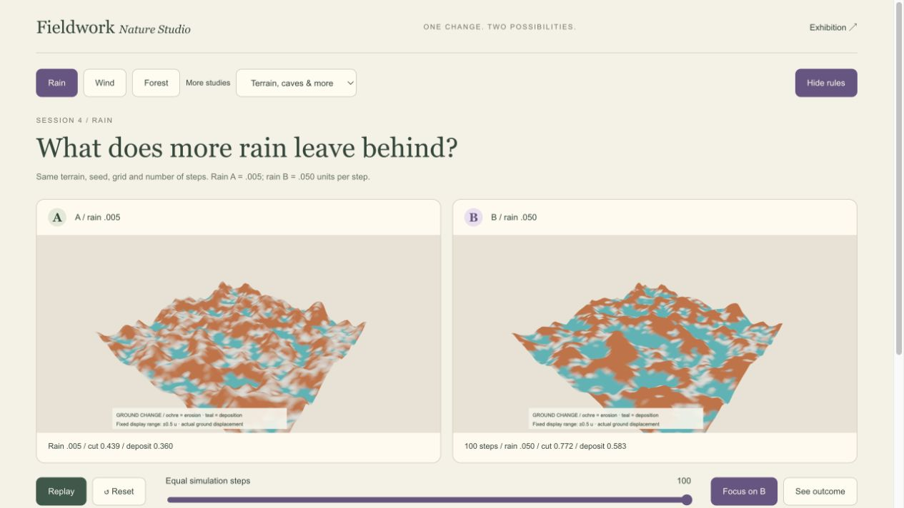

At 100 steps, mean cut / deposition were 0.439 / 0.360 for rain .005, and 0.772 / 0.583 for rain .050. Both views use a fixed ground-change color scale.

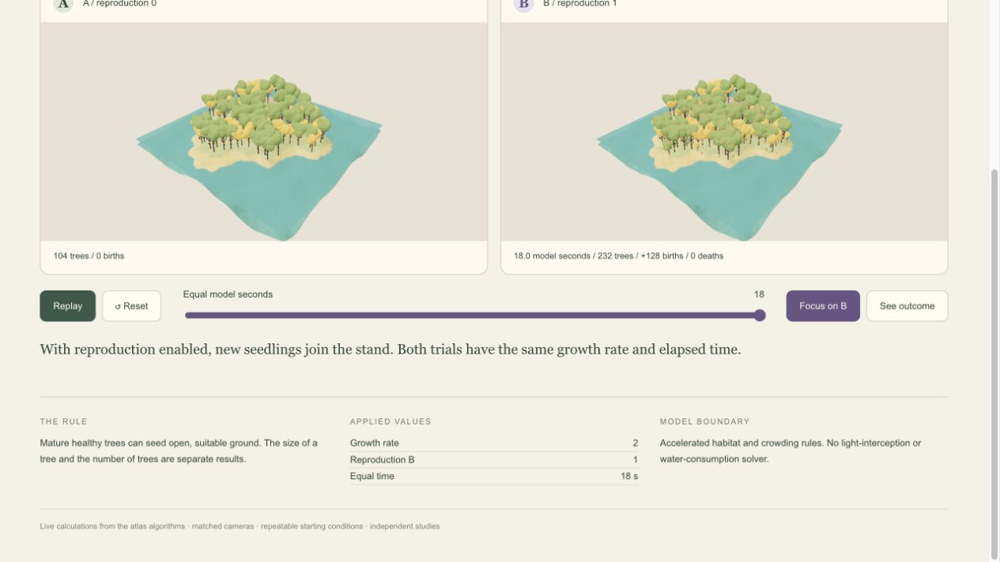

At 18 model seconds, reproduction off retained 104 trees. Reproduction on produced 232 trees and 128 births. The two trials shared their initial population and growth rate.

### The same seed waits, then grows

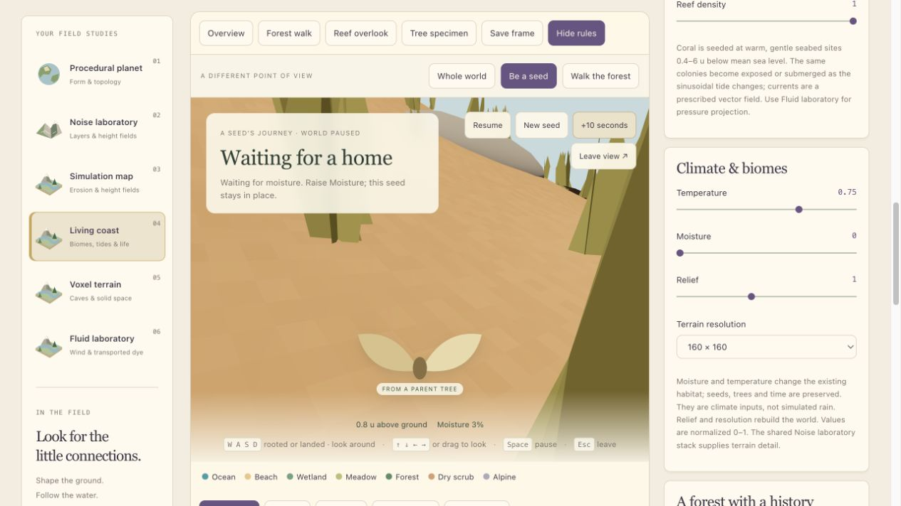

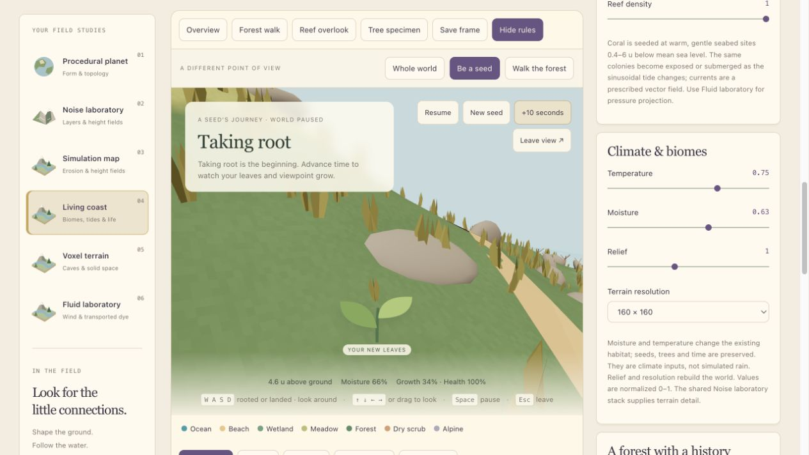

In the isolated browser test, wind, tide and reproduction were zero. At 37.6 model seconds, the seed waited in 3% local moisture. Changing the climate Moisture control from 0 to .63 left the clock and seed in place; local moisture became 66%. After advancing 10 seconds, the seed was rooted, at 34% normalized size and 100% health. The population changed from 27 to 28, with one birth. The preceding drought had killed 77 initial trees; this was a live ecological consequence, not a reset. The waiting and growing screenshots keep the same look direction, but eye height rises with the tree. They show a sequence, not an equal-time A/B comparison.

### Checks and boundaries

The full 51-test suite passed. Browser checks exercised all eleven comparison outcomes, and verified the same-seed dry-to-wet transition. No errors were captured in the isolated comparison test tab. Production build passed. Lint retains one existing PocketIsland ref warning. The phone experience remains independent; no phone files were changed.

These are independent study domains. The erosion solver is not connected to the Living coast moisture field. Seed waiting has no viability-expiry model yet. No new video, deployment, commit or push was made.

**Next experiment:** At one fixed landing position, vary moisture just below and above .24 while holding temperature, sea level and neighbors fixed. Observe the two-second germination delay and whether a temporary dry interval restarts it.

See [[21 - One Change, Two Possibilities]] for the presentation sequence.
