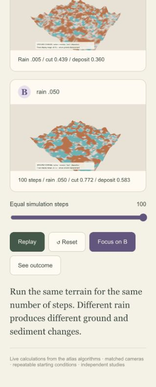

# October 21 — Publishing the midterm checkpoint

## Request

Translated request: Submit the latest version, including the updated GitHub repository and website demo.

## What is available

- [Desktop experiments](https://fieldwork-procedural-atlas.jc3785.chatgpt.site/?experiments=1): eleven matched comparisons, with Rain, Wind and Forest as a short presentation route.
- [Desktop studio](https://fieldwork-procedural-atlas.jc3785.chatgpt.site/?workspace=living&spin=0): terrain, climate, coast, vegetation and seed viewpoints.
- [Exhibition](https://fieldwork-procedural-atlas.jc3785.chatgpt.site/?exhibition=1): resettable demonstrations.
- [Pocket Island](https://fieldwork-pocket-island.jc3785.chatgpt.site/) remains an independent mobile experience. No phone-to-desktop control or state synchronization was added.

The desktop production version was published successfully. This checkpoint includes the earlier narration, films, progress images, seed lifecycle and controlled-study work. It does not add disaster simulations.

## Verification

- Production build passed before publication.
- The earlier full simulation suite passed 51 tests; the focused seed/comparison checks passed 11 tests. No application source changed during publication.
- The public Rain comparison loaded successfully. At 100 equal steps, the displayed results were A: cut 0.439, deposit 0.360; B: cut 0.772, deposit 0.583. These match the locally recorded comparison.
- This screenshot records the public page at the browser panel's narrow viewport; the October 20 log contains the full desktop comparison images.

## What the results mean

Matched initial conditions make the parameter change easier to explain. More rain changes the modeled erosion and sediment values. The numbers are simulation units, not a calibrated landscape forecast.

The studies remain separate experiments. The globe is not a planet-scale coupled simulation, and the coast's prescribed tides are not a tsunami solver. L-system geometry, individual growth and population change are distinct mechanisms.

## Next experiment — proposed, not implemented

Ask: **Can two forests lose the same number of trees and recover differently?** Start with the same forest and remove 20 trees in one cluster in A, but 20 scattered trees in B. Keep growth, reproduction, seed dispersal and competition settings equal. Observe surviving seed sources, new seedlings, spatial gaps and recovery over equal model time. Do not promise a particular outcome before running it.

This keeps the story connected to Session 7: branch rules describe tree form; growth and distribution describe the population. Flooding and wind damage can become later, explicitly modeled disturbances. A visual disaster effect alone does not demonstrate ecosystem recovery.

## Submission scope

The submission text contains Jiawen Chen's full name, the canonical GitHub repository and the published desktop experiment link. Canvas submission confirmation is recorded separately from this public project log.
