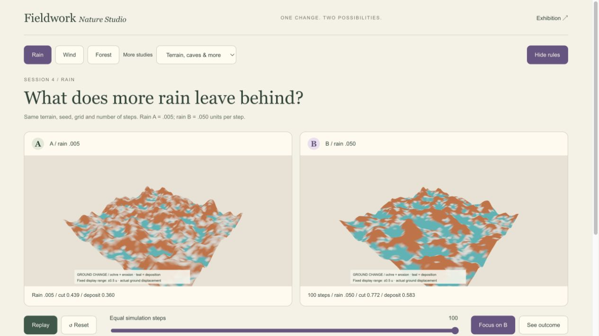
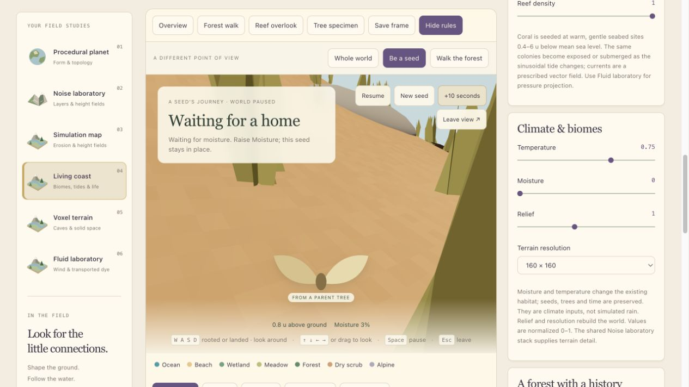
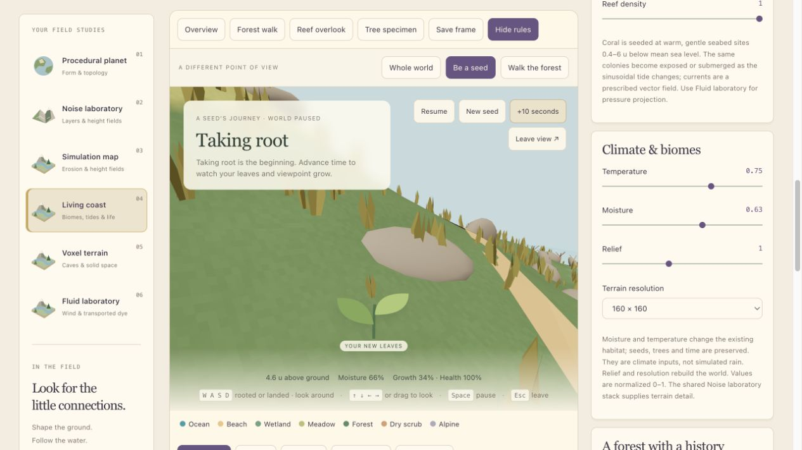

# One Change, Two Possibilities

October 20, 2026 · Desktop local preview

The question is simple: what happens when one condition changes and everything else stays fixed? The story comes from the result, including waiting or failure.

## Start with evidence

Open [Compare experiments](http://127.0.0.1:5173/?experiments=1). The header links to this page from the research studio and exhibition.

1. Choose **Rain**, **Wind** or **Forest**.
2. Click **Reset** to return to the starting conditions.
3. Drag the slider, or click **Run comparison**. Both trials use the same model time or step count.
4. Click **See outcome** to inspect the endpoint without waiting.
5. Open **Show rules** to see the applied values and the model boundary.

The Rain, Wind and Forest slider advances both trials equally; it does not change the difference between them. The rainfall, direction or reproduction contrast is fixed and stated above the images. In the additional studies, the slider changes the named parameter in B while A remains the reference.

## A short presentation sequence

**Rain — Session 4.** Ask: “What does more rain leave behind?” Show the two identical fields at zero steps, then advance to 100. Point to the measured erosion and deposition. The colors use the same scale; they are not separate decorative palettes.

**Wind — Session 6.** Ask: “Can two paths differ even when their speed is the same?” At eight seconds both groups have traveled 32 units, but in perpendicular directions. The arrows specify a uniform velocity field. These are tracers, not germinating seeds or a complete weather solver.

**Forest — Session 7.** Ask: “Is a larger forest the same as larger trees?” At 18 seconds, reproduction off leaves 104 trees; reproduction on produces 232. Use **More studies → Growth** to show a different comparison: the same 104 trees change size with reproduction off.

**Optional detail.** More studies also includes terrain frequency, resolution, snow-material threshold, biome classification, cave subtraction, branch angle and crowding. Use the corresponding research tab for free exploration, CSG order, chunking or fluid pressure experiments.

## Continue as the same seed

In [Living coast](http://127.0.0.1:5173/?workspace=living&spin=0), choose **Be a seed**. WASD adds an explicit steering intervention while airborne. Arrows or dragging change the look direction. Space pauses the world; Escape returns to the overview.

A landing is now the beginning of a state sequence:

**Airborne → waiting for conditions → germinating → rooted → growing → possible offspring.**

- Deep water prevents this land-tree seed from establishing. It cannot be revived by later raising moisture.
- Dry or cold ground can wait. Moisture and Temperature now change the existing habitat without regenerating the forest or restarting time.
- Two uninterrupted suitable model seconds are required before germination. Unsuitable conditions restart that delay.
- Once rooted, the seed becomes one actual population member. The camera and the leaf cue rise with its size.
- Its offspring receive a real parent ID. A new generation is shown only when offspring exist.
- Adult flooding stops growth and reproduction while health declines. Mortality is not instantaneous.

These screenshots show a sequence, not a controlled equal-time comparison. The development trial used zero wind, tide and background reproduction. Moisture was raised from 0 to .63 after the dry landing; the same seed then became the only new birth. The drought also killed some existing trees. That consequence is part of this model, not an automatic reset.

## Read the rules

**Show rules** in the overview opens the germination map: green is eligible habitat, teal is water, ochre is dry, violet is cold, and gray is shore or steep ground. The tracked seed panel checks local height, slope, moisture, temperature, nearest root and population capacity.

The establishment thresholds are 1.3 units above sea, slope at most .85, moisture at least .24, temperature above .15, and 2.5 units from another root. The population cap is 300. These are educational model choices, not universal botanical constants. Adult survival uses different thresholds.

The habitat map does not include root spacing; that is checked at the seed itself. Passing the habitat colors therefore does not guarantee germination.

## What this does not claim

The erosion grid and Living coast remain separate experiments. Changing desktop Moisture is a climate intervention, not simulated rain or a conserved soil-water budget. The current seed can wait indefinitely; seed viability and expiry are not modeled. Tree structure scales with age rather than growing new grammar branches. There is no genetic evolution or autonomous animal in this update. The phone world remains independent.

A useful closing line: **“I use interaction to expose the rules: hold the initial conditions fixed, change one variable, and explain both the result and the limit of the model.”**

See [the progress log](2026-10-20%20-%20Progress%20Log.md) for actual checks and observations.
