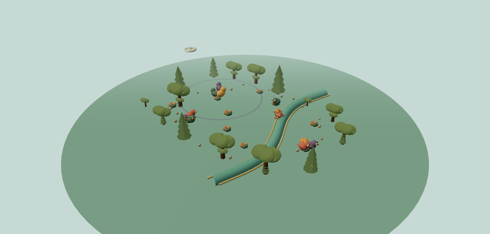
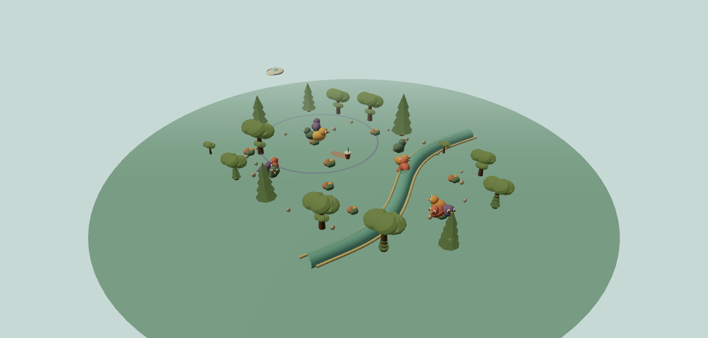

# Session 8 — Agents, Flocking and Ecosystems

## What this study explores

Session 8 asks how a small set of rules can make an agent act, and how many agents can create a larger pattern without following a single scripted path. This desktop study adds a separate Agents workspace to the living island. A bird has an energy need, a limited view, a current behavior state and neighbors it can react to. Visitors, plants and water change the conditions around it.

Open the local preview with `cd app && npm run dev`, then visit `http://127.0.0.1:5173/?agents=1`. The Agents workspace is a separate desktop tab. Pocket Island keeps its own mobile simulation.

The bubble tea spill is an experiment trigger, not a claim that wildlife should eat it. It lets us test how an unusual visible resource changes attention, movement and environmental measurements. The simulation deliberately does not assume that a bird dies after one peck. BirdLife Australia's guidance says dairy products are unsuitable for wild birds, but the model does not estimate a dose or predict an individual bird's medical outcome. See [BirdLife Australia: feeding wild birds](https://birdlife.org.au/a-guide-to-feeding-wild-birds-in-australia/).

## Session 8 concepts in the simulation

- **Agent:** each bird stores its own position, velocity, energy, state, seed cargo and short explanation of its current decision.
- **Perception:** the vision-radius control sets which nearby birds and resources an agent can sense. It does not give the bird a map-wide view.
- **Needs and a finite-state machine:** energy, food and a nearby visitor select between flocking, foraging, inspecting, resting and evading. An urgent need can interrupt the ordinary flock behavior.
- **Flocking:** separation reduces crowding, alignment follows nearby headings, and cohesion draws a bird toward neighbors it can see. The flock-response slider scales these steering forces.
- **Schedules:** a visitor arrives, pauses to drink, drops a cup, then leaves. The arrival-rate control schedules a finite pool of twelve visitors; the invite button adds one immediately.
- **Ecological feedback:** birds eat berries and can carry a seed to another patch. A seedling appears only when the seed reaches open island ground. Plants beside the creek respond to the model's water-quality value.

The deck also discusses stigmergy, crowds, behavior trees and richer perception systems. This build does **not** implement ant pheromone trails, crowd avoidance, behavior trees, hearing or line-of-sight occlusion. Those remain possible next experiments; this tab focuses on individual needs, local perception, flocking and cross-species/environment feedback.

## A simple rule chain

`Agent needs + what it can sense → state choice → movement → resource use or seed transport → habitat changes → new conditions for agents`

The creek has a second visible chain:

`Spilled residue on land + rain → runoff into creek → organic load → lower water clarity and oxygen index → shoreline plant response`

USGS describes biochemical oxygen demand as oxygen used by microorganisms while breaking down organic matter. The creek values here are normalized teaching indicators, not measured concentrations or a predictive water-quality model. Sunlight dries surface water; it does not remove a dropped cup or instantly erase the residue. Cleanup removes cups and most land residue, while the creek retains its load and recovers gradually. See [USGS: Biochemical Oxygen Demand](https://www.usgs.gov/water-science-school/science/biochemical-oxygen-demand-bod-and-water).

## Parameters to change

| Control | What the simulation changes | What to watch |
|---|---|---|
| Visitor arrival | Scheduled alien arrivals, up to a finite pool of 12 | Cups and spill sites increase over time |
| Vision radius, 3–16 m | The neighborhood an individual can perceive | Which birds notice food, visitors or flockmates |
| Flock response, 0–1.5 | Strength of separation, alignment and cohesion | Spacing and how tightly a flock turns together |
| Rain intensity, 0–100% | Rate at which surface residue moves into the creek | Land load falls as creek load rises |
| Tip a boba tea | Adds one cup, seven visible pearls and 1.2 normalized land-residue units | Agent attention and the persistent cup |
| Invite visitor | Adds one arriving visitor to the bounded pool | The visitor's arrival → sip → leave states |
| Clean the shore | Removes cups and 88% of land residue | Creek load remains; recovery is not instant |
| Camera view | Island overview, bird-follow or creek view | How the same process reads at different scales |

The unit label is illustrative: one map unit is drawn as one metre. The 3D landscape is a designed teaching island, not a surveyed site. Simulation time is accelerated and the water indicators are dimensionless.

## Progress captures

**Baseline island:** birds, shrubs, creek, and the local perception field.

**After one spill and rain:** the inspector showed 0.48 normalized units remaining on land and 0.60 in the creek; the displayed oxygen index was 94% and clarity was 88%. These readings are a captured run, not real-world water measurements.

## Step-by-step experiments

### 1. Establish a baseline

1. Press **Reset island** and wait five seconds for the starting flock to settle.
2. Note the bird count, how many agents are flocking or resting, the shrub count and the water indicators.
3. Click a bird, then choose **Follow bird**. Read its state and reason. Observe that a bird can only report neighbors inside its current vision radius.

### 2. Change perception only

1. Leave flock response at `0.72` and pause the simulation.
2. Set vision to `3 m`; note the selected bird's neighbor count and decision explanation.
3. Set vision to `16 m`; resume and watch which neighbors or resources become available to it.
4. Reset, keep vision fixed at `8 m`, and compare flock response `0.1` with `1.4`.

Record what you expected first, then what the island actually did. Do not change both controls in one comparison.

### 3. Test an unusual food-like cue

1. Reset, pause, and press **Tip a boba tea** once.
2. Watch nearby birds in the overview, then click an agent. Does its state or reason change as the spill enters its view?
3. Add two more cups and compare the number of agents inspecting the spill. Pearls are attention cues in this model; they are not treated as nutritionally safe food.

### 4. Trace pollution rather than just color

1. Reset; tip three cups in the meadow.
2. Set rain to `0%` and record land residue and creek load.
3. Set rain to `80%`, switch to **Creek view**, and record both values again after 15–20 seconds.
4. Press **Clean the shore**. Check the cup count, land residue and creek load separately.
5. Pause rain and let the creek run. Observe the gradual recovery rather than expecting the cleanup button or sunshine to erase water pollution instantly.

### 5. Follow a seed between agents and habitat

1. Reset and let birds forage in the shrub patches. Select a bird whose inspector reports a carried seed.
2. Use **Follow bird** and watch the seed cargo change as it moves away from fruit.
3. Let the simulation run long enough for a dropped seed to test the open-ground condition. Compare shrub and seedling counts. A bird carrying a seed is not yet a successful plant birth.

## Learning record — fill this in after trying it

- **My prediction:**
- **The one parameter I changed:**
- **What I observed in the agent inspector:**
- **What changed in the world-connection panel:**
- **What surprised me or did not change:**
- **A follow-up test that would isolate the cause:**

The interface and rules are implemented. The observations above are proposed experiments; add your own results after trying them. Do not report a result as personally tested until you have watched it in the app.

## Reflection

The central insight is that the agent does not need to understand the whole island. It follows its needs and responds to a limited neighborhood. A flock is the pattern produced by these local responses. Seed movement then links animal behavior to plant distribution, while rain links a spill on land to creek conditions. The inspector and connection panel make those hidden rules visible enough to compare.

## References

- [Class 08 lecture deck — Agents](https://www.figma.com/deck/ZXPEZJjOz4JqAmhYm8KHW5/PWB---Class-08)
- [Craig Reynolds — Boids](https://www.red3d.com/cwr/boids/)
- [USGS — Biochemical Oxygen Demand](https://www.usgs.gov/water-science-school/science/biochemical-oxygen-demand-bod-and-water)
- [BirdLife Australia — Feeding wild birds](https://birdlife.org.au/a-guide-to-feeding-wild-birds-in-australia/)
