## 026 — One change, two possibilities

**2026-10-20 · Desktop local review.** Eleven controlled comparisons now expose fixed conditions, applied values and model boundaries. Living coast adds a germination map and local seed checks. A dry seed waits; climate edits keep its identity and clock; rooting leads to continued growth and possible offspring.

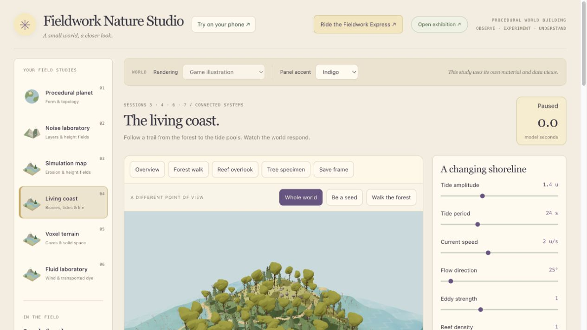

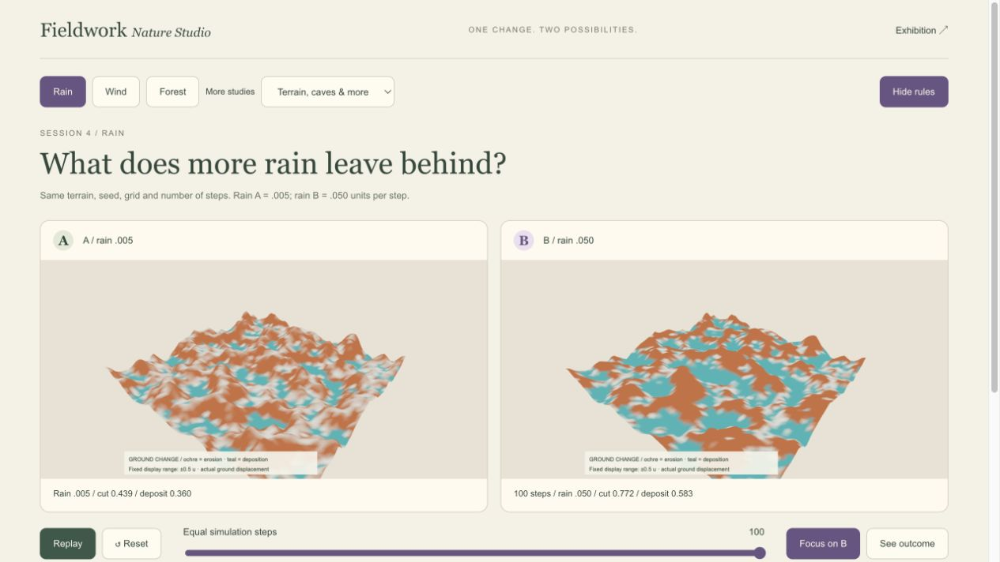

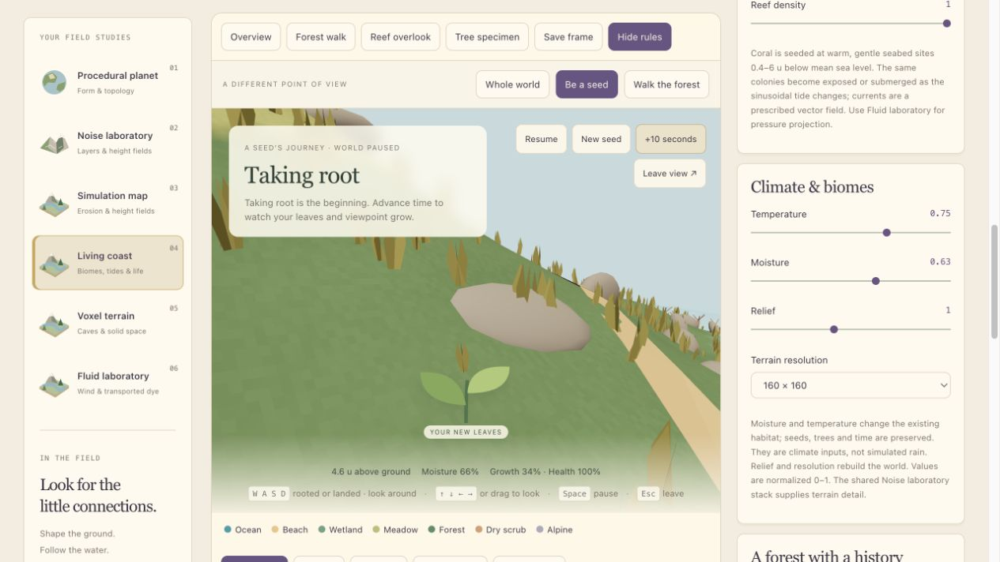

The overview baseline and seed close-up use different cameras. Only the two panels within the rainfall image are a matched A/B comparison. Full tests: 51 passed. Build passed; lint has one existing PocketIsland warning. Actual browser outcomes and the drought-to-germination sequence are recorded in [[2026-10-20 - Progress Log]]. See [[21 - One Change, Two Possibilities]] for presentation steps. Phone unchanged; no push or deployment.

## 023 — A woodland backdrop and collected discoveries

**2026-10-14 · Local review.** The opening keeps its paper island and now frames it with softly blurred, left-scrolling 2D woodland. Four animated postcards arrive with the narration: ground rises, rain follows the slopes, moisture creates habitat, and a seed becomes a forest. Pins and threads connect the pictures to their locations.

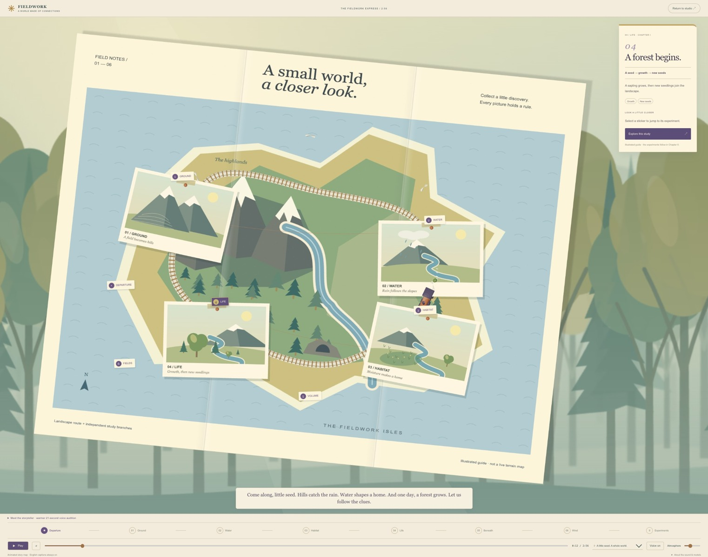

These are explanatory illustrations, not screenshots of the simulations. The introduction remains 14 seconds and the complete journey remains 2:56. The existing MP4 has not been regenerated. Build, lint and all 30 simulation tests passed; playback, seeking and the transition into experiments were checked. No push. See [[2026-10-14 - Progress Log]] for the before/after images and learning notes.

# Visual Changelog

Every visual change to Planet Studio gets an entry here: a before/after pair, what changed, and why. Newest entries on top. Design direction lives in [STYLE-GUIDE](../../STYLE-GUIDE.md); this file is the evidence that we're actually moving toward it.

## 022 — A short journey through passing woodland

**2026-10-13 · Local review.** The default journey is 2:56 with a 14-second introduction, superseding the 8:19 edit. A concise seed story, continuous roadside parallax using the preferred layered crowns, rewritten warm synthetic narration, English captions and actual parameter comparisons lead to the rotating planet.

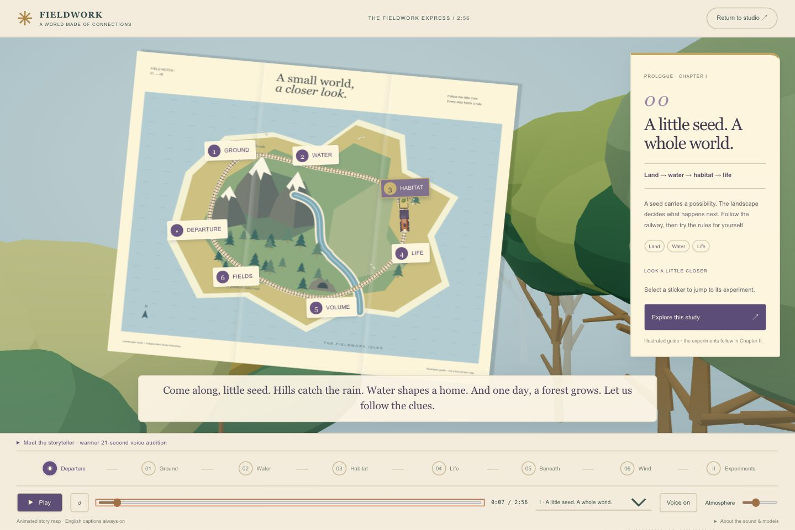

The earlier framing is preserved in screenshot 47; screenshots 49 and 50 record the new scenery at two points in time. This is a presentation change, not a change to the underlying world models. Build, lint and 30 tests passed. Owner review remains pending; no push.

[Film and editing insights](18%20-%20A%20Three-Minute%20World%20-%20Editing%20for%20Clarity.md).

## 021 — Close woodland, complete evidence and a review film / October 13, 2026

**Owner requests, translated:** Keep the earlier large tree background, finish screenshots and checks, make the video, and soften the frightening grandfather audition. No push.

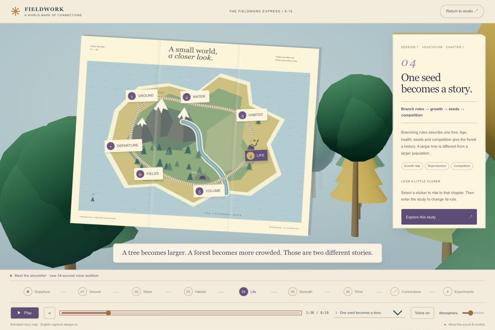

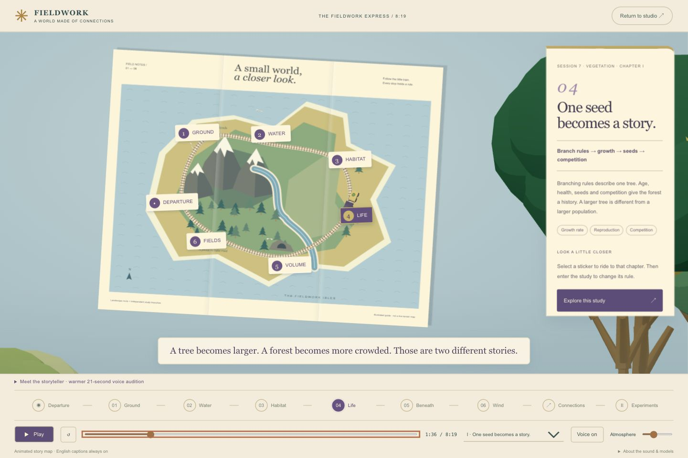

Both show the Life stop at 1:36. The later view changes tree framing and lighting; the map and procedural-study rules remain separate. The mobile card now uses a continuous vertical flow, with its study button fully visible. All 29 chapter entries, keyboard navigation, pause, reduced motion, story-to-study transition and final stop were checked. These are targeted checks, not a full exhibition screening.

The 8:19 [local film](../exhibition/fieldwork-express-v4-review.mp4) includes the story, measured experiments, captions, quiet music and nature ambience. It retains the complete Daniel narration. A warmer 21-second audition replaces the rejected sample in the app; approval of the new voice is pending. See [[17 - The Fieldwork Express - A Narrated Journey]] for screenshots and verification limits.

## 020 — A sticker map in passing woodland / October 13, 2026

The new direction keeps the island as a flat paper illustration, with a dimensional seed train and larger 3D trees passing behind the sheet. Clickable station stickers lead to narrated chapters. Pausing holds the scenery and voice together.

A desktop interaction and visual spot check passed, followed by build, lint and 28 tests. The browser interruption initially left the after screenshot and mobile/keyboard checks pending. Entry 021 below resolves those items; images under entry 019 remain earlier raised-map checkpoints.

The 34-second elderly narrator audition remains available. The complete track still uses the previous voice. Local preview only; no commit or push.

See [[17 - The Fieldwork Express - A Narrated Journey]] for the layer choices and verification boundaries.

## 019 — Folded paper map and storyteller audition / October 13, 2026

**Owner request, translated and paraphrased:** Keep the earlier map illustration, preserve depth, and hear a short gentle elderly storyteller before replacing the whole voice.

The cream folded sheet, blue wave marks, irregular coast, indigo numbered stops and separate note card return. Raised mountains, firs and the train retain depth. The before frame is paused at 0:00 and the after frame at 0:28. Composition and camera also differ; these are interface checkpoints, not a controlled terrain trial.

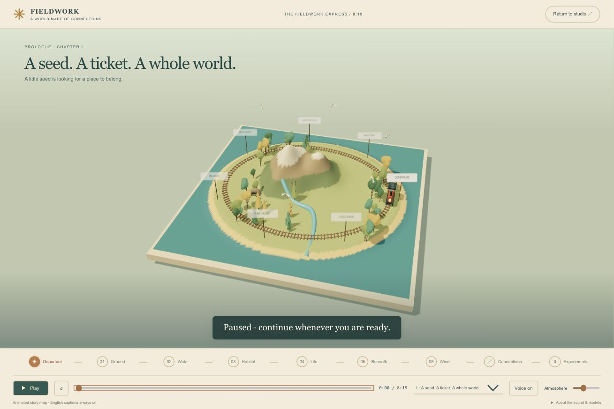

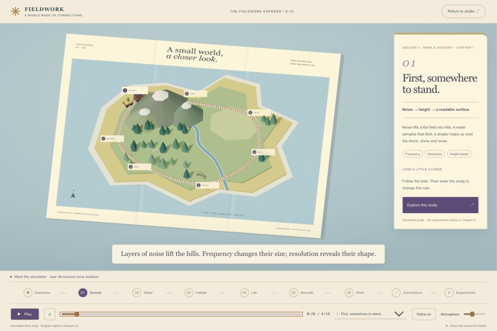

A new 34.08-second AI-generated elderly narrator audition is available in the app. The full narration still uses the previous voice; owner listening review is pending. Build, lint and 28 tests passed, with browser audio and responsive checks. Local preview only.

See [[17 - The Fieldwork Express - A Narrated Journey]] for the script, listening link, limits and next experiment.

## 018 — The Fieldwork Express / October 13, 2026

**Request, translated and paraphrased:** Turn the map into a narrated train story that continues into the detailed experiments.

Before: the visitor selected a static marker. After: a seed rides a small train through an animated map, then the player continues into real studies with changing parameter meters, A/B views and English narration/captions. Warm parchment, muted turquoise, eucalyptus and terracotta connect the story and the studio.

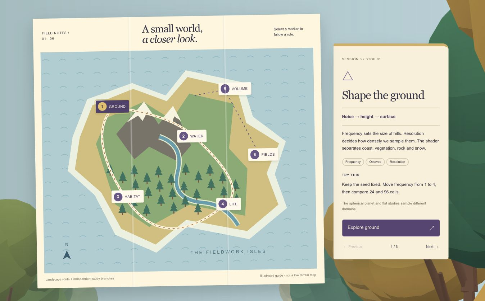

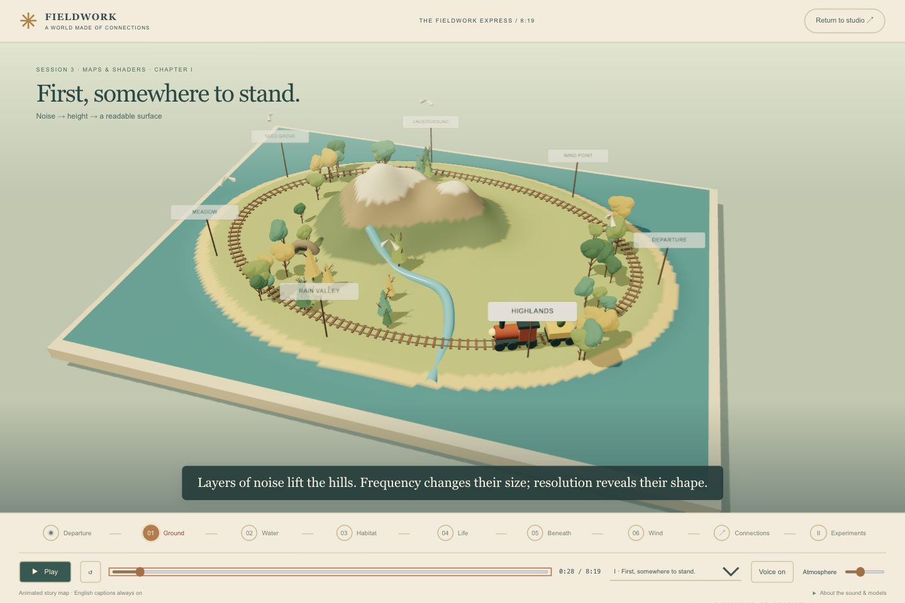

These are interface checkpoints with different framing, not a controlled terrain comparison. Build/lint and 28 tests passed; browser checks covered playback, seeking, transition and studio handoff. The local male narrator is a synthetic preview; the requested expressive elderly voice is still a future quality pass. Existing MP4s remain unchanged. No push.

Details: [[17 - The Fieldwork Express - A Narrated Journey]].

## How to add an entry

1. **Before** — capture a screenshot *before* touching the code (or reuse the previous entry's "after").
2. Make the change.
3. **After** — capture again with the same size and camera angle so the diff is honest.
4. Drop both into `images/ui-style/` with descriptive names, add an entry below.

Repeatable capture command (dev server must be running):

```bash
"/Applications/Google Chrome.app/Contents/MacOS/Google Chrome" --headless=new --disable-gpu --enable-unsafe-swiftshader --screenshot="$HOME/Documents/GitHub/Procedural-World-Building/docs/tutorials/images/ui-style/NAME.png" --window-size=1456,827 --hide-scrollbars --virtual-time-budget=20000 http://localhost:5173
```

---

## 016 — Full course experiments and a planetary closing shot · 2026-10-13

**Request, translated:** fill the missing controlled experiments and course topics; finish with a rotating planet and flowing parameters.

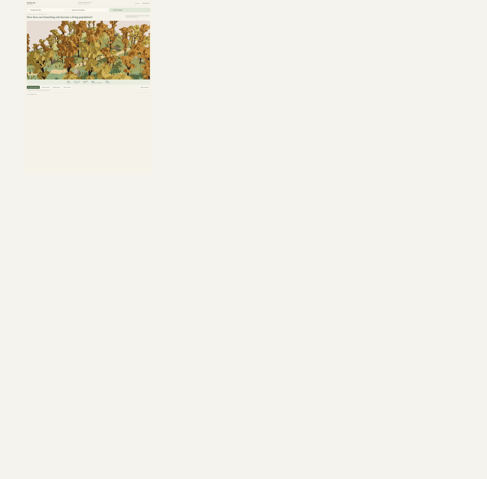
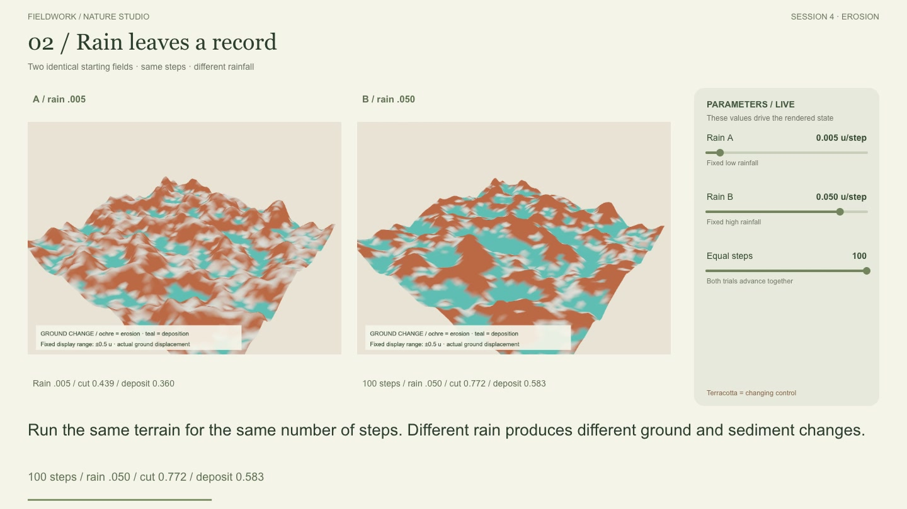
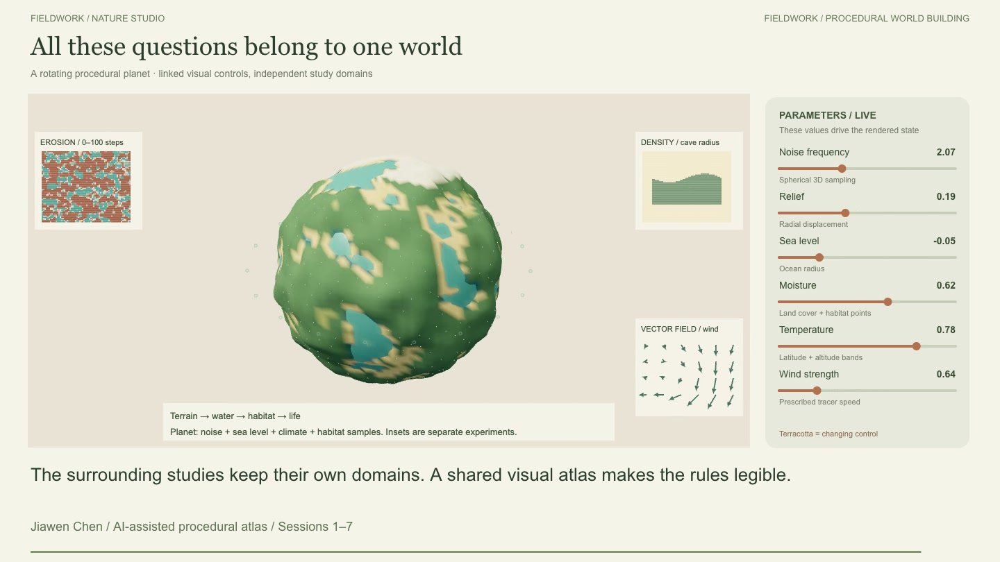

Revision 3 expands the film to 5:28 with 21 chapters, actual parameter values, matched comparisons, model measurements, camera orbits and a continuous 32-second globe ending. These screenshots compare presentation formats; each A/B study controls its own conditions. The globe uses shared seeded noise, radial ocean level, climate coloring and habitat points. Erosion, density and vector-field insets are labeled independent studies.

[Experiment tutorial and results](15%20-%20Controlled%20Experiments%20and%20the%20Planet%20Finale.md) · [Films](../exhibition/README.md). English documentation and local preview; owner review precedes publishing.

---

## 015 — Visible parameters and matched comparisons · 2026-10-13

**Request, translated:** show how the sliders change the world, rotate each step, and synchronize explanations with visible outcomes.

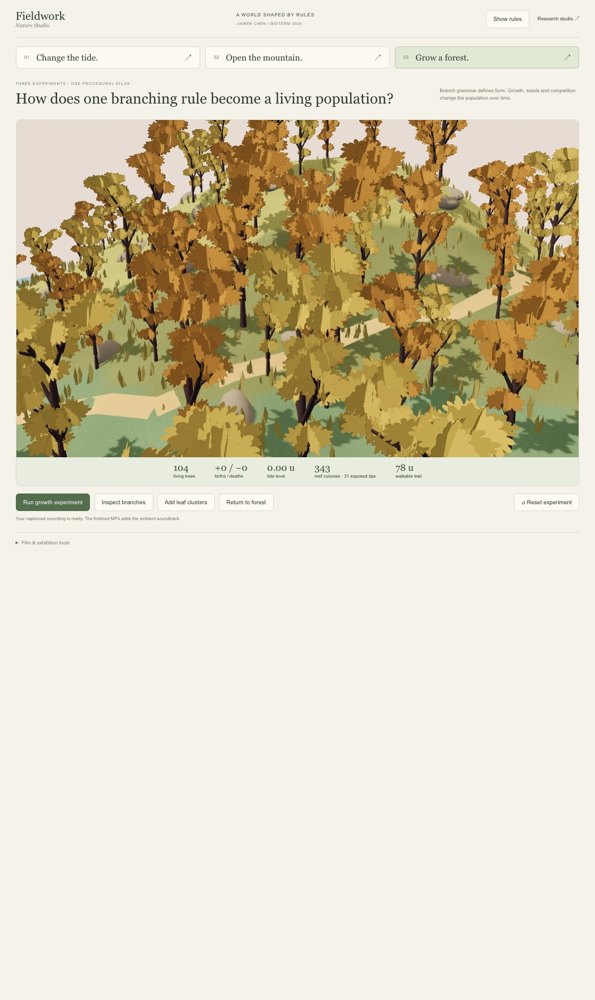
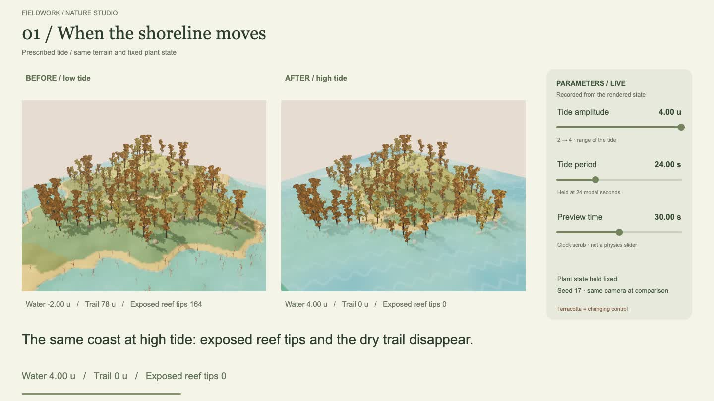

The comparison film adds animated parameter readouts, camera orbits, same-camera before/after frames and state-driven captions. These images compare presentation formats; the controlled state comparison is inside the film. The world materials remain unchanged.

[Updated tutorial](13%20-%20From%20Research%20Studio%20to%20Public%20Exhibition.md) · [Course coverage audit](14%20-%20Midterm%20Coverage%20Audit.md) · [Video preview files](../exhibition/README.md). Local preview awaiting owner review.

---

## 014 — A public entrance and a repeatable film · 2026-10-13

**Request, translated:** improve the exhibition experience before recording: a larger world view, simpler controls and three resettable demonstrations. Produce an English-captioned film with gentle ambient electronic music.

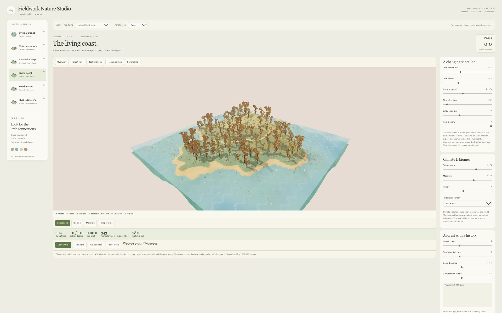
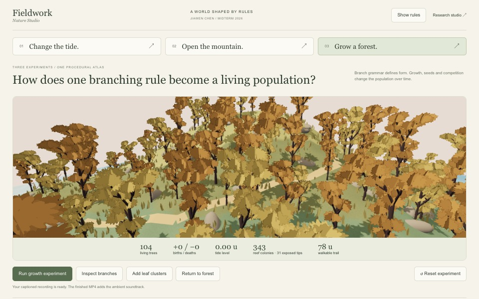

The exhibition is a separate entry point. It keeps the existing world materials and exposes tide, voxel carving and forest growth through short action sequences. Detailed rules remain available. The views above use different presentation modes and cameras; this is an interface comparison, not a controlled shader comparison.

The [new tutorial](13%20-%20From%20Research%20Studio%20to%20Public%20Exhibition.md) records presets and model boundaries. The [progress log](2026-10-13%20-%20Progress%20Log.md) records checks. A [78-second film](../exhibition/README.md) captures the real renderers with English captions; music and silent MP4 exports are available.

---

## 013 — Connected worlds and detailed woodland · 2026-10-07

**Request, translated:** make trails, reefs, biomes, tides, currents and the missing course systems demonstrable; add richer woodland and shader detail.

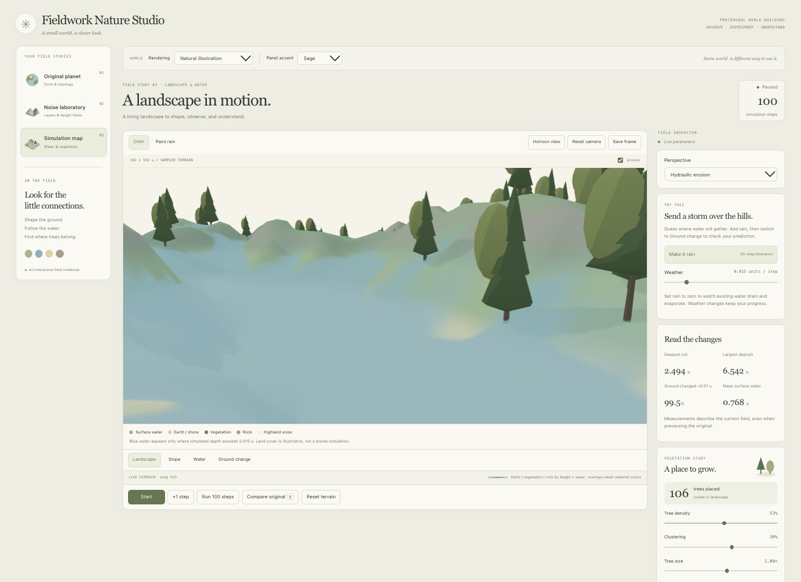
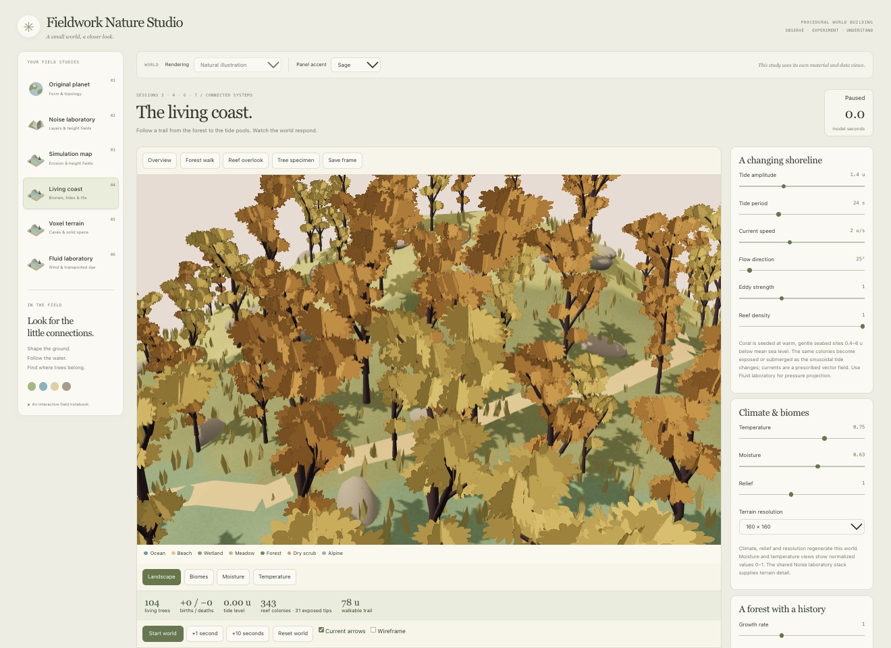

Different studies and cameras: this is an implementation comparison, not a controlled shader A/B. New leaf silhouettes, grass, rocks, shadows and depth-aware water give the world detail while controls retain the paper/sage style. Diagnostic colors remain independent of atmosphere.

Three new studies cover connected coastal ecology, voxel CSG/meshing and vector-field/fluid experiments. [Tutorial 12](12%20-%20Connected%20Worlds%20-%20Coast,%20Caves%20and%20Living%20Forests.md) records measured tide, population, chunking and divergence trials, with model limitations. These systems remain bounded educational prototypes.

---

## 012 — Course checkpoint and tree-density comparison · 2026-10-07

**Request, translated:** save this version with screenshots and explanations, align the learning record with Sessions 3–7, and supplement the last three sessions' tutorials and insights.

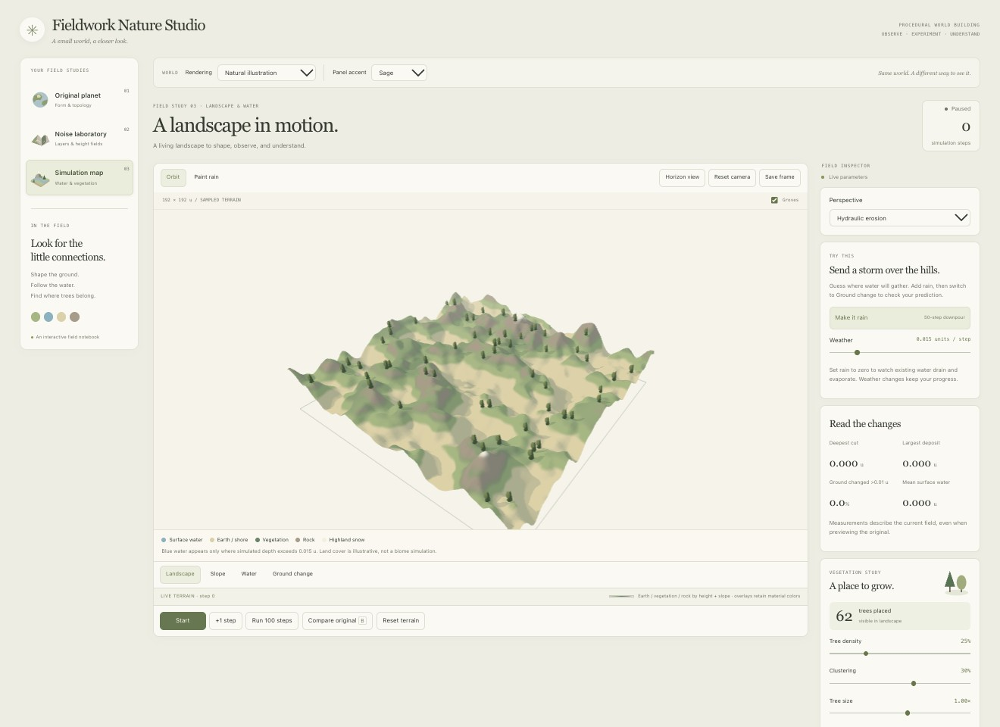
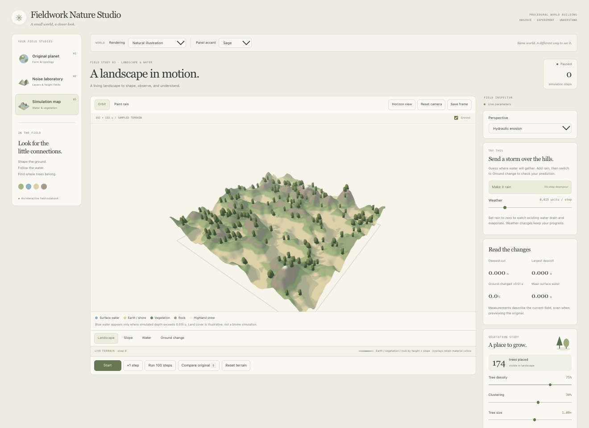

Same default field, camera, viewport and step zero; clustering 30%, size 1.00×. Restoring density 53% reproduced 125 trees. No solver step advanced. This is a distribution experiment with the existing controls, not new growth functionality.

The checkpoint includes the previously local Nature Studio redesign. The [new progress report](2026-10-07%20-%20Nature%20Studio%20Course%20Progress.md) connects each session to implemented features, parameters, experiments and explicit gaps. Tutorials 09–11 and a separate insights note were authored in the shared Obsidian folder. The earlier entry's local-only status records its state at that time.

---

## 011 — Nature Studio: a clearer instrument and a softer world · 2026-10-07

**Request, paraphrased:** implement the agreed world and panel references while keeping procedural detail readable.

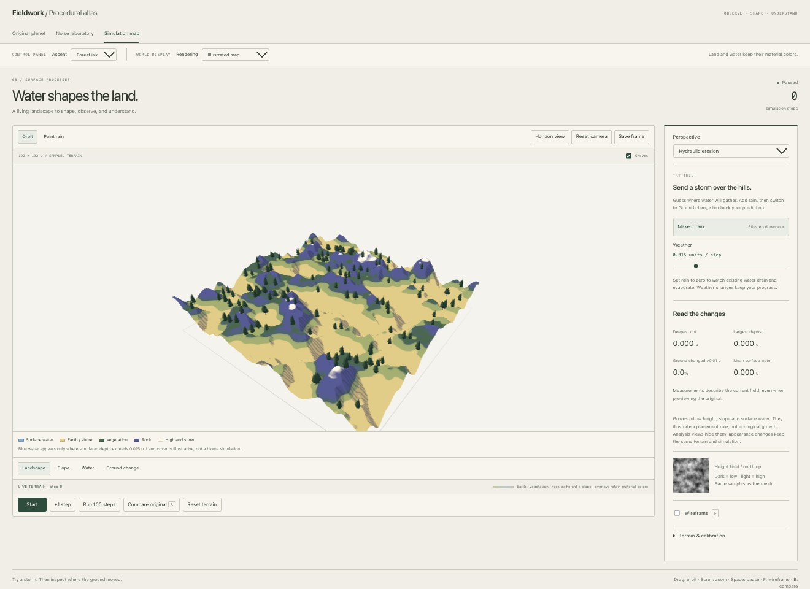


The new shell groups study navigation, world display and controls. Natural illustration adds a restrained palette, actual Simulation map shadows and distance fog. Explore water gains depth-based coloring. The vegetation inspector exposes deterministic density, clustering, size and count. The previous drawing treatment remains selectable.

Same default field and camera, paused at step zero; both captures are 1320 × 960, but the new layout changes viewport width. Seven tests, build and lint passed. A 100-step browser check preserved measurements across material, accent and tree-density changes.

**Status:** local preview for owner review, not pushed in this iteration. See [tutorial 08](08%20-%20Nature%20Studio,%20Shadows%20and%20Tree%20Distribution.md) and Experiment 2 in the [October 7 log](2026-10-07%20-%20Progress%20Log.md).

---

## 010 — Illustrated world checkpoint · 2026-10-07

**Request, translated:** save the current visuals and progress before deciding how new course topics should affect the style.

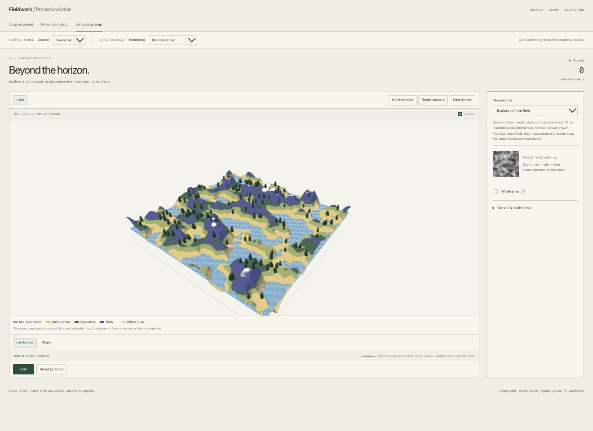

This is a fresh capture of the retained design, not a new visual implementation. Four screenshots cover all three workspaces and both Simulation map perspectives. Build, lint and six regression tests passed. The proposed next study adds spatial cues while keeping readable material colors and the panel design.

See the [October 7 progress log](2026-10-07%20-%20Progress%20Log.md) for capture settings, limitations and the proposed next experiment.

---

## 009 — Mountains, trees and water get distinct drawing cues · 2026-09-17

**Request, translated:** try the supplied hand-drawn comic/cartographic reference because the material representations are still too weak.

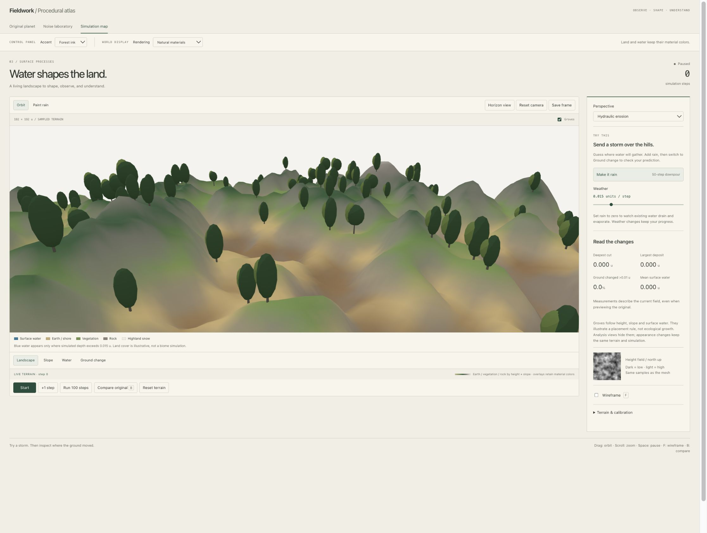

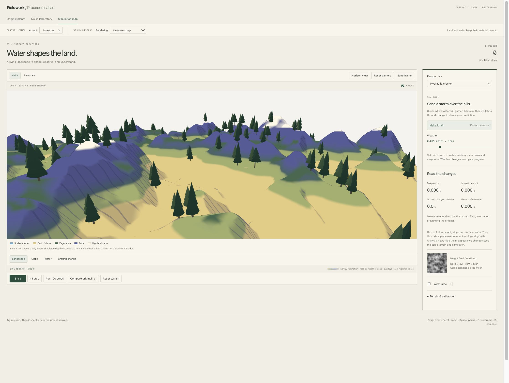

The new default uses stepped conifers, ochre ground, green land cover, indigo rock faces, pale high terrain and local pen lines. Blue water remains tied to its actual surface or simulated depth. The control-panel design stays separate. Both captures share the same viewport, field, camera and step zero; the baseline here is the retained Natural materials mode captured after implementation.

**Status:** local preview awaiting owner review. Build, lint and six regression tests passed; style switching preserved the completed 100-step experiment. See Experiment 3 in the [September 17 log](2026-09-17%20-%20Progress%20Log.md) and section 7 of [tutorial 07](07%20-%20A%20Consistent%20Visual%20Language%20for%20Procedural%20Worlds.md).

---

## 008 — Readable world, quiet controls · 2026-09-17

**Owner correction:** the reference applies to control-panel design. The world must first preserve the meaning of water, land, vegetation and mountains.

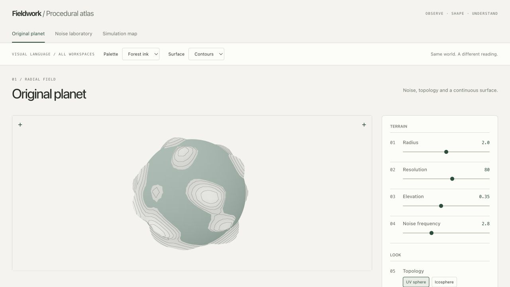

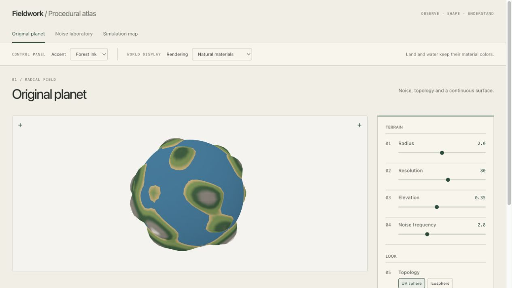

Same default terrain and camera setup, frozen spin; slightly different viewport dimensions. Interface accent and scene rendering are now independent. Natural materials are the default, overlays retain their colors, and real hydraulic depth drives an additional water surface. The solver is unchanged.

**Status:** corrected local preview awaiting review. Entry 007's monochrome world direction was rejected; its restrained interface informed the revision. See Experiment 2 in the [September 17 log](2026-09-17%20-%20Progress%20Log.md) and the revised [tutorial 07](07%20-%20A%20Consistent%20Visual%20Language%20for%20Procedural%20Worlds.md).

---

## 007 — A shared procedural atlas · 2026-09-17

**Request, translated:** a refined, minimal style across all tabs, with coherent world colors and shaders that retain readable phenomena.

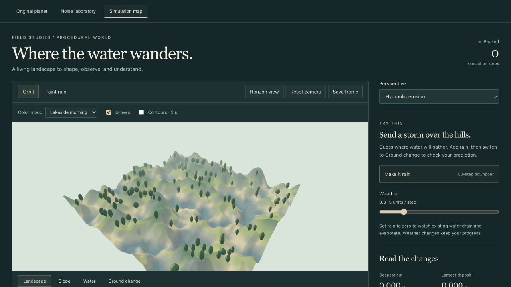

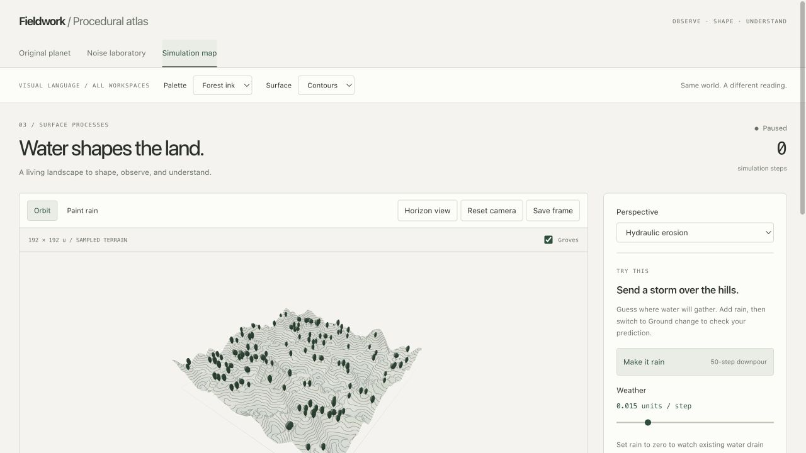

All three workspaces now share a visual system, including global Forest ink / Graphite palettes and Relief / Contours / Stipple rendering. Diagnostic views retain fixed scales and exclude fog. Both images use the default field at step zero; the layout and camera framing changed, so this is not a pixel-aligned comparison.

**Status:** implemented local preview, awaiting owner review. [September 17 log](2026-09-17%20-%20Progress%20Log.md) contains all three before/after pairs, actual checks and further trials. [Tutorial 07](07%20-%20A%20Consistent%20Visual%20Language%20for%20Procedural%20Worlds.md) explains the controls.

---

## 006 — Illustrated terrain, inspectable rules · 2026-09-10

**Request, translated:** change the style toward Lake and Nomada Studio's journey game while retaining procedural detail. Neva is the provisional interpretation of the second reference.

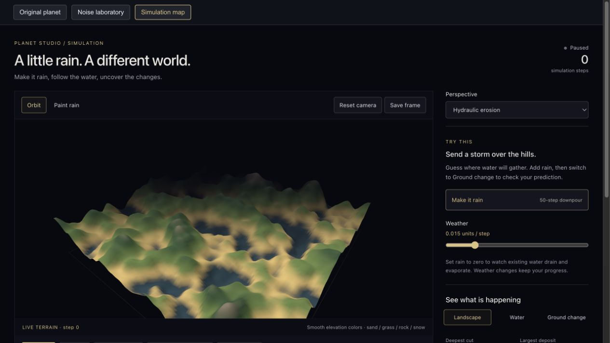

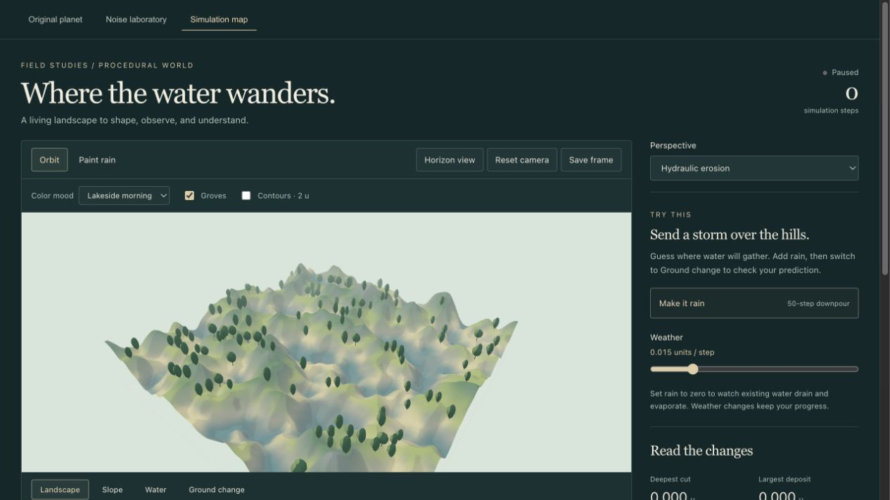

Same initial field and default camera, with a changed interface layout. Added two palettes, broad shader lighting bands, haze, terrain-filtered groves, slope diagnostics, and optional 2-unit height contours. The noise and erosion algorithms are unchanged.

**Status:** first implemented preview; owner review is still pending. [Today's progress log](2026-09-10%20-%20Progress%20Log.md) contains eight screenshots, actual checks, and current limitations.

---

## 005 — Noise and erosion playground · 2026-09-09

**Prompt:** “Make it more playful and interesting,” following requests for a noise-driven simulation map and hydraulic erosion.

**What changed:** shared noise layers feed a terrain window; rain painting, storms, single/batch steps, and original comparison make it possible to test a prediction. Smooth lighting and blended elevation colors soften the terrain. Water and Ground change views explain the state using explicit scales and measurements.

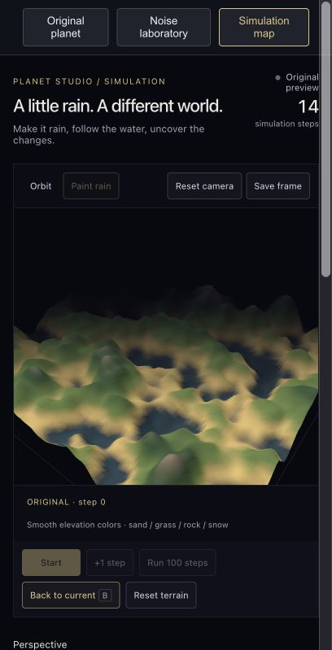

*Original ground, viewed without resetting the stored experiment.*

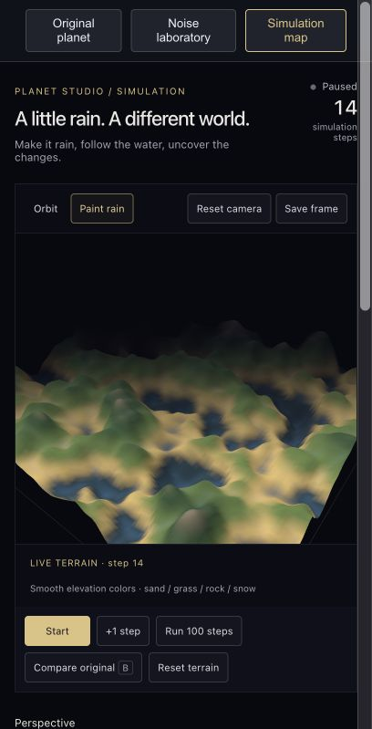

*Current ground at step 14, using the same camera. The difference is easier to inspect in a diagnostic view:*

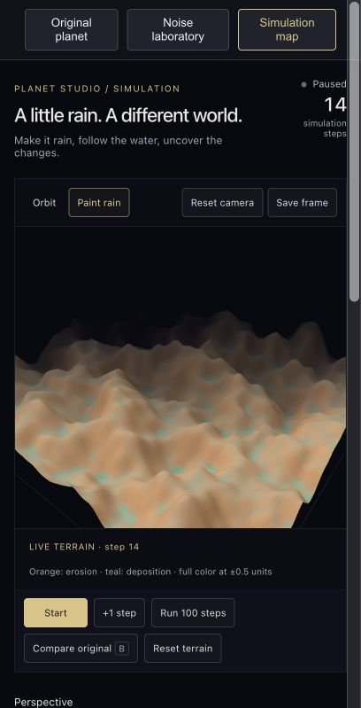

*Orange is erosion; teal is deposition. Color saturates at ±0.5 units.*

**Capture note:** these images compare original/current simulation states in the implemented UI. No pre-change screenshot of the earlier simulation UI was saved, so they should not be read as a UI redesign before/after pair. No steps were advanced during capture.

**Status:** implemented; build, lint, and four simulation tests pass. Export delivery and simulation persistence remain open. See the [September 9 progress log](2026-09-09%20-%20Progress%20Log.md) for all five images, readings, prompts, and the next experiment.

---

## 004 — Floating controls, full-bleed world · 2026-09-08

**Goal:** borrow the *feel* of editorial portfolio sites (subdivision.work was the reference) — thin rules, small type, big empty space, dim/bright hierarchy — **without** turning a tool into a poster. Every control stays visible, labelled, and easy to grab.

| Before (panel v2) | After (v3 floating) |
|---|---|
| 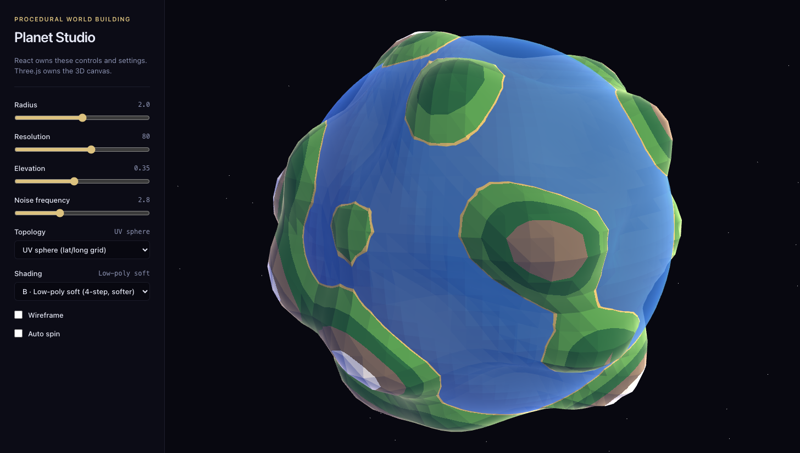 | 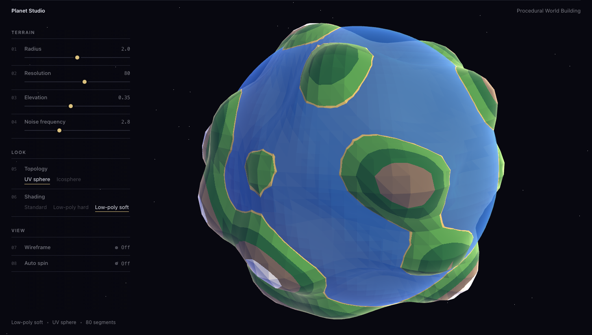 |

**What changed (`App.tsx` markup + `App.css`):**

- The sidebar is gone as a *surface*. The planet is full-bleed; the controls float over it in a 300px column with only a faint left-to-right darkening so text stays legible over bright terrain
- One hairline across the top, wordmark left, course name right — the only "chrome" on the page
- Controls grouped **Terrain / Look / View** with hairline headers, and every row carries a small index `01…08` — the reference's "numbered list" feel, doing real work as a reading aid
- Rows rest at 50 % opacity and light up on hover/focus. That's the whole hierarchy system: no cards, no boxes
- Sliders are now hairlines (2px track, 10px sand thumb that grows on hover). Still a real `<input type=range>` — keyboard arrows work, focus ring is ocean-blue
- `<select>` → inline text choices (`UV sphere · Icosphere`), active one underlined in sand. Proper `role=radio`, large hit area
- Checkboxes → text switches with a dot indicator and an explicit On/Off word, `role=switch`
- Camera view offset nudges the planet ~150px right on desktop so the column never covers it
- Bottom-left status line: current look · topology · segments

**What I deliberately did *not* copy:** the giant centred title, corner year labels, hover-to-reveal lists. Those are for browsing eight projects, not for dragging a slider forty times.

> the reference is a gallery; mine is an instrument panel. what transfers is the *restraint* — one rule, one accent, one weight — not the layout. once I stopped trying to make it look like the screenshot and asked "what does the reference do to make things feel light?" the answer was mostly "remove backgrounds and dim what you're not touching". that's usable.

**Status:** ✅ kept. Next visual work goes back to the world (real noise → taller mountains → snow line, then atmosphere).

---

## 003 — Panel follows the world · 2026-09-08

**Goal:** B is the world's look now (see 002), so the panel gets a *small* restyle so the two stop feeling like different apps. Dark stays. Every panel colour is lifted from the shader palette.

| Before (old panel + B) | After (panel v2 + B) |
|---|---|
| 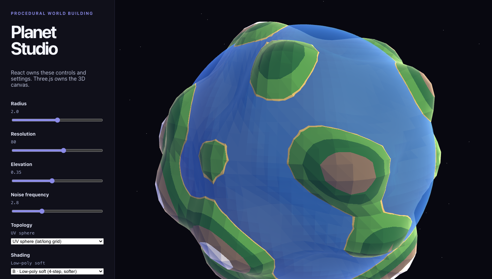 |  |

**What changed (`app/src/App.css` only):**

- Palette as CSS variables, taken from the scene: `--space` background, **`--sand #dcc27f`** as the *single* accent (the beach line colour → slider thumbs, checkboxes, eyebrow), `--ocean #4a86e6` only for keyboard focus rings
- Purple is gone — it was the one colour that existed nowhere in the world
- Headline 52px → 26px; the panel narrows 340 → 300px; *let the world lead*
- Slider values sit inline on the right with tabular numerals, so nothing jumps while dragging
- Selects and checkboxes get the same dark surface + hairline border instead of browser defaults

> the trick that made it click: pick the accent *from* the render, not from a palette site. the sand thumb next to the sand coastline — you don't notice it consciously, it just stops looking pasted-on.

**Status:** ✅ kept. This is the baseline for future entries.

---

## 002 — Stylized world shader, first pass · 2026-09-08

**Goal:** give the *world* its look before touching the panel again (lesson from 001). A custom `ShaderMaterial` replaces the default `MeshStandardMaterial` for land and ocean. Two flavours to choose between, selectable from a new **Shading** dropdown (or `?shading=lowpoly-hard` / `?shading=lowpoly-soft` in the URL).

| Standard (before) | A · Low-poly hard | B · Low-poly soft |
|---|---|---|
| 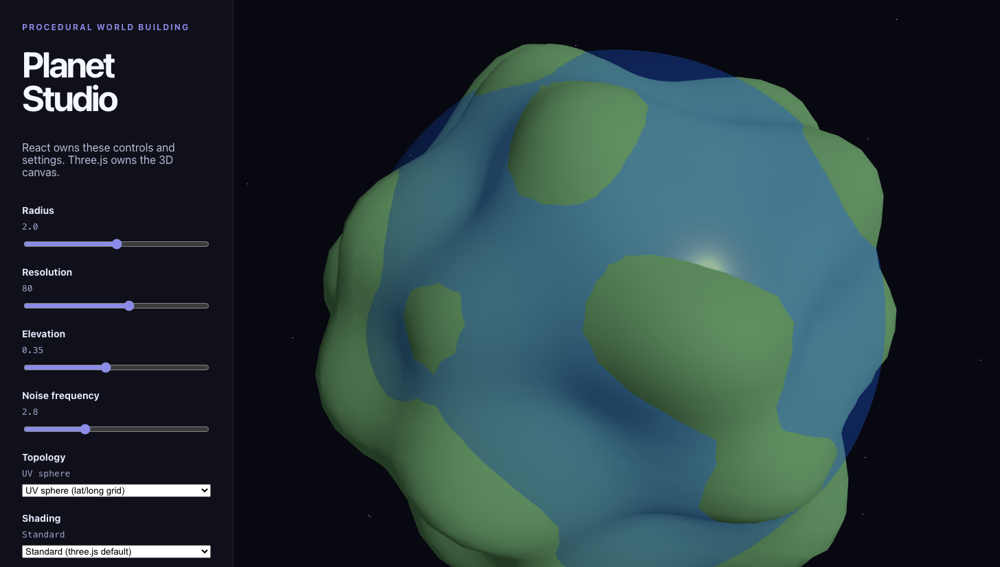 | 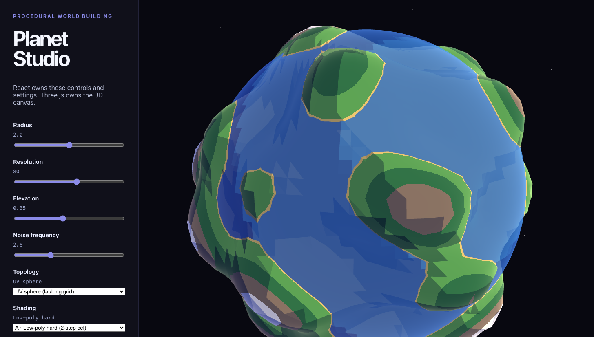 |  |

**What the shader does (`app/src/App.tsx`):**

- **Flat shading** — the fragment shader rebuilds the face normal from screen-space derivatives (`dFdx`/`dFdy` of world position), so every triangle gets one colour. No geometry change needed.
- **Elevation colour bands** — sand → grass → forest → rock → snow, hard `step()` edges, driven by `length(position) - radius` normalised by the Elevation slider.
- **Toon lighting** — diffuse quantised into *N* steps: A = 2 steps, near-zero blend; B = 4 steps, wide `smoothstep` blend.
- **Coloured shadow** — the dark side is tinted blue-violet, the lit side warm, instead of black/white.
- **Rim light** — fresnel on the smooth normal; warm on land, cool on water. Reads well against black space and is the seed for a future atmosphere.
- Ocean uses the same shader with a flat blue albedo, 82% opacity.

Same camera, same seed, spin frozen (`&spin=0`) so the three are comparable.

**Observations:**

> the *shape* didn't change at all and it suddenly looks like a place. the sand line around every coast is doing a lot — it reads as "beach" instantly.
> A is punchier and more graphic; B keeps more of the roundness because the 4 light steps trace the sphere. the ocean in A shows visible facets (it's a 96×48 sphere being flat-shaded) — either a feature or the first thing to fix depending on which way we go.
> snow only shows on the very highest peaks right now. with real noise later the mountains will be taller and it should show up more.

**Status:** ✅ **B chosen** — now the default shading. A and Standard stay in the dropdown for comparison. Panel restyle to match: see 003.

---

## 001 — Editorial panel restyle · 2026-09-08

**Goal:** first pass at the [STYLE-GUIDE](../../STYLE-GUIDE.md) direction — *minimal editorial interface × stylized miniature world*. Panel only; the 3D scene is untouched.

| Before | After |
|---|---|
| 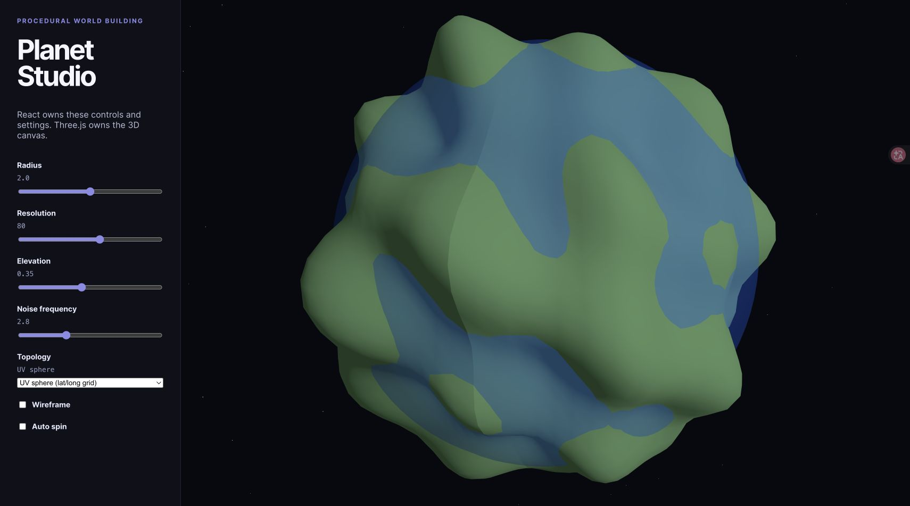 | 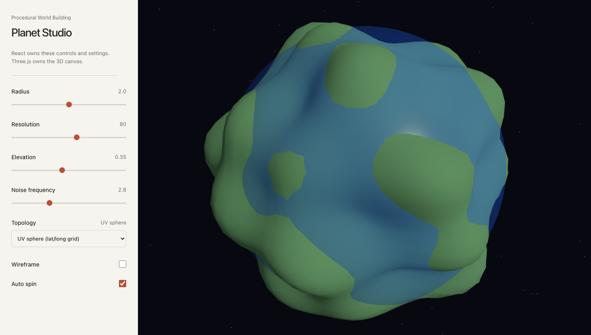 |

**What changed (`app/src/App.css` only):**

- Dark navy sidebar (`#10101a`) → warm paper surface (`#f6f4ef`) with ink text (`#292823`)
- One deliberate accent: terracotta (`#b94f38`) for slider thumbs and the active checkbox
- The huge display-size "Planet Studio" headline stepped down to a quiet 28px — *let the world lead*
- Uppercase letter-spaced eyebrow → plain small text; added a hairline rule to separate intro from controls
- Slider values moved inline, right-aligned next to their labels

**Why:** the old panel competed with the planet — big type, saturated purple, same darkness as space. The new panel reads as "instrument", the canvas reads as "world".

> side note: the planet instantly looks MORE colorful next to the paper panel even though not a single scene value changed. contrast is doing all the work here.

**Verdict: ❌ rejected, reverted to the dark panel** (2026-09-08)

> looked at it next to the scene and… no. the paper panel is pretty on its own but it has nothing to do with the black low-poly space vibe behind it — it feels like a settings page from a different app got pasted onto my planet. and honestly the real problem isn't the panel at all: the *world* still looks like default three.js. I wanted a stylized world — shader-driven color and expressive light/shadow — and no amount of panel restyling gets me there.

**What I learned:**
- Don't restyle the UI before the world has its look. The panel should *follow* the scene, not lead it.
- "Minimal" doesn't have to mean light/paper. Dark + minimal + one accent that comes from the world's palette is the direction.
- Next visual entry must be scene-side: stylized shading first, panel second.

The rejected CSS is kept at `docs/analysis/rejected/panel-editorial-v1.css` for reference.

## 017 — Readable geography and an unfolding field map

**2026-10-13 · Local preview.** Crisp per-pixel coastlines replace the soft planet color field. Volumetric broadleaf and fir crowns replace leaf-card noise. Cream/indigo/brass controls frame the semantic world colors. The app-only opening introduces Sessions 3–7 through six linked studies; it is labeled as an illustrated guide, not a live terrain map.

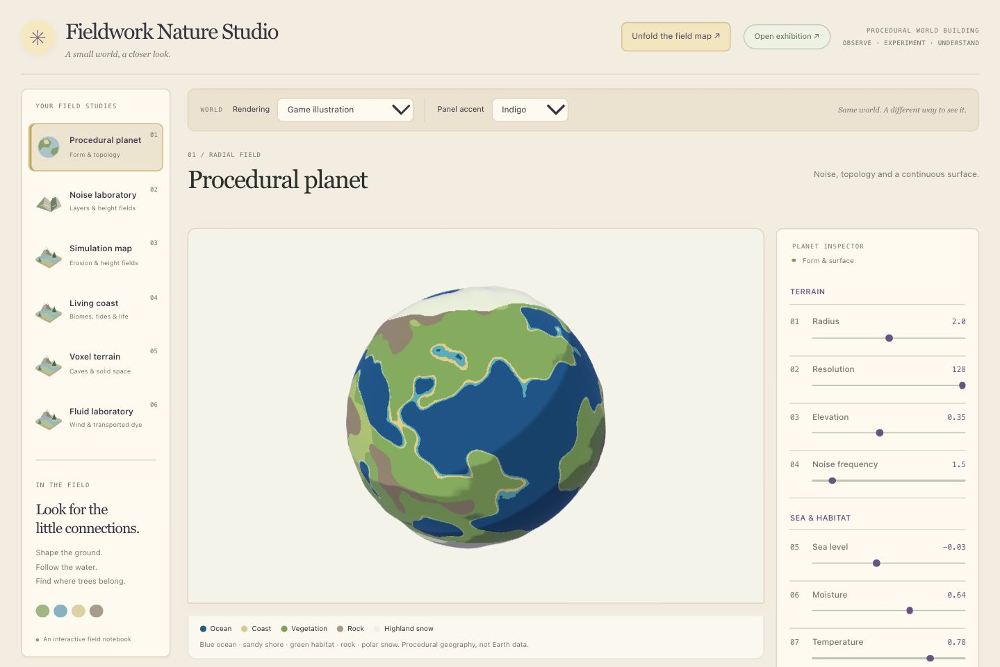

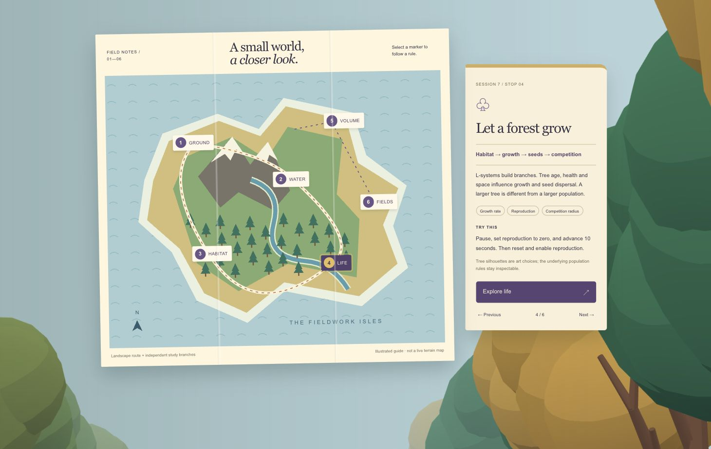

[Changes, trials and limitations](16%20-%20A%20Readable%20World%20and%20an%20Unfolding%20Map.md). Existing videos preserved; publication awaits review.


## 024 — Pocket Island / October 14, 2026

An independent phone experience replaces the large research controls with three gestures: Breeze, Rain and Plant. The quiet paper header and muted coastal palette retain Fieldwork’s visual language. Actual wind, moisture and seed state connect interaction to learning. Desktop remains separate and offers only a QR invitation.

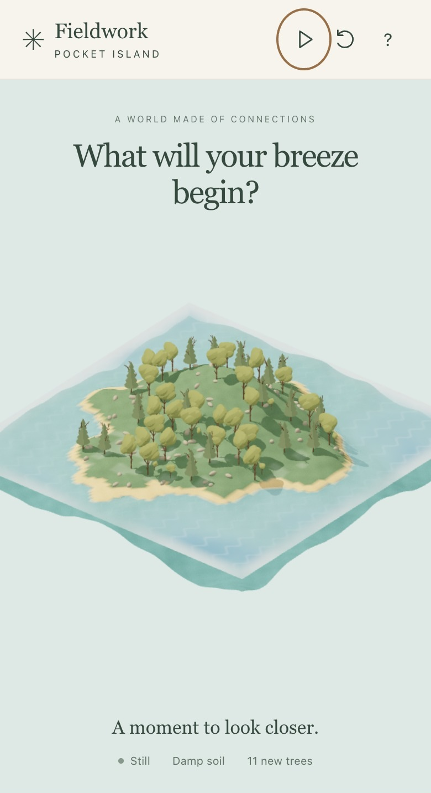

[Live phone site](https://fieldwork-pocket-island.jc3785.chatgpt.site/) · [[19 - A World in Your Hands]] · [[2026-10-14 - Progress Log]]

Published with owner authorization. Browser, build and 37 model checks passed; physical sensor testing remains pending. GitHub was not pushed.


## 025 — A seed becomes an observer of its world

**October 20, 2026 · Local desktop preview.** Living coast adds Be a seed and Walk the forest. WASD changes airborne drift or walking, arrows/drag look around, Space pauses and Esc leaves. A successful tracked landing adds one actual plant; its viewpoint rises with growth. The phone remains independent.

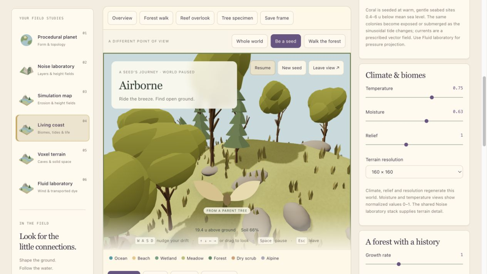

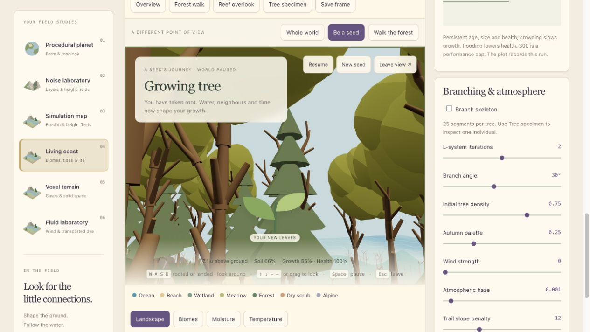

The test run recorded one birth with background reproduction disabled. Water caused failure in a separate windy trial. These are development observations, not matched A/B comparisons. Close-range foliage and physical walking collisions still need refinement. Build and 45 tests passed; lint has one existing PocketIsland ref warning. The new [tutorial and course audit](20%20-%20A%20Seed%20Finds%20a%20Home.md) distinguishes working rules from future evolution, agents, culture and persistence. [Dated evidence](2026-10-20%20-%20Progress%20Log.md). No push or new deployment.


## October 21 — public midterm checkpoint

The latest desktop studies, seed lifecycle and documented experiments are now published independently of Pocket Island. [Publication checks and screenshot](2026-10-21%20-%20Progress%20Log.md). Rain A/B results were verified on the public page; no new disaster simulation is claimed.
